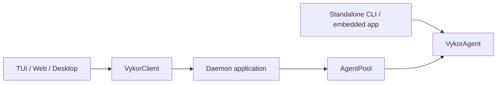

# Vykor Agent SDK

> 状态：programmatic agent 的权威使用文档。内部执行结构见 [Agent Runtime Framework Architecture](./agent-runtime-framework-architecture.md)，生命周期终态与失败语义见 [Agent Lifecycle Contract](./agent-lifecycle-contract.md)，daemon 边界见 [Agent Framework Capability Boundary](./agent-framework-capability-boundary.md)。

## 定位

`@vykor/agent-runtime` 是 Vykor 自己的 opinionated Agent SDK。它提供完整默认组装，但不试图成为通用 agent framework。

```text
createDefaultNodeAgent(options)
  -> DefaultNodeAgent
     -> submitMessage / runMessage
     -> subscribe
     -> getHistory / setModel / compact / getUsage
     -> host.memory / host.inspect / host.configuration / host.plugins
     -> children
     -> close
```

`QueryEngine` 的具体实现和 provider/tool/hook/MCP/sandbox 的组装属于内部；Node 通过 createDefaultNodeAgent 接入，Kernel 接收通用执行接口。

发布包运行实现已 bundle；公开声明引用的内部包作为正式 dependencies 安装，不能用替换依赖的方式替换已经打包的实现。细节见 [Agent Framework Capability Boundary](./agent-framework-capability-boundary.md)。

## 数据契约与宿主绑定

SDK 的执行数据与权限审查数据来自 `agent-contracts`；权限专用入口为 `agent-contracts/permissions`。Node 的插件数据使用 `plugin-contracts/manifest`、`/runtime` 等明确子入口，Job/Terminal 数据使用各自 `/contracts`。Node 不引用 Protocol、domain-contracts 或 Services。

`agent.host.plugins.runPluginAppTool()` 接收 `PluginAppHostInvocation`，其中只有已核实的 binding、lease、工具名和参数。Server 从已保存记录生成 binding，保留不透明 `instanceId = app.id` 用于实例隔离与 lease 撤销；Node 再检查 owner、插件/后端版本与 digest、generation、lease 和原工具绑定。绑定不包含应用 open/closed 状态、revision 或其他可变产品记录，Server 也不复制 Node 的 token 表。普通工具与应用工具继续共用 Kernel 的参数、权限、Hook 和超时管道。

纯 Kernel 只消费通用执行契约。其 bundle 和声明检查仍只允许 agent-contracts、Core、environment；三个新数据包和 Jobs/Terminal 实现不能借纯数据名义进入 Kernel。daemon 客户端辅助函数用于请求和显示，不能作为上述宿主检查的授权证据。

## 最小运行

```ts
import { createDefaultNodeAgent } from "@vykor/agent-runtime";

const agent = await createDefaultNodeAgent({ cwd: process.cwd() });

const unsubscribe = agent.subscribe((event) => {
  if (event.type === "output.text.delta") process.stdout.write(event.data.delta);
});

const run = agent.submitMessage("What files are in this directory?");
const result = await run.result;

unsubscribe();
await agent.close();
```

`createDefaultNodeAgent()` 自动加载 settings、provider、credentials、默认 tools、prompt、skills、plugins、MCP、memory 与 sandbox。默认工具包含纯本地文件 `Read`，不包含 `ImageToText` 或 `ImageGeneration`。调用方只覆盖需要改变的部分。旧的 `createVykorAgent()` 已删除，不提供别名。

## 嵌入 Kernel 与访问 Node 宿主

执行接口从 `@vykor/agent-runtime/kernel` 导入。它接收引擎、通用工具、交互回调和本轮准备函数，不接收 Settings、插件目录、MCP 或本机资源。

```ts
import { createAgentKernel, createBasicAgentKernelRuntime } from "@vykor/agent-runtime/kernel";
import type { StreamingMessageClient, ToolDefinition } from "@vykor/agent-contracts";

async function createEmbeddedAgent(client: StreamingMessageClient, tools: readonly ToolDefinition[]) {
  const engine = createBasicAgentKernelRuntime({ client, model: "chosen-model", tools });
  return createAgentKernel({
    cwd: "/workspace", engine,
    effects: { requestPermission: async () => ({ status: "denied" }) },
    preparation: { prepare: async () => ({
      run: { tools: new Map(tools.map(definition => [definition.name, { definition, invoke: definition.execute }])) },
      release() {},
    }) },
  });
}
```

默认 Node 工厂仍直接返回可执行 Agent；宿主功能通过独立的 `agent.host` 使用：

| 入口 | 职责 |
| --- | --- |
| `agent.submitMessage/runMessage/runTool/compact/close` | 执行、互斥、历史、取消与生命周期 |
| `agent.host.plugins` | 捕获插件能力、应用目录和已授权应用工具调用 |
| `agent.host.configuration` | 读取配置快照、修改配置与模型选择 |
| `agent.host.memory` | 显式记忆维护 |
| `agent.host.inspect()` | Node 工具、hooks、MCP 和沙箱检查 |
| `agent.host.jobs` | 共用执行来源的定点读取、等待、输入与取消；jobs:false 只关闭模型工具 |
| `agent.host.workflows` | Node 的 Workflow 宿主 |

Server 的自定义 `createAgent` 工厂必须返回 `{ agent, host }`（HostedAgent）。纯 Kernel 宿主可以明确返回 `host: undefined`；插件应用、记忆维护等功能在缺少对应宿主时不可用。已有的直接 Node 工厂可写成 `const node = await createDefaultNodeAgent(options); return { agent: node, host: node.host };`。

## 创建参数

常用参数全部位于顶层，不存在 runtime factory 或 `overrides` 包装层：

```ts
const agent = await createDefaultNodeAgent({
  cwd,
  model: "gpt-5.4",
  provider: "codex",
  maxTurns: 20,
  hostToolCeiling: ["Read", "Glob", "Grep"],
  capabilityOverrides: {
    terminal: scope => terminalProviderForSession(scope),
    backgroundShell: scope => shellAdmissionForSession(scope),
  },
  effects: { requestPermission },
  onEvent: async (event) => {
    await durableEventSink.apply(event);
  },
});
```

| 参数 | 语义 |
|---|---|
| `settings` | 可选显式 settings；缺省时使用标准 settings loader |
| `cwd` / `sessionId` | 工作目录与 live session identity |
| `model` / `provider` / `apiKey` / `baseUrl` | provider 选择覆盖 |
| `client` | programmatic embedding、自定义 provider 或测试用消息客户端 |
| `systemPrompt` / `maxTurns` / `effort` / `fastMode` | 执行行为覆盖 |
| `hostToolCeiling` / `roleAllowedTools` / `disallowedTools` | 工具范围，见下一节 |
| `tools` / `toolOverrides` | 增加 Tool，或按精确名称替换默认 Tool；替换仍经过工具范围、权限、Hook、超时和取消流程 |
| `capabilityOverrides` | 逐项配置默认能力；Terminal / Shell 接收按 `{ sessionId, cwd }` 绑定低层端口的工厂，`false` 禁用能力；`jobs` / `memory` 只能禁用 |
| `effects` | 宿主交互副作用；目前 `requestPermission` 是可选 permission effect |
| `onEvent` | 有序、可靠、可等待的 host sink；失败会终止当前 operation |
| `extensions` / `mcpServers` | Vykor extension 与 MCP 增量配置 |
| `workflowHost` | 可选借用已有 WorkflowHost；仓库通过 `capabilityOverrides.workflowRepository` 注入同一实例，由创建它的应用关闭 Host |
| `childBudget` | 整棵 child 树的深度、活动数和累计创建数限制 |

## 工具限制

工具限制分三层理解：

| 字段 | 大白话含义 |
|---|---|
| `hostToolCeiling` | 宿主给这个 Agent 家族的最大能力。子 Agent 也不能超过它。 |
| `roleAllowedTools` | 当前 Agent 角色自己想看的工具。例如 Coordinator Leader 只需要 `Agent` / `Workflow` / `Job*`，但这不代表 Worker 也只能用这些。 |
| `disallowedTools` | 永远优先禁止。父 Agent 和子 Agent 的禁止列表会合并。 |

后台生命周期旧名已经硬切，不提供兼容别名。`hostToolCeiling`、`roleAllowedTools`、`disallowedTools` 和 auto-approve 配置若仍包含已删除的 `TaskGet/List/Output/Stop/Wait/Update`、`SendMessage` 或 `TerminalRead/List/Send/Signal/Close`，runtime 会在启动时直接报错并给出对应 `Job*`；其他尚未注册的名字仍被保留，供插件动态注册工具使用。工具名精确匹配，不接受 snake_case、Python 风格或大小写修复。

最终能看到的工具是：

```text
可用工具 = 宿主能力上限 ∩ 当前角色工具集 - 禁止工具
```

`["*"]` 表示“这一层不额外收窄”，不是“绕过宿主上限”。例如：

```ts
await createDefaultNodeAgent({
  hostToolCeiling: ["Read", "Agent", "JobWait"],
});
```

这个 Agent 可以派出 Worker，但 Worker 仍然只能在 `Read` / `Agent` / `JobWait` 这个上限内活动，不能因为内置 worker 写了 `tools: ["*"]` 就拿到 `Bash` / `Edit` / `Write`。

## 默认 Node 能力与 Host 覆盖

`createDefaultNodeAgent()` 是开箱即用的 Node 入口：未覆盖时会提供本地 Terminal、Jobs、后台 Shell、Git/worktree child environment、Workflow repository 和 Memory；没有 `effects.requestPermission` 时权限会安全拒绝。Schedules 没有可用的本地默认值，未由 Host 覆盖时状态就是 `unavailable`，相应工具不会注册。

`capabilityOverrides` 按能力独立解析：不传表示使用该能力的默认值，传入 `false` 表示关闭。只有 `terminal`、`backgroundShell`、`childEnvironment`、`workflowRepository` 和 `schedules` 接受 Host 对象作为 override；其中 `terminal` 与 `backgroundShell` 必须使用 `{ value, jobs }` bundle，让 `Job*` 工具能观察与控制它们创建的 Job。`jobs` 与 `memory` 不接受 Host 对象，分别只能设为 `false` 来关闭本地 Jobs 或受管 Memory。

附件不是 Agent Capability。默认 `Read` 只读本地路径，默认 Agent 也不承诺图生文或文生图。`@vykor/tools` 不定义或导出 `ImageToText`、`ImageGeneration`。daemon 作为第一方 Agent 创建者，通过 `toolDecorators` 包装已绑定宿主配置和日志的 `Read`，把它 扩展为“本地路径 + 当前会话授权附件”，并在 server 内完整定义两个视觉 Tool。`createDaemonAgentLoader` 只调用统一的 `tools({ session, settings })` 获取当前会话的普通工具，不认识任何具体工具名称。daemon 的 `ImageToText` 支持普通路径、图片 URL 和授权后的 `attachment_id`；附件分支会把 Child session 解析到 Root session 后再校验引用。

内部的 `trustedToolOverrides` 只用于第一方 composition root 明确信任自己构造的覆盖，让 其他第一方覆盖保留原内置工具的权限分类。名称必须同时存在于 `toolOverrides`，且目标必须是默认 builtin；普通 `toolOverrides` 默认不继承信任。Extension、Plugin 和 MCP 没有设置或追加可信名称的入口。

`jobs: false` 不是独立开关：Terminal、后台 Shell、child environment 与 Workflow repository 都会产生或依赖 Job，因此必须同时写成 `terminal: false`、`backgroundShell: false`、`childEnvironment: false` 和 `workflowRepository: false`。只替换 Terminal 不会关掉本地后台 Shell 或 Memory。

`executionEnvironment` 接受异步工厂 `async ({ sessionId, cwd, settings }) => handle`。默认工厂在每个实际 root 或 child session 创建时调用它，参数是该会话的目录和已经应用审批模式的设置。返回的 `handle.workspace.hostRoot` 必须与本次 `cwd` 一致；错误目录或获取失败会直接中止创建。子代理继承工厂，按自己的会话和目录申请环境。

每次返回的环境租约默认由调用方释放。明确指定 `ownsExecutionEnvironment: true` 后，Node 接管各会话自己的租约，在初始化失败或关闭时释放一次。同一子会话卸载后恢复时，新 Node 实例会重新调用工厂取得新租约。Server loader 从实际会话记录申请租约并交给对应 Node 实例。

Terminal / Shell 工厂返回的端口由宿主持有，共同核心清理该会话的 bundle 和订阅；宿主负责处置借用的 provider。执行环境租约则按前述 `ownsExecutionEnvironment` 约定转交或借用。

Node 默认创建每棵根树的 TeamRegistry 和 WorkflowHostDirectory，child 借用本树目录。Workflow、Job 工具和 Agent.close 使用同一个 owner 视图；close 等待后台 worker 和终态保存，再移除子 Agent。应用注入的共享 Host 不由单个 Agent 关闭；其创建入口为 `@vykor/agent-runtime/node/workflow`。

Kernel 使用显式 `release` 关闭自己收到的租约。本轮 `prepare` 返回的 `release` 在准备失败或 Run 终态后释放；默认 Node 根树拥有本地执行、团队与能力捕获目录，child 借用同一棵树的目录。外部传入的 Host 由创建方关闭。

## Event 与 Effect

SDK 有两种事件消费语义，不能混用：

```text
onEvent(event)       reliable host sink
                     ordered + awaited
                     rejection fails the operation

agent.subscribe(fn) observation
                     ordered invocation + non-blocking
                     listener failure is isolated
```

daemon 使用 `onEvent` 保证 run started、transcript 与 terminal state 已可靠投影后，framework handle 才结算。日志、终端渲染和 SDK 使用者使用 `subscribe()`；observer 按事件顺序被调用，但 framework 不等待其异步工作完成，异常或慢 observer 都不能改变、阻塞 agent 执行。

### 网络重试与输出替换

`output.text.delta` 是当前尝试的实时内容，不一定成为最终回答。收到 `output.generation.started` 时，记录 generationId 和 attempt；同 generationId 的新 attempt 开始时替换前一次尝试的临时文本，保留以前成功生成的内容。`model.retry.scheduled` 表示仍在运行、等待重试，不是运行失败。只需要最终结果的调用方使用 RunHandle 的 result.output，不要把所有 delta 永久拼接。

`model.attempt.finished` 记录每次请求的结算，usageStatus 区分 complete、partial 和 unknown；unknown 没有已知用量数字。`usage.updated` 是给观察者的已知消耗通知，同一结算不能在两个事件中重复相加。daemon 仍通过 model.attempt.finished 原子保存 Run 的展示记录、已知小计和完整性，不通过 usage.updated 再计费；Goal 用量由显式 ModelAttemptGate 在事件发布前结算，事件投影不能重复写 Goal 账本。自定义持久事件接收器也应处理结算事件。结果用量包含 usageIncomplete 时，数字是已知小计，不能视作完整费用。用户中断仍需保留已发出请求的结算，再结束为 interrupted。

daemon/client 的持久接口使用协议版本 7；UI 应由最新快照读取 modelRetry/modelUsage 和 part 的 modelGeneration 标记，不依赖收到每个中间事件。详见[模型网络重试](./model-network-retry-design.md)。

权限不是 event listener 返回值，而是显式 effect：

```text
permission.requested event
  -> requestPermission(request, context)
  -> permission.resolved event
  -> approved: execute tool
  -> denied/expired: denied tool result
```

## Run Handle

`submitMessage()` 同步预占 agent 并返回 live handle：

```ts
const run = agent.submitMessage("Implement the change");

await run.started;
await run.steer({ content: "Also update the tests" });
await run.interrupt("Caller cancelled");
const result = await run.result;
```

同一 agent 同时只允许一个 root run。需要直接等待结果时使用：

```ts
const result = await agent.runMessage("hi");
```

## 稳定错误类

以下错误类从 `@vykor/agent-runtime` 与 `@vykor/agent-runtime/kernel` 再导出，可用 `instanceof` 判断（与 `@vykor/core` 内定义为同一引用）：

| 错误类 | 何时抛出 |
|---|---|
| `AgentRunNotAcceptingInputError` | run 已关闭 steering / 不再接受输入 |
| `AgentChildBudgetExceededError` | child 深度、活动数或累计创建数超预算 |
| `AgentOperationConflictError` | Agent 在非法状态下执行操作（如 closed 后 `submitMessage`） |

不要依赖解析 `error.message` 字符串。workspace 内的 `@vykor/core` 不是独立发布包；外部消费方应只从上述两个 agent-runtime 入口导入。

## Child Agent

child agent 的 live lifecycle 由 framework 管理。child 继承 root 的 provider/client、权限策略、event sink 与 observation stream，并可覆盖 model、tools、permission mode 和 max turns。

```ts
const child = agent.children.get(childId);
await child?.send({ content: "Continue" });
await child?.interrupt("No longer needed");
```

durable child session/task/run 不进入 SDK；它们由 daemon 根据 `child.*` 与 child run events 建立。

默认工具在纯 SDK 形态下同样闭环，不依赖 daemon 先建立 task projection：

```text
Agent -> context.agent.children.spawnChildAgent() -> jobId
JobWait(jobId) -> AgentJobHost.wait()
JobCancel(jobId) -> AgentJobHost.cancel()
Workflow -> spawn framework child -> await/stop the same child backend
```

`BackgroundShellCreate` 只创建后台 shell Job。工具通过宿主注入的 `AgentBackgroundShellHost` 发起创建，并把稳定的 `toolCallId` 作为请求身份；daemon 将它路由到 `BackgroundShellService`。服务先预留 pending durable execution 和 jobId，再让 `DetachedProcessSupervisor` 按同一个 jobId 幂等启动进程。工具层不直接取得进程 supervisor。child Agent 由 `Agent` 创建，并通过 framework child handle 运行。daemon 可以把 `child.*` 事件投影为 durable execution，供 UI、恢复和审计使用，但该投影不再是 framework child 完成一轮执行的前置条件。

## 两种应用形态



### Direct

应用直接创建、持有并关闭 agent。history 是 live state；应用可用 `getHistory()` / `loadHistory()` 实现自己的文件保存或恢复。

### Daemon

daemon application 每个 durable session 缓存一个 agent：

1. 从 `SessionStore` 读取 durable transcript。
2. `createDaemonAgentLoader()` 合并 settings/session metadata 并调用 `createDefaultNodeAgent()`。
3. loader 通过 `loadHistory()` 恢复 live history并绑定 callbacks。
4. 通过 `onEvent` 写 durable session/run/task/transcript。
5. 通过 `requestPermission` 连接 durable permission broker。
6. `AgentPool` 只负责实例去重、缓存、代际关闭与 active-work 查询。
7. archive、configuration change 或 shutdown 时 `close()`。

daemon 不实例化 QueryEngine，不接收 runtime factory，也不复制 child controls。

## 源码索引

| 要找的逻辑 | 文件 |
|---|---|
| SDK facade 与 run handle | `packages/agent-runtime/src/kernel/agent.ts` |
| 默认 composition root | `packages/agent-runtime/src/node/runtime/default-runtime.ts` |
| ordered sink 与 observers | `packages/agent-runtime/src/kernel/event-source.ts` |
| child lifecycle | `packages/agent-runtime/src/kernel/children/child-agent.ts` |
| Agent producer | `packages/tools/src/agent/agent-tools.ts` |
| Job lifecycle routing | `packages/tools/src/job`、`packages/server/src/jobs` |
| Workflow child spawn/wait | `packages/agent-runtime/src/node/workflow/agent-workflow-runner.ts` |
| child worktree | `packages/agent-runtime/src/kernel/children/child-environment.ts` |
| daemon application composition | `packages/server/src/application/daemon-application.ts` |
| durable session -> live Agent | `packages/server/src/daemon/daemon-agent.ts` |
| daemon agent cache | `packages/server/src/application/agent/agent-pool.ts` |
| durable event projection | `packages/server/src/application/agent/daemon-agent-event-projector.ts` |
| standalone SDK contract test | `packages/agent-runtime/src/node/agent/__test__/sdk.test.ts` |
| 插件宿主调用数据 / Server 绑定转换 | `packages/plugin-contracts/src/runtime/runtime.ts` / `packages/server/src/application/session/plugins/plugin-app-host-binding.ts` |
| Job / Terminal 纯数据 | `packages/jobs/src/contracts.ts` / `packages/terminal/src/contracts.ts` |

## 非目标

- 不提供通用 workflow graph runtime。
- 不把 durable store 或 HTTP transport 抽象进 framework。
- 不暴露 QueryEngine/Node 组装实现 作为第二套应用入口。
- 不提供 session replacement runtime；切换 durable session 是应用行为。
- 不为旧 runtime factory、host callback 或 projection adapter 保留兼容层。

### 模型请求准入与结算

Node 宿主可通过 createDefaultNodeAgent 的 modelAttempts 选项安装 ModelAttemptGate；纯 Kernel 在 PreparedAgentRun.modelAttempts 中提供同一接口。beforeDispatch 在每次实际请求前完成，settle 在完成事件前保存用量；辅助压缩和有真实 Run 来源的记忆维护也使用该接口。无 Goal 的宿主可省略它。

Server 的 GoalModelAttemptService 从持久 Run 核对 session、Goal 版本和预算。事件回放只更新展示，不做预算准入或 Goal 记账。准入后未发出记录 notDispatched，发出但缺可靠用量保留 unknown；结算失败不会重新调用 Provider。独立记忆和自动审查保留原有归属，不能伪造父 Run。

## 发布与独立消费检查

`pnpm --filter @vykor/agent-runtime test:pack` 在仓库外安装 tarball，用 TypeScript 消费 Node、Kernel、Workflow 和公共类型，再运行 fake Provider 的 root/child、事件、关闭以及跨 bundle 错误识别。它还实际启动 Native Tool 和默认 PTY/Job，不能用空导入替代。仅编译器来自测试工具链；Node 类型、产品声明及运行依赖都从临时安装目录解析，不跳过声明检查。

构建保留 `default.metafile.json`、`kernel.metafile.json`。Kernel 检查源码输入和递归声明引用，明确拒绝 domain-contracts、plugin-contracts 和 json-data；默认入口仍需要 `sharp` 与 `node-pty`，不需要数据库驱动。`host-entry.mjs` 随包保留供 Native Tool 进程启动。


## 后台任务低层端口

Terminal 覆盖接收 TerminalProvider；backgroundShell 覆盖接收 ShellAdmissionPorts。Node 统一创建工具端口与 Jobs 来源，SDK 与 daemon 不各写一份生命周期。`jobArchiveForSession` 仅提供持久 list/read。child handle 的 readRun/waitRun 使用已接纳 runId，取消旧轮不会关闭 child 或影响新轮。请求与完整 target 示例见 [Jobs 协议](./jobs-protocol.md)。
