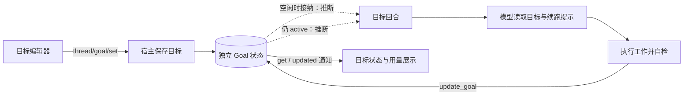

# Codex `/goal` 本地实现调研与本项目改进建议

> 2026-10-15 补充：[准备关卡与真实失败原因复查](codex-goal-followup-2026-10-15.md)。独立 preparing 批次及其工具/模型次数上限属于本项目设计，不能当作已核实的 Codex 行为；复查同时确认生产 Read 被准备工具过滤误删。

> 状态：当前调研资料；记录指定本地版本的实现与改进建议，所列建议尚未实施。

日期：2026-10-11。范围：指定安装包的本地静态分析、该包后端导出的真实协议，以及 OpenHarness-ts 当前 Goal 源码。

## 1. 结论

Codex 的 `/goal` 由目标编辑入口、独立持久状态、空闲续跑、模型自检和宿主用量控制共同组成。结束一个回合不等于结束目标；模型通过目标工具报告达成或受阻，宿主保存状态并决定后续运行。

我们的持久 Run、请求去重、版本保护、用户消息优先、逐项完成评估、外部等待和可选 Goal 扩展已经具备。建议继续使用这些机制，依次补强：**具体任务的等待判断、可区分的停止原因、真实用量账本、跨回合可读取的要求与进度、进展判断**。

这次发现的最具体问题是：本项目可能把已完成但仍保留会话句柄的子代理视为运行中，一直等到超时。见第 5.1 节。

本报告区分三种结论：**观察**指直接读到的代码、协议或二进制字面量；**推断**指多个观察支持的流程判断；**未核实**指需要后端反编译或真实运行才能确认。提示中的要求不能直接当作宿主已经执行的检查。

## 2. 目标版本与证据范围

用户提供的 `C:\Program Files\WindowsApps\OpenAI.Codex_26.1002.7124.0_x64__2p2nqsd0c76g0` 已不存在。目录检查只发现以下安装版本，因而本次没有分析或比较原来的 `26.1002`：

| 项目 | 实际值 |
| --- | --- |
| Windows 安装包 | `OpenAI.Codex_26.1007.2314.0_x64__2p2nqsd0c76g0` |
| `app.asar/package.json` | `openai-codex-electron`，版本 `26.1007.21434` |
| `resources/codex.exe --version` | `codex-cli 0.162.0-alpha.17.2` |
| `app.asar` | 567,399,024 字节，20,988 个成员 |
| ASAR SHA-256 | `c5fdef328cfa2ad9095786f9c3a7aaa447e68834d31299d6ef2592da02029038` |
| `codex.exe` SHA-256 | `d13914ced6c7af174d8d638db938284231227312104b06a25e9608c632a7daec` |

分析方法：读取 ASAR 目录与成员偏移，按原字节提取相关 JavaScript；扫描非 `node_modules` 的 JS/JSON/HTML；读取 Windows 后端可打印字符串中的 Goal 提示、SQL 和日志；运行 `app-server generate-ts --experimental` 导出协议。非 `node_modules` 成员中没有实际 `.map` 文件，只有部分 JS 末尾的映射文件引用。

REA MCP 未出现在本会话工具列表中。网络调用 `npx` 时遇到 DNS 失败，随后找到已缓存的 `rea-agents 6.3.0`。只读 doctor 报告 Codex 注册漂移、缺少原生分析引擎；REA CLI 对 ASAR 和已提取的局部目录都返回 `access_denied/EPERM`。本次使用可成功读取的文件与格式解析完成静态核实，没有修改 MCP 配置或安装引擎。

完整证据索引见 [evidence.json](./research/codex-goal/evidence.json)。`Jxx` 是安装包 JS，`P-*` 是后端导出协议，`Nxx` 是原生文件字面量；这些是本报告自定义编号，**不是** REA 返回的 Evidence ID。每项记录源文件、摘要或文本、SHA-256 及可用的字节偏移。

没有创建真实目标、启动模型回合、读取用户聊天或操作正在运行的 Codex 界面。CLI 帮助和协议导出自身会尝试清理临时 PATH 目录，沙箱拒绝了相关访问；协议导出仍成功。

## 3. `/goal` 从入口到结果

以下图示概括已经核实的接口与模块分工；“空闲接纳”和自动回合的内部箭头属于静态证据支持的推断，具体并发控制未核实。



### 3.1 输入入口与创建

**观察：**前端注册 `id: goal` 的命令，同时接受 `/` 和 `@` 触发；不要求输入框为空。选中时打开 Goal 编辑器；当前处于 Plan 模式时切换到可执行的默认模式。入口不是直接启动一个模型工具调用。（J01）

提交链路先确保会话有可用执行归属、等待或提交本轮设置，再发送：

```text
thread/goal/set { threadId, objective, status: "active" }
```

返回后更新会话中的 `threadGoal`，并可插入一个显示 `/goal ...` 的本地记录。这个记录 `turnId: null`、没有结果项、标记为 completed；其插入函数只修改本地历史容器。这不是已经完成的一次真实模型回合。创建函数本身没有再发送 `turn/start`。（J02、J04、J04a）

**推断：**首次实质执行由后端 Goal 生命周期接手；前端只创建目标并显示它。后端字面量还明确提到“空闲线程继续目标”和“自动空闲工作被拒绝”的分支。（N05、N10）

### 3.2 独立读取与状态通知

后端导出四个目标接口及相应通知：

| 接口或通知 | 作用 |
| --- | --- |
| `thread/goal/set` | 创建或修改正文、状态、可选 Token 预算 |
| `thread/goal/get` | 读取当前目标 |
| `thread/goal/clear` | 清除当前目标 |
| `thread/goal/updated` | 将新的目标快照通知前端 |
| `thread/goal/cleared` | 通知当前目标已被清除 |

会话恢复后，前端单独调用 `thread/goal/get`，读取失败会记录警告。这说明目标的恢复不只是重新解析旧聊天消息。（J06、P-ThreadGoalGetParams）

目标快照包含：

```text
threadId, objective, status,
tokenBudget, tokensUsed, timeUsedSeconds,
createdAt, updatedAt
```

协议状态为 `active`、`paused`、`blocked`、`usageLimited`、`budgetLimited`、`complete`。数据库字面量使用对应的下划线名称 `usage_limited`、`budget_limited`。（P-ThreadGoal、P-ThreadGoalStatus、N16）

`set` 和 `clear` 还有 `origin?: user | automatic`，协议注释写明来源缺失并不提供用户授权。来源字段表达显式用户操作与自动生命周期操作的区别；仅凭导出类型不能证明具体授权检查如何执行。当前读到的普通前端创建请求没有显式传 `origin`，不能据此推断服务端如何补充或判定来源。（J02、P-ThreadGoalSetParams、P-ThreadGoalMutationOrigin）

### 3.3 状态存在哪里

**观察：**后端包含 `state/src/runtime/goals.rs` 的 SQL，以及 `thread_goals` 表定义。表以 `thread_id` 为主键，保存独立 `goal_id`、正文、状态、预算、Token 用量、耗时和时间戳。（N01、N03、N16）

若干更新语句带 `goal_id` 条件；更新预算或状态时检查 `tokens_used >= token_budget`。这支持“独立目标身份”和“预算参与状态更新”的判断。SQL 字面量没有完整调用上下文，不能证明每个更新入口都使用身份保护。（N02）

还有独立的 `thread_goal_continuation_deferrals` 表，保存延后续跑的线程。（N04）导出的 `ThreadForkParams.deferGoalContinuation` 明确规定：将原目标带入新会话时，可以先不启动自动续跑，由下一次显式回合接手目标生命周期，之后恢复正常续跑。（P-ThreadForkGoalDeferral）

这是一项值得借鉴的恢复契约：保存目标、恢复执行环境和立即开始执行应当分别决定。它不等于本版本所有重启或会话恢复都自动开始工作。

### 3.4 谁继续下一轮

可见的编译路径包括：

```text
app-server/src/request_processors/thread_goal_processor.rs
ext/goal/src/api.rs
ext/goal/src/runtime.rs
ext/goal/src/extension.rs
ext/goal/src/accounting.rs
ext/goal/src/steering.rs
ext/goal/src/tool.rs
state/src/runtime/goals.rs
```

**观察：**这是随安装包编译进去的模块分工线索；没有恢复这些模块的 Rust 源码。后端日志字面量列出了线程管理器缺失、实时线程缺失、自动空闲工作被拒绝、输入提交失败时跳过续跑的路径；另有回合恢复后恢复 Goal 运行状态的日志。（N05、N11）

**推断：**整体运行方式是“宿主检测空闲与状态 → 允许时发起目标回合 → 运行期间记账 → 模型更新目标 → 仍 active 时再续跑”。这与前端没有直接循环 `turn/start` 相吻合。

**未核实：**具体空闲检查函数、持锁区间、用户消息和自动续跑同时到达时的排序、重试间隔，以及重启后的完整恢复规则。不能把旧版开源调研中具体的函数名或锁行为直接归到本安装包。

前端也有独立的“正在开始下一次目标回合”状态，会短暂禁用发送并显示 `Continuing goal…`。这是防止过渡期间提交冲突的界面行为，不证明后端没有竞态。（J08）

### 3.5 暂停、停止与完成

状态按钮通过 `thread/goal/set { status }` 修改目标。用户停止当前回合时，如果目标 active，前端先尝试把目标改为 paused，再发送中断；该暂停请求使用 critical 优先级和 500 ms 超时。暂停失败时仍尝试中断，并把失败向调用方报告，不能理解为无条件保证先暂停成功。（J03、J07）

**推断：**只中断当前回合而保持目标 active，可能让空闲续跑再次开始，因此停止动作需要同时表达“本目标停止继续”。我们已经采用类似的持久状态优先规则，应继续保留。

收到 complete 通知后，前端保存 `completedThreadGoal`，随后自动请求 `thread/goal/clear`；clear 通知清空 `threadGoal`。后端有对应的删除当前目标 SQL。（J05、N17）这只说明当前目标槽位与前端完成快照的处理，不能推断整个会话结果或历史被删除。我们现有 completed/cancelled 记录可追溯的设计继续保留即可。

## 4. 模型如何判断继续、等待与完成

### 4.1 三个控制工具

后端内置说明暴露 `create_goal`、`get_goal`、`update_goal`。（N12～N14）

| 工具 | 已读到的契约 |
| --- | --- |
| `create_goal` | 只有明确要求才创建；未结束目标存在时拒绝新建；只有明确给出预算才设置预算 |
| `get_goal` | 读取状态、预算、Token 用量、耗时和剩余 Token |
| `update_goal` | 模型用于 complete、blocked、明确用户要求的 paused；不能用它自行恢复目标或设置预算/账号限制状态 |

模型报告与宿主限制分工明确。`paused` 的模型工具约束不表示宿主遇到错误时也不能停止执行。我们的宿主继续负责可信状态结算，模型工具应受具体 Goal 与 Run 绑定保护。

### 4.2 续跑模板的实质

二进制包含完整的 `goals/continuation.md`，同一可打印区域还有 `budget_limit.md` 与 `objective_updated.md`。（N15，文件偏移 263,568,360）

续跑提示要求：

1. 目标跨回合保留；不能把完成范围缩小成当前已经做好的部分。
2. 以当前文件、执行结果和外部状态为准，旧聊天只是寻找相关工作的位置线索。
3. 把上一轮分为实际进展、已核实的等待、没有进展；重复总结和未执行的计划不是进展。
4. 等待必须关联当前确认仍存活的具体进程、会话、任务或工具句柄；锁文件和旧消息不能证明它还在工作。
5. 一次观察超时或暂时轮询失败不代表任务结束，继续核对同一个任务，不能据此重启它。
6. 同一个阻塞至少连续出现三次目标回合才可报告 blocked；改写措辞不应把同一阻塞算成新原因；恢复后重新开始审查。
7. 完成前从原始目标及引用规格推导要求，为每项找到相应的当前证据；局部测试不能证明整体完成；不确定、间接或缺失证据继续视为未完成。

**重要边界：**这些是实际随包交付的模型提示。它们不证明存在能机器判定任意要求的完成验证器，也不证明“三轮”全部由服务端计数。我们当前显式的 `blockerKey`、三轮计数和证据来源验证有独立价值。

### 4.3 用量与预算结束

协议、SQL 与 UI 都存在独立 Token 用量和耗时。UI 在 active 状态用 `timeUsedSeconds + 当前时间 - updatedAt` 更新显示，预算存在时展示已用/预算；预算缺失时主要显示耗时。这个显示公式不证明后端实际计时的起止口径。（J09、J10、P-ThreadGoal）

后端日志包含工具结束后、回合停止时、回合中断后记账的路径，另有“Token 基线不可用，跳过目标回合记账”的字面量。（N06～N09）**推断：**记账参与多个生命周期位置，不能只看最终成功结果。

预算提示要求停止新增实质工作，尽快整理有用进展、剩余工作和下一步；`budget_limited` 优先于模型自行暂停，预算接近耗尽也不能被描述成目标完成。（N15）

本次**没有核实** Token 的输入/输出公式、缓存输入是否扣除、子代理和更深后代是否归入 Goal、基线丢失后的补账、超限时正在运行工具的具体处理。原生包另有任务用量报表查询后代线程的代码线索，那属于另一条报表链路，不能用来证明 Goal 的子代理记账。

## 5. 与当前 OpenHarness-ts 对照后的改进顺序

### 5.1 优先修复：等待具体任务，而不是等待会话存在

当前 [GoalWaitVerifier](../packages/server/src/application/session/goals/goal-wait-verifier.ts) 第 29～41 行有两条判断：

- 找到 Run 时要求 `run.sessionId === rootSessionId`，否则 missing。
- 找不到 Run 时只要子代理目录能解析出相同根会话，就返回 running。

[LiveChildAgentDirectory](../packages/server/src/application/agent/live-child-agent-directory.ts) 第 34～39 行只确认 `children.get(childId)` 仍有句柄；[ChildAgent](../packages/agent-runtime/src/kernel/children/child-agent.ts) 第 544～552 行在回合完成后把代理置 idle，仍保留句柄。子 Run 完成投影也不在该分支注销代理目录。

因此存在一条源码可见的风险路径：子代理完成 → 会话仍可继续接收任务 → Goal 等待仍判 running → 最后因等待期限耗尽暂停。直接给子代理 Run ID 又会因为子会话归属不同被判 missing。这是静态代码判断，尚未运行端到端复现。

建议让等待绑定一个具体 Run/Task 身份和可信父子归属；目录只用来定位代理。核对该次工作是 pending/running/completed/failed/cancelled，不能用会话仍存在代替工作状态。验证时覆盖“任务完成但代理 idle”“代理开始了另一任务”“失败或关闭”“不属于当前 Goal 的子任务”，并保留现有超时、退避和只恢复一次的保护。

### 5.2 保存可区分的停止原因

[SessionGoalService](../packages/server/src/application/session/goals/session-goal-service.ts) 第 211、226、312、333、355、359 行等把运行失败、评估缺失、等待无效、续跑额度耗尽和下一步缺失都写成 paused；用户暂停和重启恢复也使用 paused。文本虽有说明，客户端和恢复逻辑仍难可靠分类。

先新增结构化停止原因，例如用户暂停、自动续跑上限、Token 预算、服务商限制、运行错误、评估错误、等待失效、重启恢复，并据此选择下一步操作。用枚举解释停止原因即可，暂不需要照搬全部 Codex 状态或增加大量前端状态。

保留用户暂停不可被普通消息偷偷恢复、等待批准不可绕过、暂停后撤销待派发续跑的现有规则。

### 5.3 建立真实用量账本，继续保留轮数上限

[session-goals.ts](../packages/protocol/src/session-goals.ts) 当前只有 `maxAutoTurns/autoTurnsUsed`，默认续跑上限 20；初次运行、编辑、手动恢复和用户回合不属于自动续跑计数。它是防止无限续跑的次数限制，不能表达成本预算。

可以复用 [DaemonAgentEventProjector](../packages/server/src/application/agent/daemon-agent-event-projector.ts) 第 709 行附近已有的按调用去重的用量记录，增加可选预算和 Goal 归属账本：

- 每次模型调用绑定 Goal、目标正文版本、Run 和调用 ID，用调用 ID 去重；失败、中断和恢复后不丢账。
- 明确输入、输出、缓存输入的口径；没有准确用量时保留“不完整”标记，不能记成零。
- 明确哪些用户回合和子代理调用属于该 Goal；归集后代时避免既计算父节点汇总又计算子节点原始量。
- 在可信用量到达时检查预算，预算耗尽后不再派发新的实质工作；保留整理结果的明确规则。
- 分别保存 Token 用量与有效工作耗时；暂停期间不计入耗时。

这些是本项目建议，不声称复原了 Codex 的计费算法。预算默认可为空，只有用户明确设定才限制；现有轮数上限继续作为独立防循环措施。

### 5.4 给模型可读取的目标状态与稳定要求清单

本项目已持久化评估，但 [SessionRunExecutor](../packages/server/src/application/session/execution/session-run-executor.ts) 第 239～247 行只向扩展绑定正文、ID 和 revision；[goal-extension.ts](../packages/server/src/application/goals/goal-run-contribution.ts) 主要提供正文提示和 `GoalAssessment`。续跑输入只有上一评估的 `nextStep`。

建议提供宿主绑定的只读 `get_goal`，或每轮注入精简的持久摘要：完整正文、稳定要求 ID、已完成/剩余项、最新有效证据、上轮结论、当前等待和用量。长证据按需读取；上下文压缩或恢复后仍能从这些状态继续。

调查时的 `GoalAssessmentPolicy`（原文件名为 `goal-assessment-policy.ts`，第 19～86 行；该文件已在后续 Goal 收缩中删除，参见[现行目标设计](session-goals-design.md)）会核对本轮成功工具的引用来源，并要求逐项 satisfied。它不能机器证明自由文本要求没有遗漏，或引用结果真的支持该项。

应让评估引用目标版本内稳定的要求 ID，明确哪些要求仍未完成；能确定检查的条件使用宿主结果，其余做模型覆盖审查，主观标准交用户验收。允许引用经过重新核实的历史成果，避免每轮为了满足“当前 Run 引用”重复执行昂贵检查。先明确旧证据的有效范围，不能直接取消现有归属校验。

### 5.5 改进“有进展”的判断

[SessionGoalService](../packages/server/src/application/session/goals/session-goal-service.ts) 第 230～233、342～344 行把成功工具的 `[名称, 输入, 输出]` 序列化结果是否首次出现作为进展信号。带时间戳的新日志会变成“新证据”；重复但必要的验证可能没有新签名。[GoalRepository](../packages/services/src/goals/goal-repository.ts) 第 321 行按整个 Goal ID 读取历史签名，正文修改后仍与旧目标内容的签名比较。

建议让进展关联“哪个要求推进了、交付物发生了什么变化、可信任务状态如何变化”，工具结果的新颖性只作为辅助线索。分别维护目标正文版本和一般状态版本；正文编辑后明确旧要求、旧证据和阻塞记录的继承范围。

我们已有同一 blocker 连续三轮的宿主判断，以及外部等待 `unknown` 时继续退避核查的处理，继续保留，不需要重新实现这些已经完成的规则。

### 5.6 保留已有可靠机制

以下当前源码机制已经符合持续目标的需要：

| 已有机制 | 当前入口 |
| --- | --- |
| 目标、首次输入和 Run 在事务中保存；提交后派发 | `session-goal-service.ts:72` |
| requestId 去重、expectedRevision 防旧操作覆盖 | `session-goal-service.ts:436`、`goal-repository.ts:123` |
| 续跑记录按目标、版本和前一 Run 防重复 | [schema.ts（第 257 行）](D:/code/personal-project/OpenHarness-ts/packages/services/src/session-runtime/schema.ts) |
| 用户消息撤销尚未执行的自动续跑，执行前再核对 | `run-admission-service.ts:262,448` |
| 暂停或编辑先改持久状态，再停止对应 Run | `session-goal-service.ts:140,559` |
| 外部等待退避轮询，不创建空转模型回合 | `goal-external-wait-observer.ts:22` |
| Goal 为可选运行扩展，普通任务不依赖其状态机 | `goal-extension.ts:10`、`framework-agent-run.ts:192` |
| 重启默认暂停活动目标，保留可恢复信息 | `goal-transactions.ts:215`、`startup-recovery-service.ts:20` |

重启是否自动继续是产品决策。若将来改为自动续跑，应先保证运行派发恢复、用户优先和用量去重，不能只删除重启暂停逻辑。

`docs/session-goals-retrospective.md` 的 4.1～4.3 部分“当前问题”已被后续代码解决：现在已有逐项完成评估、统一三轮阻塞、外部等待与 Goal 扩展。本报告以本次源码为准；其中完整 Token 预算仍未实现的判断继续成立。

## 6. 模糊目标、目标变更与循环停止的工程边界

以下补充针对用户提出的三类工程问题，属于本项目设计建议，不是本次安装包中已核实的新增行为。

### 6.1 目标不明确时先补完成条件

当前 `parseCreateSessionGoalInput` 只核对正文非空、长度、字符和字段格式；`SessionGoalService.create` 随即保存并派发首次 Run。它没有在创建前检查是否存在完成条件。已有完成评估是在执行后发生，不能代替目标开始时的澄清。

建议区分三种情况：

| 输入情况 | 处理方式 |
| --- | --- |
| 范围与可核验结果明确 | 直接进入有效目标；例如修复有复现步骤的错误，或实现接口并通过指定验收 |
| 缺少信息，但可通过低成本、只读检查补足 | 进行有次数/用量上限的初步调查，产出问题定位与候选完成条件；在确认前不自动进入无限“优化”循环 |
| 多种结果存在实质取舍，或停止条件必须由用户决定 | 提出最少的关键问题，保存草稿或待澄清状态；得到答案后再开始对应的实质工作 |

澄清判断应放在能读取上下文的目标接入服务，解析层只负责格式校验。不能用有无百分比、QPS 或内存数值来判定所有目标有效性。完成条件可以是确定性检查、可复查的交付物，也可以是明确的用户验收；界面改善、调研报告等目标不必被迫变成性能指标。

性能目标必须说明基线、环境、工作负载、测量方式和不可退化的约束。“QPS 提升 20%”若没有这些边界，仍然可能模糊。未知基线可以先测量，但模型不得凭空设定用户期待的最终阈值。

对“优化这个系统”，合理的第一阶段可限于定位瓶颈和给出有证据的方案；优化范围、成功标准和主要取舍由用户已有指令或后续答案确定。系统不能把调查结果自动当成“系统优化已完成”。明确、简单、可逆的目标无需再增加审批步骤。

### 6.2 允许用户演进目标，模型只提出变更建议

当前已经支持用户编辑：`SessionGoalService.update` 先持久暂停，停止旧 Run，再更新正文并启动新版本；`expectedRevision` 防止旧请求覆盖新状态。模型的 `GoalAssessment` 工具没有修改 objective 的字段，不能通过该工具直接改写持久目标。

已有请求记录保存操作内容，`session.goal.updated` 事件保存目标快照，可用于追溯；但当前协议没有专门的变更类型、变更原因、操作者或批准来源，不能将其描述为完整的目标变更审计。

建议将两类变更分别表达：

- `refine` 补充原范围内的完成条件、约束或表述。用户明确提交的编辑直接作为授权；模型自行提议改变正式条件时，先保留提案，由用户决定是否采用。
- `pivot` 更换预期结果或主要范围。例如原任务要求使用某上游 API，而该 API 已退役。模型先报告证据和可选路线；替换方案是否仍满足原要求由原始指令决定，需要改变要求时不能自行把“实现替代品”视为原目标完成。实质转向可建立新目标并关联被替代目标，旧目标记录为已被替代而非已完成。

子命令是入口形式，关键是宿主执行一次完整变更：记录旧/新正文和完成条件、原因、来源、关联证据、用户决策及时间；停止旧版本运行；递增正文版本；明确要求和证据的继承或失效；按新版本重新安排工作。普通状态 revision 与正文版本应分开，不能把暂停或记账误算成正文变更。

特别注意：当前正文编辑虽然清空阻塞计数，但没有在该更新字段中显式清空旧 assessment/evidence；历史工具签名也按整个 Goal ID 查询。后续不能简单继承它们为新正文的有效验收依据。澄清或转向也不能自动清零已发生的用量、总截止时间和费用记录；新预算需要有明确来源。

### 6.3 依据实际变化防循环，避免依赖模型自报分数

当前已有同一 blocker 连续三轮没有进展时进入 blocked，以及默认 20 次自动续跑上限。但进展信号仍依赖工具输入/输出是否新颖；`blockerKey` 也由模型提交。变化的时间戳、改写阻塞名称或不断微调目标，均可能影响连续计数。次数上限是另一道保护，不能认为三轮判断已经解决所有循环。

连续低进展时停止的方向正确，但不建议把一个模型自报的 Progress Score 作为唯一依据。当前也没有独立 Critic 代理；是运行模型提交结构化 GoalAssessment，再由宿主核对和结算。新增独立评审应按风险与必要性决定，避免每轮固定增加一次模型调用。

优先记录有依据的变化：稳定要求从未完成变为完成、交付物发生与目标相关的变化、新的诊断排除了关键假设、具体外部任务进入可信终态。正常回归检查没有新增交付物也可能有价值；无关文件变化或重复计划不能当成有效推进。

模型静默等待一个仍存活的长任务时，完成率可能长期不变。这属于已经核实的等待，不能按无进展累计；观察超时和任务真正超时需要区分。失败工具也可能产生有价值的定位证据，成功工具也可能毫无帮助，不能直接用成功/失败代替进展。

停止控制应同时具备：按同一问题累计的连续无进展判断，以及不因换 blockerKey、修改正文而自动重置的总用量/次数/时间边界。阻塞身份尽量来自具体错误、资源和阶段；确实换了问题时允许重新判断，同时保留历史记录。

阻塞报告应列出仍未满足的要求、已经尝试的路线及证据、为什么当前授权内没有可继续的动作、用户需要提供的信息或选择，以及恢复条件。blocked 后不再自动派发；恢复明确记录用户输入或外部变化，可以重新开始连续审查，但不删除旧记录或重置总账本。尚有可行授权路线时应先尝试该路线；达到硬预算或确定不可继续时由宿主停止，不能依赖模型主动承认低分。

这三类规则应连接起来：先有可验收的目标版本，执行只能在该版本内推进；变更必须有授权与记录；完成、等待和阻塞都对照同一版本的要求与证据结算。

## 7. 建议实施批次与调研剩余边界

| 批次 | 工作 | 对应验证 |
| --- | --- | --- |
| 一 | 具体子任务等待与结构化停止原因 | 子任务 completed/idle/failed/closed；旧任务和新任务不混淆；暂停、缺评估、额度耗尽分别展示 |
| 二 | 可信用量归属、去重和可选 Token 预算 | 根调用与子调用不重复；中断/失败/重启不丢账；用量缺失可辨识；预算结束不再派发 |
| 三 | 持久要求、只读目标摘要和进展判断 | 压缩/恢复后继续；正文编辑后重新审查；部分完成和无关工具不能整体完成；时间戳变化不清零阻塞 |

本次仅新增调研报告与证据索引；实现批次是后续建议，未修改运行代码，也未运行项目测试。

原始问题检查：

| 问题 | 完成程度 |
| --- | --- |
| `/goal` 从哪里进入、前端如何提交 | 已回答：安装包真实 JS 调用链 |
| 有哪些状态、接口、存储字段 | 已回答：后端导出协议与编译 SQL；具体事务调用顺序未核实 |
| 谁负责空闲续跑、如何与回合关联 | 部分回答：前端与宿主分工明确；后端锁与精确调度实现未反编译 |
| 模型如何判断完成、受阻与等待 | 已回答：实际完整提示与工具契约；全部宿主校验机制未核实 |
| 用量与预算如何参与运行 | 部分回答：字段、SQL 条件、生命周期字面量与收尾提示；Token 算式及后代归集未核实 |
| 如何改善本项目 Goal | 已回答：当前源码对照、具体等待风险、实施顺序与相关验证范围 |

要继续核实原生剩余边界，需要匹配该二进制的源码或可用的原生分析引擎；需要验证实际调度时，再进行隔离会话的运行观测。本报告没有把这些未完成项写成已复原行为。
