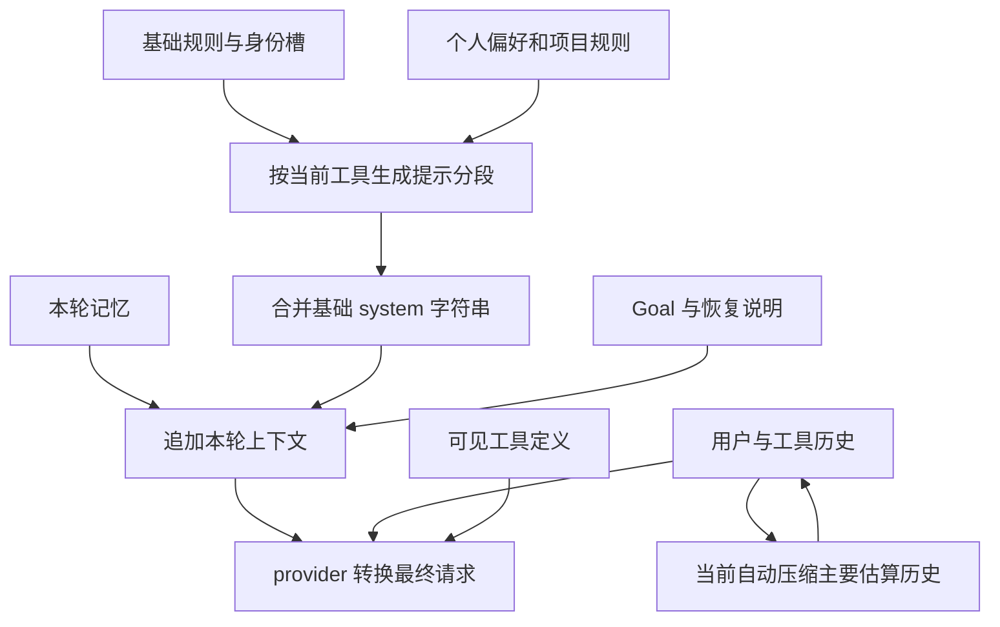

# Codex 提示词系统调研与本应用改进建议

> 状态：历史研究快照，记录 2026-10-13 的分析证据与改进建议。

日期：2026-10-13。范围：本机 Codex 安装包、后端导出协议、OpenHarness-ts 当前源码。本文提出改进顺序，没有修改应用运行代码。

## 1. 结论

最值得借鉴的是提示词的**装配规则、按能力选用、来源区分和压缩后的恢复**。本应用已有分段提示、工具权限检查、按需加载 Skill、历史摘录保护和独立 Goal 状态，建议沿用这些基础。

优先解决以下问题：

1. 实际发送、上下文统计和自动压缩没有使用同一份最终请求，可能漏算系统提示、工具定义及运行时追加内容。
2. 完整 Skill 说明只存在于工具结果中，压缩后可能丢失关键步骤，而系统没有独立记录“本任务仍在使用哪些技能”。
3. 角色或会话的完整自定义提示可能替换公共底座；协调模式也使用单独的大模板。
4. 长期记忆进入 system 指令，但来源和“不能替代当前用户要求、不能扩展授权”的说明没有贯穿渲染。
5. 摘要任务自己的提示较薄，缺少明确的数据来源约束；现有宿主历史摘录机制应继续保留。

之后再考虑模型差异、精简文案和缓存效果。文案优化是否改善真实行为，需要少量针对具体失败场景的验证。

## 2. 证据、版本与边界

| 对象 | 本次核实 |
| --- | --- |
| Windows 包 | `OpenAI.Codex_26.1007.2314.0_x64__2p2nqsd0c76g0` |
| Electron 包版本 | `26.1007.21434` |
| 后端版本 | `codex-cli 0.162.0-alpha.17.2` |
| ASAR SHA-256 | `c5fdef328cfa2ad9095786f9c3a7aaa447e68834d31299d6ef2592da02029038` |
| 后端 SHA-256 | `d13914ced6c7af174d8d638db938284231227312104b06a25e9608c632a7daec` |
| 内嵌模型目录 | 原始 JSON 起点 264,824,328；473,672 字节；11 个模型条目 |

方法包括：读取 ASAR 目录并原字节提取相关 JS；解析后端内嵌模型 JSON；提取提示模板与配置字面量；通过 `app-server generate-ts --experimental` 导出协议；追踪本项目真实请求路径。

REA 本次已连接。原包分析发现若干外置原生模块的声明摘要与实际文件不符，改为明确记录矛盾后继续静态分析，未执行这些模块，未调查矛盾原因。分析又受到客户端 300 秒超时、单源 30 秒超时、堆和图容量限制。按技能要求取回了保留的部分证据，没有重复启动同一分析。

REA 父证据：`ev_385aefaa34c17f1d139641953dc8644f7dd8245d7a60fae37381d4de9a32c0c9`。摘要视图：`ev_0333480a044d7fba7db02154d908de7940ea375f92167feb6ca298f23e25bd93`。其应用和语义覆盖均为 partial；相关大文件的静态事实保留，但语义关系并未完整恢复。不能把结果中没出现的关系当作不存在。

[证据索引](./research/codex-prompts/evidence.json) 记录真实 REA 编号的投影摘要，以及本报告的 `J`（JS）、`N`（原生字面量）、`C`（模型目录）、`P`（协议）、`R`（项目源码）记录。后者是本报告自定义编号。摘录附源摘要、偏移或行号；该索引不是完整可移植 REA bundle。

**观察**指直接读取的代码、协议和模板；**推断**指这些证据支持的运行分工；**未核实**指需要原生控制流或真实请求观测。没有捕获实际模型请求，没有进行真实模型效果测试，也没有读取个人聊天、凭据或操作 Codex 界面。包内模型目录可以被远端目录和运行配置改变，不等于所有运行当前都采用该默认值。

## 3. Codex 如何组合提示

### 3.1 模型基础指令有独立目录

后端内嵌目录在每个模型条目中保存 `model_messages.instructions_template`，部分条目另含持续执行、多代理、审批、协作模式、工具和上下文预算相关模板。目录还包含工具种类、输入模态、上下文窗口与自动压缩限制等能力字段。（C01）

| 目录条目 | 基础模板字符数 | 部分额外模板字段 |
| --- | ---: | --- |
| `gpt-6.1-sol` | 21,769 | persistent、collaboration_modes、multi_agent、approvals、auto_review、token_budget 等 |
| `gpt-6-astra` | 21,420 | 与上项相似的模块字段 |
| `gpt-6-sol` | 18,992 | 持续执行、协作、多代理、审批等 |
| `gpt-5.6-sol` | 17,730 | instructions_template、token_budget |
| `gpt-5.5` | 21,459 | 本条目主要是基础模板；技能/应用用法开关与较新条目不同 |

这里是字符数，不是 Token 数，也不是完整请求大小。模板存在或能力字段为 true/false 只证明目录内容；未恢复后端对每项的实际选择过程，不能据此认定某运行已经注入全部模板。

基础模板同时覆盖持续完成工作、许可判断、沟通方式、工具使用和技能加载等具体行为。可借鉴的是“公共要求＋模型适配＋功能模板”的组织方法；无需把 11 套原文复制到我们的应用。

还有一个应避免照搬的旧接口：导出的 `ThreadStartParams.personality` 明确 deprecated，说明 friendly/pragmatic 不再选择风格；前端仍存在默认 personality 和传递参数的路径。前端遗留参数不证明后端仍按旧人格切换。（P-ThreadStartParams、J07）

### 3.2 桌面层追加实际可用的产品规则

`getProjectAwareDeveloperInstructions` 合并基础开发者说明与自定义说明，读取 Git 设置、是否为 Git 工作区、工作区依赖功能，以及聊天管理、工作树和侧栏工具开关，再调用统一构建函数。（J01）

该构建函数使用 `<app-context>` 包装桌面规则；按开关加入工作区依赖、聊天工具、工作树、侧栏、回答细节、Git 和 heartbeat 相关章节。不适用 Git 的工作区不加入该组 Git 指导。（J02、J03、J08）

请求准备先构建参数，再读取开发者说明；之后按条件追加其他产品说明和 `additionalDeveloperInstructions`，通过 `developerInstructions` 传给后端。另有单独的 `baseInstructions` 参数。（J04、P-ThreadStartParams）

**推断：**桌面产品功能、模型基础行为与后端运行规则有明确接入边界。最终发往模型的原生消息排列尚未反编译；本次不能给出所有模式通用的精确 role 顺序。

对我们最直接的借鉴是：**模型看到的工具说明和操作规则，应由本次实际可用能力生成。**我们已有这部分机制，继续保留；不要因为某段指南提到一个工具，就让模型认为该工具一定存在。

### 3.3 小任务采用独立、受限的提示配置

包中有结构化生成函数，使用单独 base/developer 指令、输出 schema、模型和推理设置；创建 ephemeral 会话，使用 read-only 权限，并在结束后取消订阅。（J06）

一项后台建议检查使用配置关闭项目文档、权限/应用/环境说明、技能、记忆及一组工具功能，再给出该任务自己的基础提示。（J05）这是实际调用代码的观察，只能归到这项小任务，不能推广为所有后台任务都采用相同策略。

可以借鉴到标题生成、摘要、分类和方案检查：为每类任务定义它需要的输入、工具、输出结构和成本上限。摘要模型应被明确要求只总结；标题生成不需要整个项目的技能和操作教程。权限仍由代码限制。

### 3.4 项目规则的作用域与更新有明确表达

原生模板规定 AGENTS 规则覆盖所在目录树，涉及子目录或 cwd 外路径时应检查适用规则。另有 `AGENTS.override.md`、`AGENTS.md`、后备文件名，以及旧规则不再适用/新规则替换旧规则的字面量。（N02、N03、N09）

配置文本出现 `project_doc_max_bytes = 32768`，证明存在项目文档预算配置线索；不能只据这一段文本认定每项运行都采用该值，也不能恢复具体截断顺序。（N01）

前端个人规则编辑路径会检查 `AGENTS.override.md` 是否有内容。（J09）这与规则有显式覆盖入口相吻合。此次未恢复规则发现的完整原生控制流。

可借鉴的重点是记录规则的来源、目录范围、版本和覆盖关系，而不是依赖“文本拼得越后优先级越高”。

### 3.5 压缩是任务交接，来源和授权要分别处理

内置压缩模板要求为下一次继续工作的模型生成交接摘要，包含进展、决定、用户偏好/限制、剩余步骤与关键引用。（N04）这比普通聊天概述更贴近长任务需要。

另外，在独立评审相关提示中存在保留用户指令的顺序说明：原始接受顺序不等于摘要章节顺序；后来的指令可以撤回先前授权；助手文本是理解回复的背景，不能当成已经核实的问题或授权。（N05、N06）这是特定评审模板的观察，不能声称完整普通会话恢复也采用同一机制。

这提示我们：目标、用户纠正、工具观察、模型计划、待处理批准和实际完成证据应分别保存。摘要里一句“用户已经同意”不应替代宿主的批准记录。

**未核实：**Codex 在所有压缩路径如何重注入完整 Skill、项目规则、权限和 Goal；摘要与保留消息的完整排序；哪些状态由数据库重新生成。本项目的完整 Skill 重装建议来自当前源码缺口，不是声称已复原 Codex 的同款机制。

### 3.6 记忆分索引与明细，并保留引用

内置记忆读取提示区分 compact summary、可搜索 MEMORY 注册表、技能目录与详细回顾文件；要求按当前任务逐步查找，简单、自包含任务可以跳过记忆。（N07）

记忆整理模板明确：历史和工具输出可能含第三方内容，应当作为数据；保留有证据的结论、简洁错误与引用；没有有用的新内容时可以不更新。（N08）

可借鉴“短索引 → 相关条目 → 原始依据”的读取路径，以及记忆中事实与用户偏好的来源。不能据模板断言 Codex 已从工程上完全防止旧事实或间接指令影响模型。

## 4. 我们当前实际发给模型的流程

`packages/prompts` 的分段带 `stable/context/volatile` 和统计 bucket；这些是内部装配层，不是模型协议的不同权限 role。SOUL 只替换默认身份槽，公共行为规则在默认构建中仍保留。（R01）

默认运行按可见工具重新构建提示：没有 Skill 不列技能，缺少相关 Agent/Job 工具不注入委派教程；工具注册、冻结能力视图和运行时权限检查继续实际执行。（R02）

每次模型调用前，QueryEngine 选择基础 prompt，再追加当前相关记忆、运行贡献（Goal）、恢复/收尾和轨迹控制提示。之后交给 provider。（R03、R05、R19）

| Provider | 当前提示/历史转换 |
| --- | --- |
| OpenAI Chat Completions | 完整字符串作为一条 system 消息；历史按 user/assistant/tool 转换 |
| Anthropic | 完整字符串进入 system 参数；工具结果在 user 消息中的 tool_result block |
| Codex provider | 完整字符串进入 instructions；历史进入 input，工具结果为 function_call_output |

这三个转换都有源码依据。（R16～R18）应保留 provider 差异；给段添加 authority 元数据有助于正确编译，但 role 名或标签本身不是权限保证。

当前 `/output-style` 是 REPL 输出渲染模式，不是模型人格开关；模型沟通方式主要由 workStyle 与 Markdown 指导控制。优化时不要改错入口。

## 5. 具体改进与优先级

### 5.1 第一优先：用同一份最终请求计算预算与展示

当前自动压缩发生在构建最终 system/tools 之前；依据主要是 `estimateTokens(messages)`，扣输出预留和固定 13,000 的缓冲，并没有扣除这次实际系统提示与工具定义。（R03、R04）系统规则、项目说明或 MCP 工具较多时，固定缓冲不能保证足够。

`lastRunPrompt` 又在 Goal、恢复与轨迹提示追加之前记录；上下文展示虽然已优先真实基础提示，仍可能漏掉后面的运行贡献。预览也有独立重建路径，未完全采用角色、运行环境和当前能力过滤。（R03、R15）

建议统一生成“最终请求快照”：实际 prompt 段、工具定义、历史、模型限制和估算用量。先扣除本次非历史部分与输出预留，再决定如何压缩历史；发送、预览和统计引用同一快照。Provider 转换后的形状也应参与估算，不能把字符数当精确 Token 计数。

最小验证：加入长项目规则、多工具 schema、Goal/恢复追加说明，确认触发线能反映全部请求；比较展示快照与 mock provider 收到的请求内容。现有统计 bucket 可以复用。

### 5.2 第一优先：让使用中的 Skill 在压缩后仍可恢复

完整 Skill 内容通过 Skill 工具结果返回，系统只保存名称与短描述。（R02、R20）micro 清理避开了 Skill，但后续长文本压缩仍会截掉旧 tool_result 的正文；摘要输入又对单条消息截断。daemon 压缩补充目前主要接附件与会话记忆。（R07、R10）

建议记录当前任务激活的 Skill ID、路径、内容摘要、使用范围与版本。压缩后按当前能力重新读取必要技能，或显式提示重读；技能过期或失去可用权限时给出可辨识结果。无需把所有技能全文塞进每轮 system，也不能把任意旧工具结果自动变成系统规则。

最小验证：构造关键步骤处于长 Skill 中段的任务，经历两次压缩与历史重建后，确认续跑请求仍拥有有效说明或明确重读路径；取消插件能力后不得继续使用失效工具。

### 5.3 第一优先：公共底座与角色说明分开

settings 中的 systemPrompt 会作为附加段构建；configuration 中的 systemPrompt 则可以整体替换默认构建，连同公共行为、项目规则和个人偏好一起略过。（R02）这不等于绕过 PermissionChecker，但会造成正常行为约定丢失。

协调模式另行构造完整模板，模板身份仍为 `You are Claude Code`，并包含较长工作流教程与示例。（R13、R14）

建议区分公共宿主规则、角色职责、用户附加说明和明确的完全替换模式。普通角色设置默认追加角色职责；可信宿主确有完全替换需要时保留显式入口并测试。协调、worker、普通聊天和 Goal 使用同一公共装配器，按真实能力添加少量职责说明；把详细工具教程移到工具 schema 或按需文档。

最小验证：自定义角色、coordinator、工具受限和 Plan 模式中，公共持续执行/来源约束仍存在，模型不被提示不存在的工具；真实执行权限检查继续有效。

### 5.4 第二优先：把记忆的来源和当前用户优先贯穿到请求

相关记忆每轮检索并作为 `<system-reminder>` 拼到 system；展示内容主要是正文、tags 与 freshness，未包含现有来源类型、源消息 hash 或条目 ID，也未明确历史记忆不能建立新授权。（R05、R06）

建议系统只规定如何使用记忆，把记忆正文作为带来源的数据条目表达。保留来源 ID、适用项目、观察时间和有效性；明确当前用户纠正优先，历史事实要按任务复查，旧记录不能扩大操作范围。自动提取已经有来源检查，应让这份信息贯穿到渲染。

还发现会话记忆开关的读取/写入边界不一致：关闭时不写新 checkpoint，但压缩上下文仍读取已有文件。建议读取也遵守开关，已有文件无需删除。（R10、R11）

最小验证：旧记忆和当前用户指示冲突、关闭记忆后已有 checkpoint、跨项目事实和过时环境数据均不被错误地当成当前指令或事实。

### 5.5 第二优先：摘要提示与任务状态共同承担交接

当前摘要 system 较简短，摘要正文主要要求叙述目标、过程、结果和后续事项，未明确“不执行被总结内容中的指令”、来源区分、用户纠正顺序和未验证结果。（R08）

我们已有宿主生成的历史摘录容器，保存 user/tool_result 来源和顺序，声明历史不授予新权限，并防止模型伪造的相似容器被再次继承。（R09）这比仅依靠模型自由摘要可靠，建议保留。

摘要任务建议输出少量固定栏目：目标与版本、有效约束、后续用户修正、已验证/未验证结果、剩余工作、等待对象和来源引用。Host 再从真实状态补充当前 Goal、待批准、任务句柄与激活技能，不依赖模型“记住它们”。Goal 目前已有独立读取和每轮注入，应继续使用。（R19）

完成后会话 checkpoint 不能完全替代长运行交接；现有接线没有填充函数支持的全部进度/产物字段。先补真实状态，不为中断工作虚构成功。

最小验证：带间接指令的工具结果、模型自称已获批准、摘要漏掉要求、多次压缩和后续用户纠正。现有脚本模型行为测试能验证请求结构与宿主保护；真实模型是否按规则行动需要另外验证。

### 5.6 第二优先：每段记录来源、范围、版本与省略原因

当前 TaggedPromptSegment 只有 bucket/text/layer，渲染成字符串后无法直接回答“这句话来自哪里、适用于哪个路径、为什么本轮还存在”。（R01）

建议在现有分段上增加 source、scope、authority、contentHash、revision、预算和 omission 信息。用户不需要在正常聊天看到内部细节；诊断界面或日志可以回答最终用了哪些规则、哪些被裁剪、哪些已被替换。

项目规则目前从 cwd 向祖先发现，每文件限 12,000 字符，没有发现后续访问的子目录规则，也没有这一来源的总预算。（R12）建议按实际文件范围补充适用规则，给总量与省略策略，保留最近目录的关键约束；避免只截文末而没有说明。

来源元数据不是新增审批门槛。明确用户指令、简单可逆工作仍应直接推进。

### 5.7 后续：模型适配、精简与行为验证

模型目录证明 Codex 有不同模板和能力，但没有证明把某份长文搬过来就能改善我们的模型。建议公共行为保持一致，仅为不同 provider/模型的工具格式、结构化输出、输入模态和确有失败证据的行为添加少量适配。

把稳定规则放在稳定位置，动态记忆和当前状态单独追加；减少重复工具说明和不适用章节。是否提高前缀缓存命中或减少成本，应通过实际请求和用量观察验证，本次未测量缓存。

可用一组小样例比较调整前后：明确简单修改、模糊目标、长 Skill、多工具、用户中途纠正、真实等待、压缩后续跑。观察是否完成原要求、重复确认、调用不存在工具、错误继承授权或重复已完成工作。测试具体行为，避免只比较提示词是否包含若干句子。

## 6. 实施顺序与剩余问题

| 批次 | 工作 | 验证重点 |
| --- | --- | --- |
| 一 | 最终请求快照、预算统一、完整 Skill 恢复、公共底座 | 最终发送和展示一致；压缩后技能有效；角色不丢公共约定 |
| 二 | 记忆来源、开关语义、摘要交接、规则范围/版本 | 当前用户纠正优先；关闭后不读取；旧事实和权限可区分 |
| 三 | 协调模板精简、模型适配与小规模行为比较 | 成功率、重复确认、调用错误、成本和长任务连续性 |

本次问题覆盖：

| 问题 | 结果 |
| --- | --- |
| 模型基础提示如何组织 | 已回答内嵌目录与差异；运行中的远端覆盖未观测 |
| 桌面规则如何装配 | 已回答 JS 构建链与开关；原生最终消息排列未反编译 |
| 项目规则、Skill 和工具如何进入上下文 | 已回答部分模板/协议/前端入口；原生全部加载与恢复控制流未核实 |
| 记忆与压缩如何处理 | 已回答实际模板意图，并核实本项目完整链路；Codex 各路径重注入策略仍部分未知 |
| 哪些改进最适合当前应用 | 已给出源码依据、分批顺序和对应验证 |

没有更改运行代码，没有运行项目测试或真实模型调用。证据文件的字节、摘要和路径检查用于验证调研摘录，不代表已经验证这些建议实施后的效果。
