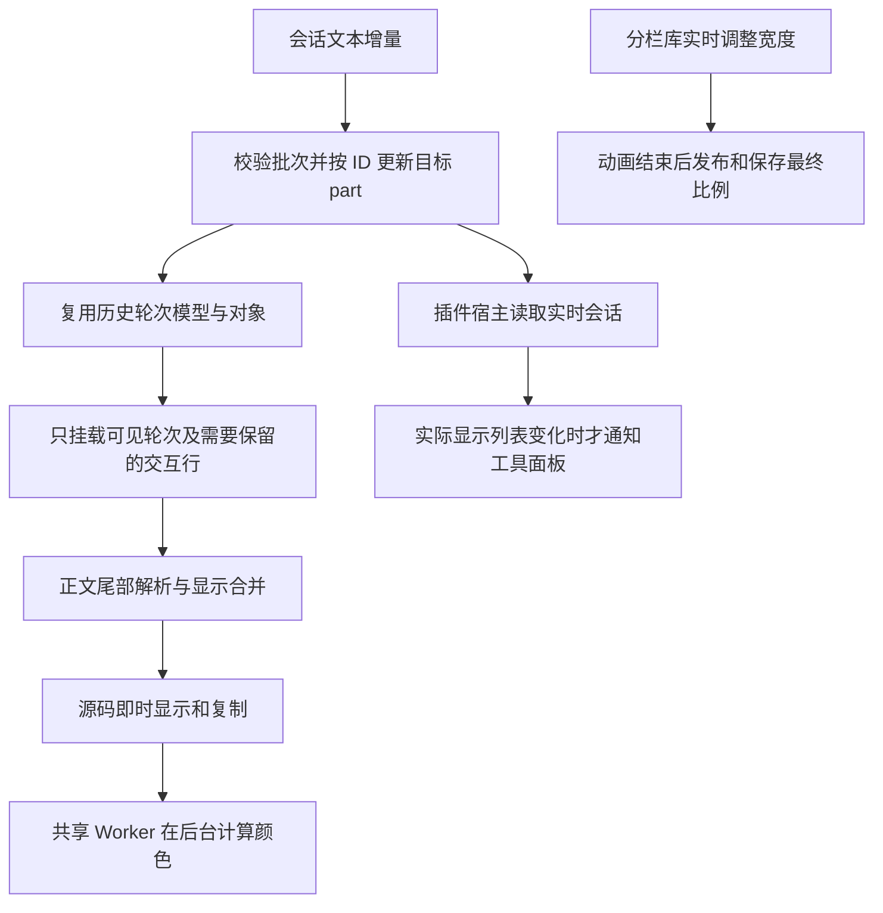

# Desktop 长对话性能优化复盘与维护约定

> 整理日期：2026-10-16。阶段：本轮优化收尾，用户已反馈实际使用明显流畅。本文记录当前实现、已测证据和维护边界；不代表所有会话、插件和硬件上的卡顿均已消除。

## 1. 问题与处理顺序

最初现象是：停留在正在生成的长对话时，正文掉帧，两侧面板的操作也不顺畅。排查没有把所有卡顿直接归因于 Electron IPC 或分栏动画，而是逐层检查：

1. 每次文本追加是否重新分组历史、创建新对象并带动历史消息渲染。
2. 已经离开视口的历史轮次是否仍占用 DOM；测高后是否反复发布滚动状态。
3. 单条超长回复是否反复解析全文、创建大量逐字动画节点、同步计算代码颜色。
4. 与正文无关的面板、插件宿主是否也处理每次增量。
5. 分栏动画产生的中间宽度是否被当成需要发布和保存的最终布局。

优化按这些层次逐批实施。重构收尾只整理入口、类型归属和失效分支，不再调整已有的流式节奏、滚动算法或动画参数。

## 2. 当前更新流程与代码归属



图表示处理职责，不表示所有路径都是常数时间。新轮次、结构变化、语法回退以及数组复制仍有随数据量增长的成本。

| 职责           | 入口及状态所有者                                                                                                                                                                                                                                                                                                                                                                                                     | 维护边界                                                             |
| -------------- | -------------------------------------------------------------------------------------------------------------------------------------------------------------------------------------------------------------------------------------------------------------------------------------------------------------------------------------------------------------------------------------------------------------------- | -------------------------------------------------------------------- |
| 增量应用       | [`session-view-state.ts`](../apps/desktop/src/renderer/src/stores/desktop-session/session-view-state.ts) 的 `applySessionPartDeltas`                                                                                                                                                                                                                                                                                 | 批内建立查找表；校验失败返回恢复同步信号，不提交半批数据             |
| 轮次模型复用   | [`transcript.tsx`](../apps/desktop/src/renderer/src/components/desktop/conversation-page/transcript/transcript.tsx) 的 `useTranscriptModel`、轮次组件                                                                                                                                                                                                                                                                | 缓存属于当前组件；仅在满足文本追加条件时复用，结构变化回到完整构建   |
| 视口与滚动意图 | [`conversation-scroll-state.ts`](../apps/desktop/src/renderer/src/components/desktop/conversation-page/conversation-scroll-state.ts)、[`virtual-transcript.tsx`](../apps/desktop/src/renderer/src/components/desktop/conversation-page/transcript/virtual-transcript.tsx)                                                                                                                                            | 前者保存阅读意图、导航与交互行状态；后者负责可见范围、测高和实际滚动 |
| Markdown       | [`assistant-markdown.tsx`](../apps/desktop/src/renderer/src/components/desktop/conversation-page/message/assistant-markdown.tsx)、[`incremental-markdown.ts`](../apps/desktop/src/renderer/src/components/desktop/conversation-page/message/incremental-markdown.ts)、[`use-streaming-markdown.ts`](../apps/desktop/src/renderer/src/components/desktop/conversation-page/message/use-streaming-markdown.ts)         | 每条回复保留自己的解析器和显示状态，不用全局 Map 保存各版全文        |
| 代码高亮       | [`code-highlight-options.ts`](../apps/desktop/src/renderer/src/lib/code-highlight-options.ts)、[`streaming-code-highlighter.ts`](../apps/desktop/src/renderer/src/lib/streaming-code-highlighter.ts)、[`background-code.tsx`](../apps/desktop/src/renderer/src/components/ui/background-code.tsx)                                                                                                                    | 配置共享；任务和结果归代码块实例；源码与颜色分开更新                 |
| 插件 UI 订阅   | [`plugin-ui-context.ts`](../apps/desktop/src/renderer/src/components/desktop/conversation-page/plugin-ui/plugin-ui-context.ts)、[`plugin-ui-provider.tsx`](../apps/desktop/src/renderer/src/components/desktop/conversation-page/plugin-ui/plugin-ui-provider.tsx)、[`use-plugin-ui-conversation.ts`](../apps/desktop/src/renderer/src/components/desktop/conversation-page/plugin-ui/use-plugin-ui-conversation.ts) | 类型和 Context 统一入口，完整宿主与面板显示列表保持两个订阅范围      |
| 面板布局保存   | [`use-utility-panel-controller.ts`](../apps/desktop/src/renderer/src/components/desktop/layout/main-layout/utility-panel/use-utility-panel-controller.ts)、[`panel-toggle-transition.ts`](../apps/desktop/src/renderer/src/components/desktop/layout/main-layout/panel-toggle-transition.ts)                                                                                                                         | 分栏库负责实时宽度；controller 负责当前会话的最终比例与保存          |

### 增量与历史消息

`applySessionPartDeltas` 对一批消息只建立一次 message/part 查找表，随后按 ID 定位；相对过去每个 delta 都查历史，减少了重复扫描。它仍需建立索引并复制被更新的 parts 数组，不能描述成完全不扫描历史。

普通文本追加尽量保留 `entries` 和历史对象引用，让 `memo` 和已有的计算缓存生效。只有对象引用稳定，给组件加 `memo` 才有用。目标 part 被改写、截断，或消息、运行信息、显示结构变化时，必须走正常的完整构建，不能为了命中缓存跳过业务变化。

### 虚拟列表与滚动

当前使用 TanStack Virtual 的单列轮次虚拟列表。行 key 来自稳定的轮次 ID，导航入口把消息 ID 映射到轮次。已测行高由虚拟库保存；同一实例中离屏重挂载、同 ID 数组重建不会丢失它。编辑中的用户消息和打开的插件交互通过保留行机制维持本地状态；折叠状态、已展示标记也不依赖某次行 DOM 的生命周期。

`following` 表示用户允许跟随最新内容，`atEnd` 只是当前位置是否靠近底部，二者不能混为一谈。上滚意图先于原生 scroll 事件关闭跟随；轮次导航先关闭跟随再定位；“返回最新”明确恢复跟随。

原生滚动和虚拟列表共同使用 `conversationEndThresholdPx` 判定底部。测高后，TanStack 的 `directDomUpdates` 已先更新容器高度，`onChange` 就在同次测量中对齐底部；仅当浏览器仍把位置限制在旧高度时，才保留一帧补偿。补偿执行前再次读取最新跟随意图。阅读点上方整行高度改变可以补偿位置，当前正在阅读的回复向下增长则不应把人拉走。

这一顺序依赖本次安装的 `@tanstack/react-virtual` 3.14.9 / `@tanstack/virtual-core` 3.17.7。升级库时应重新核对 DOM 更新与回调顺序，并跑原生回归，不能仅凭 API 名称假设实现未变。

### 单轮超长正文与代码

增量解析器保留稳定前缀，重新解析末尾两个非空块，以覆盖列表续写、Setext 标题和未闭合围栏。脚注、引用定义、HTML、数学块等可能影响整篇语义的语法，以及上游规范化导致原文无法直接拼回的情况，回退到完整解析。文本改写和截断也必须失效重算。

冻结的块会独立保存字符串，避免 V8 子字符串间接保留多个旧版全文。这段处理有内存回归保护，不应为了“简化”恢复成持有所有历史快照的缓存。

现有显示策略需要如实保留：

- 正文超过 4,096 字符后不再创建逐字进入动画，并以 64ms 窗口合并普通流式正文显示；短正文不受这个合并窗口影响。
- 修正、截断、完成、围栏标记变化以及解析器报告的开放代码围栏走即时显示路径。代码源码和复制内容不能跟着着色频率延迟。
- 会话代码块用普通 DOM 显示完整源码，颜色交给共享的单 Worker 池。流式着色间隔从 160ms 起，随内容增长，上限 1,000ms；首个任务、最终收尾或修正可以立即派发。
- 同一代码块最多一个任务在途，只保留最新待处理源码；只有仍匹配当前前缀、语言的结果才用于着色。出错时保留源码，卸载时取消任务。
- 会话后台高亮与虚拟化文件预览共用 `codeHighlighterOptions`，其中单行分词上限为 4,000 字符；这限制颜色分析，不截断源码。普通文件式代码块另有渲染选项，不能把这些上限误认为所有代码显示的统一截断长度。

这里存在明确的表现取舍：长正文少了逐字动画，正文更新可合并，颜色可以稍晚出现。没有通过隐藏历史内容、复制旧源码或关闭流式高亮来换取性能。

### 两侧面板与插件宿主

左侧栏本身在已测的纯文本更新场景中没有重复渲染。其操作仍会受共用主线程影响：插件提交确认逻辑原本在没有待确认请求时也扫描全部历史；右侧工具面板又订阅了每次变化的完整宿主状态。

现在没有待确认提交就跳过扫描；回执监听属于外部 store 订阅。Frame 继续通过完整宿主读取实时 cursor、会话与调用状态，工具面板只订阅 `displays/close`。显示列表过滤后长度没变就保留原数组，避免重新通知面板。不能把两个 Context 重新合并成一个大对象，也不能通过停止 Frame 的实时更新来减少提交次数。

左侧开合会改变右侧分栏组的可用宽度。分栏库仍逐帧调整布局，但这些中间比例不再逐帧触发整个工作区更新和同步写 `localStorage`；controller 在当前组或祖先开合动画结束后统一提交最终比例。新的手动调整、会话切换和卸载会取消旧的延后任务。

异步结果还必须匹配生命周期身份：插件提交按会话、连接状态及 `pluginUiGeneration` 隔离；侧边聊天的关闭结果按当前 `closeScope` 身份校验。A→B→A 后仅比较会话字符串不足以识别旧回执，不能删除这些身份检查来消除 Hook 依赖。

## 3. 已测结果及其适用范围

下表是实施过程中相同夹具的前后记录。它们是工作量和布局证据，不是整页 FPS、用户硬件的承诺值，也不是本次整理重新采集的旧版数据。

| 场景                                               | 优化前         | 优化后  | 证据范围                                                 |
| -------------------------------------------------- | -------------- | ------- | -------------------------------------------------------- |
| 100 次末轮增高：React 提交                         | 303 次         | 104 次  | jsdom，真实虚拟列表及控制器，模拟尺寸和 ResizeObserver   |
| 同场景：布局次数                                   | 398 次         | 203 次  | Electron，真实 Chromium 布局、生产模式 bundle            |
| 同场景：测量后最大底部间隙                         | 12px           | 0px     | Electron，每次增高后的固定观察点；不是所有时刻的截图差分 |
| 20 次纯文本更新、10,000 条历史：额外 metadata 检查 | 200,000 次     | 0 次    | 真实 store、插件 Provider，无待确认提交                  |
| 同场景：空闲工具面板执行                           | 40 次          | 0 次    | 真实 UtilityPanel，既定工具内容，无活动插件显示          |
| 左侧关开一次并持续增长：工作区提交和布局保存       | 各约 18～19 次 | 各 2 次 | 真实分栏库、controller 和虚拟列表，合成正文              |

尾部增高在 1,000 轮和 10,000 轮下的查找计数相同。原生纯增高场景最多挂载 8 行；面板场景采样为 5 行。这些是该视口与负载下的观察值，不是编辑保留行、插件行等所有场景的硬上限。

本次收尾还复跑了含旧实现对照的批内索引、Markdown 尾部解析 benchmark。以仓库中的输入和实际运行输出为准；耗时会随机器、并发进程、预热和运行模式变化，因此回归主要约束工作量和行为，不对微秒级耗时设固定门槛。

原生夹具使用隔离临时 profile、离屏窗口并关闭 GPU，正文和工具列表为合成数据。它能验证布局、输入和滚动行为，但不包含完整真实 Markdown、字体、终端、所有插件、GPU 合成及生产会话负载。用户“明显流畅”的反馈是有价值的真实使用证据，但也不等于全场景性能认证。

### 首轮整理的验证记录（df7fcbe3）

2026-10-16 在当前工作区复测：

| 检查              | 结果与边界                                                                                                                                                                            |
| ----------------- | ------------------------------------------------------------------------------------------------------------------------------------------------------------------------------------- |
| 相关 Vitest 回归  | 50 个文件、437 项通过，包含滚动、历史状态、Markdown、内存、实时源码与复制、插件、面板和会话增量                                                                                       |
| 原生性能入口      | 单独运行两次均完整通过；最终构建在 1,000／10,000 轮下均为 203 次布局、最大观察间隙 0px、最多挂载 8 行；两侧鼠标／键盘调整、历史阅读和返回最新通过                                     |
| Renderer 类型检查 | 通过                                                                                                                                                                                  |
| ESLint            | 新增和实质修改的实现、配置测试、性能夹具严格检查通过；仅改导入的 `plugin-ui-frame.tsx`、原生插件 `ui-host.tsx` 与 HEAD 对照，既有 7 个错误、10 个警告无新增，本轮不改动其生命周期行为 |
| 原生插件入口      | 构建通过；完整运行两次均在 native 后端模块加载阶段超时，未完成整套原生插件验证。不能用构建或单元测试冒充它通过                                                                        |

基准单次采样均值：64 个 delta、2,000 条历史从 6.26ms 到 0.09ms；20,000 条历史从 49.97ms 到 1.19ms；1,000 段正文的 100 次更新，全文解析从 1,013.66ms 到尾部解析 22.56ms。这是夹具中每批工作的耗时，不是单 token 延迟或产品速度承诺。

首次大量检查并行时，原生性能夹具曾报告 `resize lost following`；单独复跑未复现，根因尚未确认。本次只补充失败时的面板、滚动位置和焦点上下文，没有改滚动算法、增加等待或放宽断言。后续若再出现，应保留失败上下文继续定位，不能仅凭复跑成功归因为机器负载。

### 后续排查：滚动归属与原生插件测试

上述遗留问题继续按可复现证据处理：

- **resize 误停跟随。** 宽度变化让行高缩小时，TanStack 会自行补偿滚动位置。原来只记录应用层滚动，漏掉了库内部的写入，随后到达的 `scroll` 事件可能被误认为用户向上阅读。现在统一通过公开的 `scrollToFn` 写入并调用 `recordScrollAdjustment` 记录实际位置，不改变阅读意图。真实向上滚动、包括没有前置滚轮事件的滚动条拖动，仍会停止跟随。
- **插件文档生命周期。** 用 `display.key` 标识文档：新文档整体重置高度、加载状态与错误状态；同一文档的流式更新和隐藏继续复用 iframe。宿主引用在提交后的 layout effect 中更新，异步结果仍保留身份和有效性校验。提交动作的重试与回执查询移至 `plugin-ui-action.ts`，不与组件导出混在一起。
- **原生后端启动。** 测试原先在 Electron 的计时区间内用 tsx 加载整张依赖图；并发负载下可能超过 45 秒。入口改为先用 esbuild 从当前源码构建后端，再启动 Electron；保留真实 SQLite、原生依赖、迁移文件与工具子进程，不读取旧构建产物代替源码。原有启动与整套测试时限保持不变。
- **关闭重开的旧 frame。** DOM 中 iframe 已关闭后，Electron 的 frame 列表仍可能短暂保留旧文档；直接取第一项并执行脚本可能一直等不到结果。测试改为读取当前 DOM iframe 的地址，匹配尚未分离的活动文档。
- **测试退出顺序。** 先手动销毁测试窗口、再异步关闭探测服务器并发起退出，会与 Electron 的窗口退出流程交错。仅延后调用退出、换导航地址或换 profile 都不能解决。测试现在保留窗口直到服务器和后端清理完成，由 `app.quit()` 统一关闭窗口并退出；完整原生回归已正常返回 0。每次运行另建临时 profile，结束后删除，避免固定目录的缓存冲突。外层仍要求正常退出码 0，不能只凭 `passed` 日志判定成功。

回归需要同时覆盖最终位置和中途状态：面板最大化、恢复、快速开关期间不应短暂丢失跟随；向上阅读后增长不能拉回底部；轮次导航与返回最新仍需正常。原生夹具支持 `VYKOR_CONVERSATION_CPU_RATE=6`，只在 resize 阶段以 6 倍 CPU 限速执行两侧鼠标和键盘各 4 轮正反调整，避免把整个动画夹具的固定观察窗口与限速混为一谈。

ESLint 的本轮目标是首轮记录的 7 个错误、10 个警告及本批涉及文件。另一次全 desktop 扫描发现大量无关文件的既有格式和规则问题，不应据此宣称整个仓库已清零，也不在性能修复中批量改写无关模块。

本轮验证结果：

| 检查             | 结果                                                                                                                                                         |
| ---------------- | ------------------------------------------------------------------------------------------------------------------------------------------------------------ |
| 相关 Vitest 回归 | 51 个文件、440 项通过；新增插件文档重置／复用与布局限位回归，限位用例已验证修复前失败、修复后通过                                                            |
| 本批 ESLint      | 所有涉及的实现、测试与脚本严格检查通过，0 错误、0 警告                                                                                                       |
| 类型检查         | Renderer 与主进程均通过                                                                                                                                      |
| 完整原生插件测试 | 原始安全断言、桌面组件、真实 Native／SQLite、官方示例交互通过，进程正常退出 0，未触发外层超时                                                                |
| 原生性能回归     | resize 阶段 6 倍 CPU 限速通过；1,000／10,000 轮下均为 203 次增高布局、最大观察间隙 0px、最多挂载 8 行；两侧各 4 轮鼠标／键盘正反 resize 与阅读、导航回归通过 |

### 2026-10-17：连续代码块的重建与闪烁排查

用户反馈主会话中连续输出多个代码块时闪烁、结束后集中显示。排查确认并修复了两类组件重建条件：

- 文件打开回调变化时，重新创建 Streamdown 的组件表，会连带替换内部的代码渲染组件。现在组件表在当前回复内保持不变；提交后更新回调引用，文件链接仍调用最新函数。测试验证原代码节点、颜色和 Worker 任务都能复用。主会话当前回调链通常稳定，因此这只是已验证的触发条件，不能单独解释用户的全部现象。
- 完成、恢复时直接切换 Streamdown 的 `streaming/static` 模式，会更换整棵渲染树。普通回复现在继续使用原来的块渲染结构，仅按实际状态关闭动画和未完成语法处理。首次打开的历史仍使用静态渲染；包含 `]:` 的回复在完成时保守沿用全文处理，保留引用定义、脚注、嵌套定义和跨行标签的既有语义。该候选检查仅在完成时进行；代码内容误中时最多保留原有的一次完成重建。

新增回归同时检查 DOM 身份、已有颜色、Worker 请求次数、延迟着色时的实时源码和复制、完成与恢复、跨 4096 字符边界，以及真实 Transcript 的相邻文本 part 和缓存重建。跨段语法分别与重新打开的历史内容比较，不能只检查最终文本包含了注释。

原生性能夹具也接入真实 Markdown 和高亮 Worker：1,000／10,000 轮历史下各连续输出四个代码块、105 次增量；另以稳定文件回调输出三个各 350 行的代码块。逐次检查旧块身份、颜色和新源码，并检查完成时不重建普通代码块。原有布局、历史阅读、自动跟随、轮次导航与两侧 resize 回归一并保留。

这些合成场景已通过，但不是对所有实机会话的证明。用户随后反馈新建会话暂时正常；目前没有稳定复现最初的持续闪烁，不能仅凭新会话正常宣布唯一根因已确认。若再次出现，应对照同一会话的消息身份、全文修正、组件挂载和滚动测量记录继续定位，避免继续叠加未经证实的优化。

## 4. 评估后未采用的方案

参考 ZCode 的活动轮次与历史列表分离、独立行高缓存后，先核对了本仓已安装的虚拟库实现，再测量历史长度是否放大尾部测高成本。

当前单列库已按变化位置更新测量结果，也能按稳定 ID 复用行高。测量没有显示从 1,000 轮到 10,000 轮产生相应倍数的尾部维护工作；因此没有再增加第二套测量缓存，也没有把活动轮次移出虚拟列表。实际收益来自修复测高后多等一帧的对齐，以及无关订阅和保存工作。

这不证明拆分方案永远没有价值。若后续测量发现虚拟库重建、单轮内容极大或生命周期切换确有成本，应携带新的运行证据重新评估。开源项目用于提出假设，不能代替本仓的测量。

## 5. 本次代码收拢

- 插件 UI 的类型、完整宿主 Context 和显示列表 Context 统一放在 `plugin-ui-context.ts`；两个订阅范围仍分开。Provider 只负责运行时，不再由 Context 反向导入组件文件中的类型。
- 共享高亮配置放在 `lib/code-highlight-options.ts`，命名不再限定于文件预览；去掉旧的 `tools/code-preview-worker-options.ts` 转发层，配置测试跟随所属模块。
- 普通代码块用 `FileCodeRenderer`，会话代码块用 `BackgroundCode`；去掉静态渲染器中永远为 false 的会话参数和残留样式分支。
- 底部判定阈值只有一个来源，原生滚动与虚拟列表共同使用。
- 原生回归统一放在 `tests/conversation-performance/`，通过 `test:conversation-performance` 构建和运行，不依赖上次留在本机的 bundle。
- 改名时检索了 `src` 之外的消费者，修正原生插件测试夹具的旧 Hook 导入。`tsconfig.web.json` 不覆盖这些 Electron 测试入口，单跑 Renderer 类型检查不足以确认它们能构建。

没有引入通用的全局缓存、调度框架或另一份滚动状态；已有的专用机制继续由其所在层负责，避免为了抽象再增加隐含的生命周期。

## 6. 如何复测

从仓库根目录进入 Desktop 后运行。常规安装使用 pnpm；如果本机 pnpm 包装器需要联网引导，可用本仓已安装的 Node 入口执行同一工具。

```powershell
cd apps/desktop
pnpm run test:conversation-performance
pnpm run typecheck:web
```

原生入口输出 JSON，包含 1,000／10,000 轮的尾部增高、两侧开合、鼠标拖动、键盘调整、快速开合、最大化恢复、历史阅读、返回最新及其 Chromium 指标。只有所有断言通过才输出最终 `result: passed`。profile 位于系统临时目录，清理前检查父目录和专用前缀，不读取真实用户会话。

```powershell
pnpm exec vitest bench --run src/renderer/src/stores/desktop-session/session-view-state.bench.ts src/renderer/src/components/desktop/conversation-page/message/incremental-markdown.bench.ts --maxWorkers=2
```

这两组 benchmark 内置“原线性查找／每次全文解析”的对照，不需要手动覆盖产品代码。完整 Markdown 组件路径还有 `message/assistant-markdown.bench.tsx`，它的 jsdom 与测试 Worker 不能当作生产 Electron 的主线程计时。

```powershell
$conversationRegression = @(
  "src/renderer/src/components/desktop/conversation-page/transcript",
  "src/renderer/src/components/desktop/conversation-page/message/assistant-markdown.test.tsx",
  "src/renderer/src/components/desktop/conversation-page/message/assistant-markdown-repair.test.tsx",
  "src/renderer/src/components/desktop/conversation-page/message/incremental-markdown.test.ts",
  "src/renderer/src/components/desktop/conversation-page/message/incremental-markdown.memory.test.ts",
  "src/renderer/src/components/ui/code-block.streaming.test.tsx",
  "src/renderer/src/lib/streaming-code-highlighter.test.ts",
  "src/renderer/src/lib/code-highlight-options.test.ts",
  "src/renderer/src/stores/desktop-session/session-view-state.test.ts",
  "src/renderer/src/components/desktop/layout/main-layout",
  "src/renderer/src/components/desktop/conversation-page/plugin-ui",
  "src/renderer/src/components/desktop/tools/side-chat-panel.test.tsx"
)
pnpm exec vitest run @conversationRegression --maxWorkers=4
```

无需为改一段文档反复跑全部 Desktop 测试；按改动层选择上面的相关部分。修改 Context 导出或原生夹具导入时，还应构建并运行 `test:plugin-ui-electron`；重命名工具入口时，实际执行新的 package script，避免只检查文件存在。

## 7. 后续维护原则

1. 先复现并计数，再修改。区分组件重新执行、React 提交、历史扫描、布局、绘制和后台任务，不能用一个“渲染次数”包办全部成本。
2. 一次只改变一个主要机制，比较相同输入、视口、模式和历史长度；并发运行类型检查等任务时，不据此比较 CPU 耗时。
3. 为缓存写明所有者、命中条件、失效条件和释放时机。维持原对象引用比到处添加 `useMemo` 更重要。
4. 高频更新与用户意图分开：上滚、导航、复制、输入和拖动不能等待正文或着色节流。
5. 每个优化都保留安全回退：快照恢复、完整 Markdown 解析、原始源码、必要的一帧滚动补偿。删除回退前先证明它不再需要。
6. 异步结果按实例和生命周期校验。不要只比较路径、会话字符串或内容长度，也不要用延迟 `setState` 掩盖依赖问题。
7. 升级 Streamdown、TanStack Virtual、Pierre 或分栏库时，复核依赖的更新顺序与缓存语义，至少跑对应行为测试和原生夹具。
8. 本阶段结束后，新的优化由实际卡顿记录触发。单轮超长 DOM、活动插件的合法历史检查和真实 GPU／终端负载仍可能需要单独分析，不继续凭猜测追加缓存或调度层。

## 8. 记录与相关文档

主要实现提交：`d3d0b3ef`（历史与 Markdown）、`a52a651c`（批内索引与后台流式高亮）、`64419d37`（同次测量对齐）、`b9fe59f0`（面板与插件生命周期）。版本更新 `42673094` 将 Desktop 标记为 `1.2.20`；本次整理是后续收尾提交，不改版本号。

- [Desktop Agent 消息渲染设计](./desktop-agent-message-rendering.md)：产品展示与组件职责。
- [2026-10-08 会话流式传输历史分析](./desktop-session-streaming-performance-analysis.md)：当时的静态分析，不代表当前已实现的增量传输链路。
- [会话增量更新设计](./superpowers/specs/2026-10-08-desktop-session-incremental-updates-design.md)：快照恢复、同步水位与应用确认的约定。
