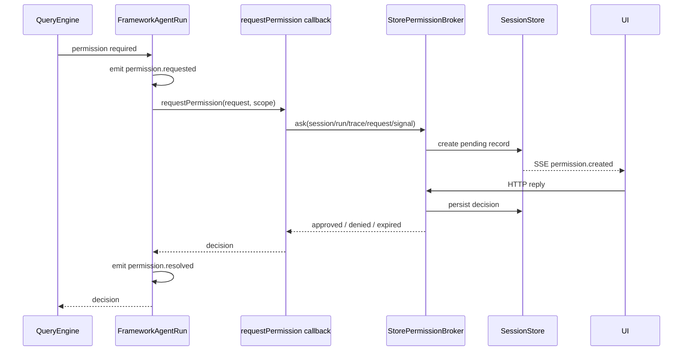

# Permission Flow

> 状态：当前实现快速索引。daemon 全链路见 [Daemon Application Architecture](./daemon-application-architecture.md#工具运行与授权)。

## 核心语义

permission decision 通过 SDK callback 返回，不是带 resolver 的 event：

```text
request/decision : createDefaultNodeAgent({ effects: { requestPermission } })
observability    : permission.requested / permission.resolved AgentEvent
durable UI flow  : daemon StorePermissionBroker
```

framework 等待 decision；event 只描述事实，保持可序列化。

## S1 工具操作安全

daemon 注入 `AgentToolSafety`，同时提供操作记录宿主和 `RequiredPolicyGate` 强制规则。独立 SDK 通过 `toolSafety` 显式接入，默认不创建数据库；配置不完整时在创建或执行入口拒绝。

工具输入先规范化和校验，再准备操作记录，依次经过普通权限、强制规则、原有审批和派发前复核。操作和实际 Attempt 写入成功后才调用工具；完整结果保存成功后才交付下一步。强制规则检查默认最多等待 5 秒，拒绝、异常、超时和取消都不放行；关闭普通 Hook 不会关闭强制规则。

普通 Hook 沿用原合同，与必须生效的规则分开。root、child、手动 `runTool`、嵌套和代理调用使用同一检查管道；每次实际派发有独立尝试身份。审批等待只有 operationId，不能用预先拼出的尝试编号冒充实际调用。

未声明工具默认不能自动重放。`safeToRetry`、MCP 提示和同名工具都不能证明业务支持去重。未知结果默认保留记录但不阻止其他操作；全局设置 `blockOnUnknownToolOutcome: true` 才启用同根会话树的后续写入阻断，原因及保留的检查见[决策记录](./tool-outcome-blocking-decision.md)。具体只读与业务去重承诺由可信宿主按实际工具实现声明。核对入口只接受授权宿主提供的只读查询证据，模型和普通工具输出不能自行确认“没有执行”。

当前审批仍使用下面的 callback 与活体等待机制；跨重启保留审批和修改意图版本属于 S3。S1 的字段与状态见[持久运行记录](./durable-execution-data-model.md#s1-工具操作记录)，分阶段范围见[实施计划](./superpowers/plans/2026-10-26-s1-tool-operation-safety.md)。

## Standalone

```ts
const agent = await createDefaultNodeAgent({
  capabilityOverrides: {
    terminal: { value: terminal, jobs: terminalJobs },
    backgroundShell: { value: backgroundShell, jobs: shellJobs },
  },
  effects: { requestPermission },
});
```

`requestPermission` 是可选 effect；未提供时默认拒绝，不隐式放行。上例的 Terminal 与后台 Shell override 是 Host 借用对象，必须可用于 root session tree 的全部 child session，且由 Host 而不是 `agent.close()` 释放。

## Daemon



## 代码位置

| 行为 | 文件 |
|---|---|
| 工具权限检查与 callback 调用 | `packages/core/src/engine/tools/query-tool-permissions.ts` |
| request/decision contracts | `packages/agent-contracts/src/policy/permissions.ts` |
| 执行 effects 与事实事件 | `packages/agent-contracts/src/execution/execution.ts`、`packages/agent-contracts/src/execution/events.ts` |
| daemon callback 注入 | `packages/server/src/daemon/daemon-agent.ts` |
| durable broker | `packages/server/src/permissions/permission-broker.ts` |
| live resolver/expiration | `packages/server/src/permissions/permission-controller.ts` |
| list/reply routes | `packages/server/src/http/routes/permission.ts` |
| event durable observation | `packages/server/src/application/agent/daemon-agent-event-projector.ts` |

## Cancellation 与 lineage

- run `AbortSignal` 传给 broker/controller。
- interrupt/archive 时 pending request 变为 `expired`，broker 保留该 decision，不再降格成 `denied`；等待中的 callback 返回且不继续执行工具。
- child scope 使用 child session/run；broker 沿 parent lineage 把 prompt 暴露给顶层 session。
- durable payload 保留 child session/run identity，UI 无需持有 framework handle。

## Daemon 重启

permission resolver 只存在于创建它的 daemon 进程。新 daemon 启动时，`SessionStore.expirePendingPermissionRequests()` 会把旧进程遗留的全部 `pending` request 改为 `expired`，写入明确的 restart reason 和 `permission.replied` durable event。已 approved/denied/expired 的记录不可再次改写。

## 不变量

- event payload 中没有 resolve/reject/function。
- daemon 不向 QueryEngine 注入 host。
- callback 未配置或失效时绝不默认批准。
- daemon callback 必须原样传递 `approved | denied | expired`，不得用 boolean 压平状态。
- `permission.resolved` 在 callback settle 后发布，供日志与 projection 使用。

## 三档授权与独立计划模式

当前会话在 `metadata.runtime.approvalMode` 保存 `ask | auto_review | full_access`，在 `workMode` 保存 `execute | plan`。计划限制先于普通审批，进入、退出计划都保留授权选择。

`auto_review` 将尚需审批的具体操作交给无工具的独立模型请求，决定和理由保存在授权记录的 `payload.approvalReview`。自动批准仅限一次；格式错误、超时、未知工具、凭据资料和缺可靠隔离的命令转用户确认。人工先答、取消及旧修订结果不得再次结算。

`full_access` 使用当前会话的执行设置副本，统一传给文件、网络、终端和后台任务，不修改全局沙箱。现有禁止规则和计划限制继续先行。

职责分工：`agent-contracts/permissions` 定义执行授权与审查数据，`protocol` 只负责通信格式，持久审查记录归 `domain-contracts`；`core` 在工具执行前发起审批，`agent-runtime` 在内部解析模型与凭据并提供审查器；`server` 读取可信用户输入、保存操作参数快照并处理审批结果；`services` 保存记录和事件。审批业务服务通过注入的 `review` 函数调用审查，不导入运行时实现类型。

架构检查同时读取包声明和实际源码导入，包含纯类型导入、动态导入及相对路径跨包引用；发现包依赖形成闭环时失败。

自动批准成功时不在输入框上方展示结果卡片，也不额外插入消息提示；审批决定和理由仍保存在原有授权记录中。需要人工处理的审批继续显示。
