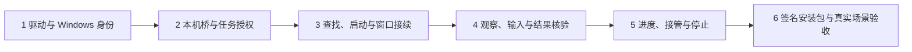

# Vykor Windows Computer Use 接入计划

> 状态：实施计划。按同一条实现线分阶段交付。平台范围为 Windows x64 本机 Desktop。
>
> 执行时逐阶段完成复选框。先用真实边界写能发现问题的测试，再实现和复跑。每个阶段通过它的验收条件后进入下一阶段。

**目标**　用户在 Vykor 里说「打开记事本，写三行会议待办，另存到我选的测试目录，再用资源管理器检查」，即使这些应用都没开，Vykor 也能找应用、获得许可、启动或复用窗口、执行多步操作，并用应用状态或产物回答实际完成了什么。用户能看到进度、暂停接管、继续或停止。

**实现方式**　Vykor Desktop 负责发现和启动应用、核对窗口身份、提示前台占用和停止输入。daemon 负责将本机许可绑定到一次 Agent 运行，以及装配工具、记录动作和返回结果。Cua 负责读窗口和操作控件。Windows UI Automation 让驱动通过操作系统读取并请求按钮、文本框和菜单等控件。需要时再使用指定窗口的画面和有边界的前台键鼠。

**交付范围**　覆盖普通 Windows 应用和受支持的系统界面，包括打开应用、浏览文件、编辑和保存、跨应用窗口交接、读取普通应用或系统设置，以及执行用户要求且可核验的非敏感设置变更。管理员提权、系统安全桌面、认证和需要真人完成的敏感流程走接管。网页任务继续使用 Vykor 的 [Browser](../../browser-capabilities.md) 能力。Windows ARM64、macOS、Linux、远程控制和锁屏操作各有独立的平台验收。

## 产品体验

1. **一句任务开始。** 用户在聊天中启用 Computer Use，可以直接写「打开计算器算 27×14 并告诉我结果」，也可以显式选择 Computer 工具入口。开关默认关闭。识别依据是 Desktop 中的用户输入和开启状态。网页、文档、控件文字与模型输出均当作外部上下文，无法开启该能力。
2. **Vykor 找应用和窗口。** 在本机已安装的目录中解析用户指的应用。若找到唯一且匹配的已运行窗口，直接复用；应用未运行时，按应用许可启动并等待可操作窗口。手动选窗用于多个文件或窗口都符合条件、应用归属无法核实，或者用户想纠正目标。
3. **应用授权后连续工作。** 第一次使用未授权应用时，询问是否仅允许本次任务，或将该应用设为始终允许。始终允许可在设置中撤销。许可限定到受识别的本机应用并由实际任务激活。它涵盖许可范围内的普通观察、点击、编辑、滚动和导航。跨入未授权应用、占用前台键鼠、向外发送、删除或覆盖、支付及重要系统变更时，分别检查当前任务范围，并在适用时停下来要求明确确认或接管。
4. **看得见，也接得回来。** 运行区显示正在查找、启动、等待许可、操作、核验或已暂停，以及当前应用、窗口和最近动作。授权时可展开指定窗口预览。前台输入前显示它会使用当前桌面的鼠标和键盘。用户可暂停接管，完成登录、处理对话框或纠正位置后，点继续让 Agent 重新观察。Stop 立即拦住新的派发，已进入应用的动作仍可能继续。
5. **用可核实的结果结束。** 比如计算器屏幕实际显示 378，或用户指定的文件已经保存且重新打开后内容吻合。只收到点击成功回包、没读到应用结果时，明确说已发送且效果待确认。任务结束后清除当前窗口引用与操作许可，并释放输入。

### Codex 交互参考

OpenAI 的官方说明明确支持从自然语言或应用提及启动任务、按应用授权、记住和撤销允许的应用、在敏感或干扰性动作前追加确认，以及随时停止或接管。Windows 上的 Codex 在活动桌面进行前台操作，macOS 的后台和锁屏能力有各自的条件。Vykor 借鉴其任务入口、权限分层和接管体验，Windows 的实际交付方式按 Cua 的实机结果确定。 [OpenAI Computer Use 指南](https://learn.chatgpt.com/docs/computer-use)

### Windows 实测基线

本机上游 Cua `0.28.2` 已验证 WinForms 目标窗口观察、窗口截图、后台按钮触发、字段赋值和读回。过期控件引用和同进程未授权窗口被拒绝。窗口级 `bounded` 清单只准访问已识别的窗口，经实测会拒绝按 PID 枚举窗口。其目录仍返回 57 个工具，Vykor 自行筛选向模型开放的能力。PoC 由测试脚本启动窗体，冷启动应用、多应用交接、前台键鼠和物理接管均要补实机证据。停止驱动的命令返回后，已进入应用的延迟动作仍继续约 1.9 秒。 [Cua 固定发布](https://github.com/trycua/cua/releases/tag/cua-driver-rs-v0.28.2) · [Cua 应用与窗口工具](https://cua.ai/docs/cua-driver/reference/mcp-tools/apps-windows-and-screen)



阶段 1 至 5 使用夹具和内部开关合入同一条实现线。发布按完整用户旅程验收。仅有选窗和一次语义点击通过时，能力仍处于内部测试。

## 代码落点与状态归属

- **Desktop 主进程**　拟建 `apps/desktop/src/main/features/computer/`。其中 `app-catalog.ts` 从可信 Windows 目录找应用，`app-launcher.ts` 处理启动和等待，`window-identity.ts` 管窗口归属和失效通知，`windows-driver.ts` 管 Cua，`computer-host.ts` 持有本轮应用许可、当前目标、观察缓存、输入队列、驱动世代和撤销状态。增加 `computer-bridge.ts` 和 `ipc.ts` 接入 [Desktop 会话入口](../../../apps/desktop/src/main/features/session/ipc.ts) 与 [daemon 连接](../../../apps/desktop/src/main/features/session/daemon-connection-service.ts)。Windows 原生系统调用放在 `apps/desktop/native/computer-windows/`。
- **daemon**　拟建 `packages/server/src/application/computer-tools/` 下的 `computer-tool.ts`、`computer-bridge.ts` 和 `computer-grant.ts`，分别负责模型工具、请求传输和按运行授权。拟建 `packages/server/src/http/routes/computer-host.ts`。从 [HTTP 组装](../../../packages/server/src/http/server.ts)、[运行准入](../../../packages/server/src/application/session/execution/run-admission-service.ts) 和 [单次运行工具贡献](../../../packages/server/src/application/session/execution/session-run-executor.ts) 接入。daemon 持有用户输入和运行 ID、审批记录、请求账本及工具结果。
- **协议和界面**　拟建 `packages/protocol/src/runtime/computer.ts` 定义请求、结果和事件。在 [运行能力声明](../../../packages/protocol/src/runtime/capabilities.ts) 公布 Computer 桥支持。renderer 组件放在 `apps/desktop/src/renderer/src/components/desktop/tools/computer/`，通过 [预加载 API](../../../apps/desktop/src/preload/desktop-api.ts) 获取状态和发起授权、暂停、继续、停止。优先复用已有组件，需要新组件时按项目约定先查 beUI。 [Desktop 设计约定](../../../apps/desktop/DESIGN.md)
- **打包和验证**　拟建 `scripts/prepare-cua-driver.mjs`、`apps/desktop/scripts/verify-cua-packaging.mjs` 和 `apps/desktop/tests/computer-windows/`。接入 [资源打包](../../../apps/desktop/electron-builder.yml) 和 [标签发布](../../../.github/workflows/tag-release.yml)。测试放在模块的 `__test__/`，跨模块夹具放共同目录。每个新职责目录加 README，包根 README 加导航。上游许可随资源打包并更新 [第三方许可](../../../THIRD_PARTY_NOTICES.md)。

## 共用工具、权限和结果契约

### 工具面

拟将 Vykor `Computer` 暴露为以下受限动作。应用和窗口引用由宿主在本轮签发。原生 PID、窗口句柄、路径、启动参数和驱动令牌留在可信端。

| 动作 | 输入与返回 | 关键约束 |
| --- | --- | --- |
| `find_app` | 输入应用名称或已知别名。返回候选应用引用、名称、是否正在运行及有限状态。 | 启用本轮后才查询。首次许可前的结果只包含应用级元数据。 |
| `open_app` | 输入 `appRef`。宿主复用符合意图的窗口或启动应用，等待就绪。 | 先获得许可。启动参数由受信任的宿主定义。窗口就绪后独立核实，名字重复时交给用户。 |
| `select_window` | 输入本轮 `windowRef`。返回当前目标和新的观察世代。 | 唯一合格目标可自动绑定。新应用需要自己的许可，弹窗需证明属于获准任务。 |
| `observe` | 返回结构化控件，有许可时可附当前窗口画面。 | 默认结构化信息。限制节点数、深度、文本与图片体积。 |
| `invoke`、`set_text`、`choose`、`scroll`、`press`、`click_at` | 使用本轮、当前窗口及最近观察产生的元素引用或有限坐标。 | 语义优先。坐标绑定同一窗口的快照。前台输入需要独立许可与已实测的停止能力。 |
| `verify` | 通过结构化条件或获准的业务读回，给出满足、不满足或未知。 | 条件已在动作前成立时，另行确认变化，或报告原先已满足。 |

`invoke` 包含能证明控件能力的按钮、选项、菜单和状态动作。`set_text` 使用控件的赋值接口。普通文本框无法语义赋值时，才评估目标窗内受控键盘输入。受支持的键和动作按实际验证登记。文件选取用用户在任务中授权的文件或目录；能够提交数据、启动程序或越出目录的输入单独验权限。

### 四层判断

- **任务许可**　Desktop 启用状态和顶层用户输入与真实 `sessionId/runId/inputId` 绑定。连接重建、排队重放、子任务、工作流或其他客户端不能借用。浏览器页签和插件权限保持独立。
- **应用许可**　宿主按 Windows 应用目录、安装身份和可执行来源发放「仅本任务」或用户明确保存的「始终允许」。始终允许只减少应用级提示；当前使用仍受任务、窗口、操作风险和系统权限限制，设置里可撤销。新应用、候选冲突、发布者或身份变化均复核。存储持久选择，不持久化窗口或输入票据。
- **窗口许可**　Electron 核对登录会话、进程创建时间、句柄归属和窗口实例，给 Cua 一个当前窗口的 `bounded` 清单。发现与启动由受信任的 Desktop 启动器完成。切到别的窗口时，暂停派发，释放旧观察和驱动窗口权限，再按新目标建清单。句柄复用、弹窗归属含糊、锁屏、失去监听或截图几何变化均重新验证。
- **操作许可**　任务许可覆盖经过确定性策略判定的普通操作。派发前结合请求、应用、控件语义、截图范围与当前状态判断。可能是发送、删除、覆盖、系统更改等高影响动作或效果无法可靠归类时，走真正的人工确认；可暂停让用户完成。前台键鼠使用单独显式许可并占用同机输入。提权、安全、认证等窗口由用户接管。通用的 `full_access` 和 `auto_review` 保留其现有含义，均无法代签这些真人批准。 [Vykor 运行权限](../../../packages/permissions/src/index.ts) · [会话审批](../../../packages/server/src/permissions/session-approval.ts)

### 状态和证据

- 运行状态为查找、启动、等待授权、观察、执行、核验、已暂停、停止中、已停止和完成。状态由 Electron 和 daemon 各管其真实部分，通过现有会话事件显示；本地接管入口在桥断开时仍可用。
- 工具结果记录 `not_sent`、`sent_unconfirmed` 或 `verified`。已派发结果未知使用 Core 的 `executionState: "unknown"`。回包晚于许可失效时丢弃旧的窗口内容，已派发事实和效果未知仍保留。模型先请求重新观察，恢复写入须通过最新状态检查。派发成功、状态改变和用户目标达到分别核实。
- 每次请求带 `connectionId/requestId/toolCallId/toolAttemptId/deadlineAt`、任务及宿主世代。每台本机同时只有一个任务可持有输入队列。批次按 deadline 和取消收敛，发出前票据只消费一次，中断或重连不会重放。
- 本地预览帧、可提交给模型的截图和留在聊天或附件中的证据分别控制。预览默认短时存在且不落盘；模型图片需任务授权并满足模型能力。证据留存遵守会话访问和保留策略。操作日志仅含用来追踪动作的标识、阶段、耗时与结果类别。

## 阶段 1 · 固定驱动与 Windows 身份

**交付**　通过上游 Cua 实测回归的 Windows 宿主、可信应用身份和可打包资源。

- [ ] 将 PoC 的同 PID 双窗、计数、赋值与延迟应用动作移入 `apps/desktop/tests/computer-windows/`。增加检测目标窗重建、已关闭应用的启动、同名应用或文件的测试结构。由夹具内部日志给实测提供基准。
- [ ] 固定 Cua `0.28.2` Windows x64 ZIP 的 SHA-256 `1f4bfceeab64cb7f56be7aad774c3dc2d2910d1427e4be1d79939c706e8029ba`。核对解包后的必需文件 SHA-256、架构和适用的厂商 Authenticode 签名。将资源路径固定在已核对的安装目录。工具帮助、版本探测和真正启动一律从第一个进程起设 `CUA_DRIVER_RS_TELEMETRY_ENABLED=0`，关闭更新检查和外部 MCP 监听，使用独立的临时数据目录。 [现有固定资源模板](../../../scripts/prepare-office-engine.mjs)
- [ ] 资格验证候选 `cua-driver mcp --direct` 的父子进程专属标准输入输出。复测窗口清单、旧引用拒绝、截屏、读回、退出和后代进程清理。PoC 的普通同账号管道留作复现。如果候选连接不能证明进程身份或清理，阻断下一阶段，调整驱动生命周期或选用经审查的私有认证传输。
- [ ] 从本机 Windows 应用注册与开始菜单可识别入口生成应用候选，覆盖传统桌面程序与打包应用。窗口身份复核覆盖当前交互会话、进程创建时间、归属、完整性级别和销毁通知。驱动或窗口监测失效时关闭旧许可。
- [ ] **阶段通过条件**　重复跑通 PoC，驱动和观察权限精确绑定一窗；切窗或重建使旧目标失效；上游二进制和其退出可核对；已安装应用目录可以区分应用身份与显示名。

## 阶段 2 · 本机桥与本次运行授权

**交付**　任意普通客户端请求无法领取本机权限，已授权的 Desktop 主任务能装配限域 Computer 工具。

- [ ] 借用 [Browser 宿主路由](../../../packages/server/src/http/routes/browser-host.ts) 的回环绑定、认证、来源头校验、大小限制、超时、连接代换和断开回收。新增独立的 Computer 能力和配对凭证，通过 Desktop 所有的 daemon 私有启动通道传递。普通 API token、用户 metadata、命令行和日志不能发放配对凭证。
- [ ] 从 Electron IPC 的实际主窗口验证任务发起者。经本机桥提交一次性运行意图，daemon 把它与实际人类输入和运行原子绑定。任务启动无需已有窗口。Desktop 或 daemon 重新配对后清空旧授权，未受 Desktop 管理的现有服务仍可以提供普通会话。
- [ ] 在 `session-run-executor.ts` 按 `AgentRunToolContribution` 装配 `Computer`，发出前经 `beforeDispatch` 和主进程二次复核。计划模式、远端、CLI、Web、渠道、定时、委派和恢复的请求无法继承授权。 [派发校验入口](../../../packages/server/src/application/session/execution/tool-dispatch-check.ts)
- [ ] 用实际路由并配合假驱动检查伪造 metadata、跨来源 warm Agent、同一运行重复票据、连接替换和迟到结果。写入动作高影响审批先实现确认与拒绝的服务端授权契约，阶段 4 接到用户可见的审批卡。
- [ ] **阶段通过条件**　工具目录按本次运行变化。无资格时驱动调用为零。正常聊天、浏览器工具和独立 daemon 的行为通过回归检查。

## 阶段 3 · 找应用、自动启动与窗口接续

**交付**　从聊天开始可处理已运行和未运行的应用，能够找到节奏明确的窗口和受支持的跨应用目标。

- [ ] 将应用发现结果收敛成最小候选列表。对用户请求中的自然语言名称和别名做确定匹配。对多个同名候选及多个同应用文档显示可辨认的选择，选择时公开最少必要信息。
- [ ] 打开前检查应用许可，使用 OS 注册的应用 ID 或核实后的本机应用入口启动。只用宿主明确构造的固定启动方式，禁止模型传任意可执行路径、命令、参数、脚本或 URI。唯一的运行实例也要核对具体窗口或文档。启动成功但未产生可操作窗口时给出单独状态，并停止进一步操作。
- [ ] 内置等待阶段，区分找不到应用、启动被拒绝、窗口尚在启动、存在冲突和目标已就绪。等待正确归属的窗口事件，校验新出现的窗口、启动返回的实例关联和实际选中的文档。对托管进程、单实例复用、启动画面和系统弹框都有超时及人工选择分支。
- [ ] 同一应用打开新对话框和跨应用切换走同一绑定流程。可验证归属的普通模态窗口可延续本轮应用许可；身份或安全属性含糊时暂停。跨应用先验证已有许可或请求新增许可，停止旧窗口的派发并重新观察。
- [ ] 使用 Vykor 的本机运行设置支持查看和撤销始终允许的应用。区分应用未安装、隐私或权限限制和应用虽已运行但不可控制。错误信息告诉用户可行的下一步。
- [ ] **阶段通过条件**　用关闭的夹具和至少一个正常 Windows 应用证明从自然语言意图到应用启动和就绪。已开的文档复用、多个同名窗口歧义、新对话框和跨应用许可分别记录测试结果。整个正常路径无需用户预打开应用或预选窗口。

## 阶段 4 · 观察、输入与结果核验

**交付**　Agent 能在获准的任务中连贯地多步操作真实应用，覆盖语义和前台控制路径。

- [ ] 先接控件树、字段和动作能力，明确无法获知的属性。实现受支持的按钮、选择、滚动、编辑和菜单，按每次操作后获取的新状态决定下一步。目标消失、同名控件冲突和模态变化会废弃旧引用。
- [ ] 再接目标窗口的屏幕观察和前台输入。仅在应用许可和画面授权下生成裁到目标窗口的图片。点击坐标携带窗口、画面 ID、缩放、窗口边界和显示器身份。键盘输入前验证焦点属于本次选择的控件或受授权的对话框。任何移动、遮挡、焦点漂移或 DPI 变化都会要求重新观测。无法证明前台目标时暂停。与现有 [模型图片处理](../../../packages/server/src/application/browser-tools/browser-tool.ts) 保持一致。
- [ ] 底层根据实际支持的投递路径选择动作。常规语义操作能后台完成时保持其他窗口的焦点。前台输入只在人明确允许且页面显示占用状态后开启。自动切换前台、向活动桌面任意位置下注入，均不在普通工具权限范围。
- [ ] 使用现有审批卡显示应用、控件、拟做动作和相关影响。人工票据绑定运行、原始用户输入修订、请求摘要、当前窗口及许可世代，只能消费一次。等批准期间放弃输入占用，获批后执行前重验。日常任务在明确允许的边界中连续执行，无法判断后果的操作暂停。
- [ ] 根据任务建立可复查的后置条件。赋值读回字段，选项读回状态，窗口跳转验证实际窗口，保存验证用户指定位置和重新打开的内容。计算结果可由当前程序的显示值确认。读回失败时报告已发出但未确认，继续观察或请用户介入。避免把屏幕任意变化当成业务效果。
- [ ] **阶段通过条件**　测试覆盖任务范围内的连续操作、语义与画面路径、前台开启前不发送输入、窗口/坐标变动拒绝、跨应用转移、已批准动作只派发一次、最初即满足的核验条件，以及 driver 成功但实际未变化的情况。

## 阶段 5 · 进度、人工接管、停止和数据

**交付**　用户可看、可介入、可恢复。中断能及时阻止新动作，输入和数据的状态可准确说明。

- [ ] 在 Desktop 聊天常驻显示当前应用、当前窗口、操作方式、最近的动作与结果。进度区显示查找、等待许可、启动中、前台使用、核验、已暂停和已停止。用户能在聊天里控制，也能通过本机入口停止。前台使用时提供已验证的本机紧急停止方式。
- [ ] 「暂停 / 接管」立即禁止新的派发并释放当前自动输入。需要人登录或处理安全对话框时关闭对该窗口的自动读取和截图，直到用户显式继续。继续时重新检查用户会话、应用、窗口、界面和新目标的许可，再开下一步。修改任务目标或应用范围时重新授权相关部分。
- [ ] Stop 先撤销任务许可和单次审批，递增世代、清空队列并停止派发，再通知驱动结束会话与退出。正常关闭须有退出事件和连接关闭，超时只限时回收本轮拥有的进程。验证错 PID 或旧连接不能误停。区分 Stop 接收回执、驱动退出、输入释放和应用行为已完成。
- [ ] 补真实的前台输入清理验收。用夹具记录键和鼠标的按下与释放事件，在中途暂停、物理接管、焦点切换、断线和 Stop 时检查配对。严格防止无授权的后续输入。有在途动作或无法证明释放时暂停再次输入，相关路由须在发布资格中单独通过。
- [ ] 在聊天停止、关闭 Desktop、登录会话切换、锁屏/睡眠、窗口退出、daemon 或驱动异常、升级前走撤权。保留 PoC 延迟动作回归，防止把已派发说成从未开始。调试和输出遵循受信任窗口范围，当前应用 UI 中出现的指令不能改变权限。
- [ ] 文件、字段值、图像和任务内容进入记录前控范围和字节并过滤敏感信息。应用预览只在当前任务和用户可见。关闭捕获许可后停止采集。验证聊天历史、附件、导出和崩溃日志不会把目标窗私密内容泄至其他会话。 [会话结果投影](../../../packages/server/src/application/session/transcript/transcript-projection.ts)
- [ ] **阶段通过条件**　在前台输入过程中接管或停止，已运行的工作可说明，下一步派发数为零，键鼠释放证据符合路由资格。用户继续时只能基于新观察。无已退出驱动、管道、陈旧许可和预览残留。

## 阶段 6 · 签名安装包、试点与发布验收

**交付**　从签名的 Windows 安装包完整走通用户旅程，具备升级、停用、排障和回退能力。

- [ ] 在 `extraResources` 放 Windows x64 专用驱动与许可。CI 核对打包前、解包后和实际安装后的文件路径、架构、SHA-256、签名策略及许可证。分别核对驱动厂商签名和 Vykor 安装器、宿主及辅助程序的签名。Linux 安装资源不收进 Windows 驱动。 [资源配置](../../../apps/desktop/electron-builder.yml) · [现有安装验收](../../../apps/desktop/docs/packaging.md)
- [ ] 用真实模型、普通 Windows 交互账号和签名安装包跑下列验收脚本。生产流程走同一 Desktop 启用、授权、调度、读回和停止入口，测试夹具另存应用侧事件用来独立核对结果。

  - **从无窗口开始**　关掉记事本与资源管理器测试窗，发送自然语言任务。Vykor 查找并启动记事本，填写多行、导航保存对话框、写入用户批准的测试文件，再经资源管理器打开确认。检查文件字节和应用内读回。
  - **复用和歧义**　启动一个计算器，给任务后准确复用。准备两个同应用的同名文档时，只对选中的文档观察和操作，选择前两个窗口均无更改。
  - **普通系统界面**　从没有设置窗口开始，打开 Windows 设置并导航到显示页面，读回实际缩放比例。在隔离测试账号中通过资源管理器改变已明确授权的普通视图设置，重开窗口核验并恢复初始状态。受保护的管理员或系统安全对话框让用户接管；无授权的修改没有派发。
  - **语义不足时继续**　用自有画布控件验证从结构化观察切到截图与受控前台操作。对话框覆盖、窗口移动、多屏缩放和焦点切换均要重新确认，快照过期零误操作。
  - **多应用与审批**　跨两个应用执行明确的任务，首次需要的新应用获得许可，已授权范围内日常步骤连续完成。对覆写、外部提交或前台接管拒绝确认时停止相应操作，保留前面已验证的结果。
  - **暂停、继续、停止**　在等待授权、已排队、键鼠在途和应用已收动作四种状态分别测试。暂停后用户可操作、显式继续读取新状态；Stop 后下一步零派发，原动作如继续则准确显示未知或事后读回的实际结果。

- [ ] 验收干净安装、应用升级、立即安装和随退出安装、回退和卸载。服务重启、资源损坏、用户数据目录切换及重新连接时，旧许可和引用不可恢复。保留功能开关，错窗、权限绕过或已停止后仍有新输入时可停用并回退。运行诊断只采集失败类别、是否核验、停止时延与孤儿进程情况。 [更新入口](../../../apps/desktop/src/main/features/updater/updater-service.ts) · [退出流程](../../../apps/desktop/src/main/application.ts)
- [ ] 补 `docs/computer-capabilities.md` 并更新 [文档索引](../../README.md) 与 [契约测试索引](../../contract-test-index.md)。按应用、控件和后台/前台路线说明已验证范围，说明遇到授权冲突、找不到应用、窗口不明确、需要接管或结果未知时用户会看到什么。
- [ ] **阶段通过条件**　完整操作路径和各临界场景都有安装制品的验收记录。窗口仍关闭的用户能够从一次自然语言任务开始，经必要授权走到已核验结果。用户可接管、继续和停止。已发布的能力和实际支持矩阵一致。

## 验收命令

以下命令随各阶段新增 Computer 用例接入。在实现前运行已有 Browser 和 Desktop 回归作为基线。Windows 真实 UI 在交互账号单独运行，并保留签名包实测记录。

```powershell
pnpm --filter @vykor/server exec vitest run src/application/computer-tools src/http/__test__/computer-host.test.ts src/application/session/execution/__test__/run-admission-service.test.ts
pnpm --filter @vykor/desktop exec vitest run src/main/features/computer src/preload/desktop-api.test.ts
pnpm --filter @vykor/desktop typecheck
pnpm test:desktop-integration
pnpm --filter @vykor/desktop test:computer-windows
pnpm --filter @vykor/desktop build
pnpm --filter @vykor/desktop exec -- electron-builder --win --publish never
pnpm check:retired-ui
pnpm check-docs
```
