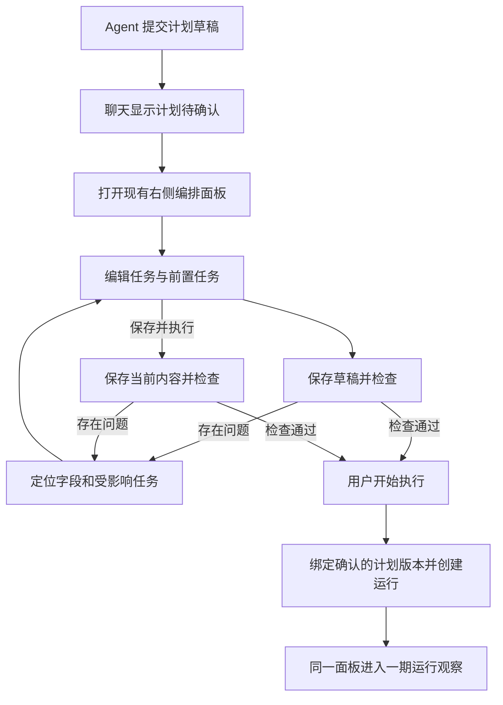

# 桌面编排二期：执行前计划编辑交互规格

日期：2026-10-18。范围已由用户确认；本文用于审阅交互与实现约束，应用功能尚未实现。

## 1. 目标和范围

用户能在现有右侧编排工具面板中，检查 Agent 提出的计划、修改任务与依赖、保存草稿，并明确确认执行。执行后接入一期运行观察，不另开页面。

本期交付：Agent 提交待确认计划、任务编辑、依赖预览、问题定位、草稿保存恢复、确认启动，以及聊天摘要和运行记录的衔接。

运行中的计划修改、暂停、失败续跑、从历史运行复制计划、画布拖线和完整配置源码编辑不在本期范围内。

遵循 `apps/desktop/DESIGN.md`、现有工具面板的会话归属和标签行为。优先直接复用已接入组件；需要补充组件时先检查 beUI 官方源代码和依赖。

## 2. 用户应当始终能回答的问题

1. 现在编辑的是哪个计划，准备做什么？
2. 当前内容是否保存，还有哪些地方需要修改？
3. 点击执行后，使用的是不是刚刚看到的内容？

计划草稿与运行记录是两个对象。草稿中没有正在运行的任务，不展示完成率、运行耗时或等待调度等执行状态。保存草稿不会启动工作。

## 3. 主流程

### 3.1 入口

- Agent 通过结构化能力提交计划草稿，返回稳定的计划标识与所属会话。这个操作不调用执行器。
- 聊天中展示紧凑摘要：`计划待确认 · 3 项任务`，主要操作为「查看计划」。保存和校验反馈更新同一条摘要，不追加重复卡片。
- 点击摘要打开现有 `workflows` 标签并选中对应计划。打开失败时保留聊天入口和读取重试提示。
- 二期通过独立的计划提案入口接入；不依靠从聊天文本中猜测计划，也不把已经提交执行的工具调用拦成草稿。

### 3.2 面板组织

- 继续使用已有工具面板的展开、收起、最大化、来源消息定位和会话范围。
- 顶部选择器把「待确认计划」和「运行记录」分组，明确对象类型。选择项使用用户能理解的名称与次要时间信息。
- 编辑计划时显示「计划 / 任务图」，保持现有 beUI Tabs 的 Icon on selected 模式。
- 「计划」是默认视图，展示任务列表和计划级设置；任务图预览当前正在编辑的内容，不读取旧的已保存副本。
- 计划标题与保存状态位于内容顶部；唯一实心主操作位于稳定的底部操作区。
- 开始执行成功后，当前选择切到对应运行，沿用一期「概览 / 任务图 / 事件」。运行中的内容只读。

## 4. 任务编辑

### 4.1 任务行

直接引用已安装的 Task Rows 组件，通过业务数据与展开内容插槽提供编辑内容，不另写一套近似的任务行。

- 收起：任务名称、前置任务摘要、需要处理的问题。普通草稿使用「待确认」语义，不显示伪造的完成状态。
- 展开：任务名称、执行要求和前置任务三个常用字段。
- 高级设置按需展开：执行 Agent、模型、超时、重试和预计修改范围。权限继续受现有会话及后台规则约束。
- 任务行提供复制、删除操作；列表末尾提供「添加任务」。新任务使用稳定且唯一的内部标识，改名不改变依赖身份，复制生成新的标识。
- 名称和执行要求应当非空，才能从编辑计划启动执行。新任务允许先保存为空的未完成草稿，并显示需补充位置。
- 本期没有展示为编辑字段的既有配置应完整保留，保存时不能静默丢弃 Agent 提供的设置。

### 4.2 顺序与依赖

计划级执行方式使用明确中文标签：按顺序执行、按依赖执行；现有流水线模式作为高级选项保留原有语义。

- 按顺序执行：通过上移、下移调整任务顺序，预览同步显示实际执行链。首版排序提供键盘可操作的按钮，不要求拖动。
- 按依赖执行：通过「前置任务」多选修改依赖。列表中的位置不代表某任务一定先执行。
- 前置选项排除任务自身；可以提前判断的循环选项禁用并说明原因。后台仍检查全部依赖。
- 顺序和流水线模式的实际依赖必须包含后台自动添加的顺序关系；不能只画用户显式选择的连线。
- 草稿保留用户填写的原始关系，自动生成的顺序关系只进入派生预览。切换模式不会把上一个模式的自动关系误存为手工依赖。
- 切换执行方式时说明顺序和依赖变化；如果产生循环或冲突，定位问题后再允许执行。

### 4.3 删除任务

- 没有下游依赖的任务可直接移除，并提供撤销反馈。
- 存在下游依赖时，先列出受影响任务再确认删除。
- 被删除任务作为显式前置任务时，受影响任务保留「前置任务已删除」问题，用户明确移除或替换该前置关系后才能执行。
- 顺序和流水线模式删除中间步骤时，确认内容说明余下步骤将按新顺序串联，预览同步反映这条执行链；仍有缺失的显式前置关系时继续阻止执行。
- 不自动级联删除下游；按依赖执行时不自动重接连线或把受影响任务悄悄变为独立任务。

### 4.4 计划级设置

常用设置包括执行方式及同时执行数量；顺序和流水线模式明确显示实际同时执行数量为 1。失败处理策略等低频设置按需展开。

「预计修改范围」描述计划和调度意图，不承诺它本身完成文件访问的权限隔离。

## 5. 保存、检查与执行的状态

保存状态、检查结果和执行状态分别记录和展示，不合并为一个含义模糊的成功标记。

| 状态 | 用户能看到的反馈 | 可用操作 |
| --- | --- | --- |
| 正在读取 | 与任务列表密度相符的加载反馈 | 返回聊天 |
| 已读取、未修改 | 已保存；显示当前内容的检查结果 | 编辑、开始执行 |
| 已修改 | 有未保存修改；旧检查结果不再视为当前结果 | 放弃修改、保存草稿、保存并执行 |
| 存在明确错误 | 字段错误、任务行问题、底部问题数量 | 定位问题、继续编辑、保存草稿 |
| 正在保存或检查 | 对应操作显示进行中 | 保留内容，阻止重复提交 |
| 已保存但有错误 | 草稿已保存，还有若干项需修改 | 定位并修正、继续保存 |
| 正在启动 | 正在启动；暂不接受修改与再次启动 | 等待结果或查询启动状态 |
| 启动结果待确认 | 正在确认是否已启动 | 查询同一次请求，不另建运行 |
| 已启动 | 显示关联运行的真实状态 | 打开一期运行观察 |

补充规则：

- 「放弃修改」恢复最近保存的内容，不删除计划，也不取消运行。
- 允许保存不完整草稿；只有内容有效、依赖有效且后台检查通过，才允许启动。
- 未修改且当前保存版本检查通过时，主要按钮为「开始执行」。
- 有修改且本地未发现明确错误时，主要按钮为「保存并执行」；它保存当前内容，再由后台检查并启动，任一步失败都不启动任务。
- 有明确错误时执行按钮禁用，旁边说明原因，并保留可点击的问题定位入口。不能仅以灰色按钮表达原因。
- 警告与错误分开。预计修改范围重叠提示「这些任务会依次执行」，不把现有后台支持的串行调度误报为阻止执行的错误。
- 检查通过只说明计划结构与配置有效，不等于任务结果一定正确。

## 6. 问题展示与定位

- 字段问题显示在字段附近，并提供可被辅助技术识别的错误关联。
- 任务行标明需要修改，保持任务名称可辨识。
- 底部汇总问题数量，按项列出可理解的问题描述；点击后切回「计划」、展开对应任务并聚焦字段。
- 从任务图点击问题节点，可以定位同一任务的编辑内容，返回后保留图的缩放和观察位置。
- 重复标识、缺失前置任务、循环关系、无效执行参数等由后台返回结构化问题位置。界面不依靠解析英文异常字符串定位字段。
- 不可定位到单个字段的问题在计划级展示，保留输入，不清空或重建整份计划。

## 7. 草稿恢复与并发修改

- 已保存计划由后台持久化，并绑定项目与所属会话；应用重启后可以重新读取。
- 未保存编辑属于当前计划的临时内容，按会话及计划标识分别保存于界面状态，不与运行观察的事件刷新混在一起。
- 收起、展开、最大化及关闭工具标签不清空当前会话的临时编辑。
- 切换计划或会话时存在未保存内容，提供保存、放弃、继续编辑的保护操作；保存失败不完成该次切换。
- 启动过程不能因面板收起或标签关闭而重复提交或失去查询关联。
- 切换会话后忽略旧读取、保存或启动请求的界面返回，后台结果仍属于原会话。
- 首版不提供 Agent 对用户当前草稿的自动改写。再次要求 Agent 调整时生成独立候选草稿，原稿保留，用户主动打开新建议。
- 同一草稿被其他窗口修改时，保存或启动返回版本冲突，保留本地输入，展示重新读取入口；不能自动覆盖另一版内容。

## 8. 确认执行的约束

「保存并执行」与「开始执行」都必须满足以下条件：

1. 后台确认计划和请求属于当前授权会话，沿用现有任务执行权限检查。
2. 确认请求绑定明确的保存版本；版本变化时停止该次启动并提示查看新内容，不能改为执行最新版。
3. 后台对该版本重新检查，执行使用的计划与任务图预览所表达的规范化关系一致。
4. 同一次用户确认在后台只关联一个运行；重复点击、请求重试及响应丢失后查询，都返回该次确认关联的运行。
5. 请求失败明确发生在创建运行之前时，允许修改后重新确认；结果不确定时先查询原请求，不立即提供会创建新运行的重试。
6. 创建成功后保存计划版本与运行标识的关联，运行观察读取后台真实状态。

这需要后台提供结构化的计划提交、读取、保存、检查和启动能力。当前 `Workflow.validate` 可复用领域校验逻辑；当前 `Workflow.run` 会直接执行，不承担草稿保存或待确认状态。Renderer 不直接导入服务端调度器，也不把完整计划重新交给模型转写后当成已确认内容。

## 9. 设计与组件约束

| 区域 | 复用方式 |
| --- | --- |
| 外层工具面板 | 现有 utility panel、标签状态和会话控制 |
| 任务列表与编辑展开 | 已安装的 Task Rows，使用数据和内容插槽 |
| 计划和任务图切换 | 已接入的 beUI Tabs，Icon on selected |
| 前置任务多选 | 优先采用 beUI Multi Select；适配现有路径别名、主题、键盘和焦点行为 |
| 输入与普通操作 | 现有 Input、Textarea、Select、Button |
| 高级配置 | 现有 AgentDisclosure 和字段布局 |
| 需要确认的删除与未保存保护 | 现有 AlertDialog，避免另建弹窗样式 |
| 保存、撤销和错误反馈 | 现有 toast、字段错误与计划级问题区域 |

- 不增加独立全屏编辑器，不在右侧工具面板中再嵌套侧抽屉。
- 工具栏沿用 56px；底部操作区保持稳定，内容区独立滚动，不压住最后一个字段。
- 主要信息靠字号、留白和对齐形成层级，不为每个设置再套卡片。
- 只有执行使用实心主要按钮；保存、展开、查看和其他低风险操作使用现有次要或 ghost 样式。
- 窄面板下字段纵向排列，按钮允许有序换行；最大化不改变编辑内容与字段含义。
- 任务图不因表单焦点变化反复跳位；切换标签立即移除未激活面板的占位。
- 保留键盘操作、错误定位后的焦点、减少动态效果支持和主题语义颜色。

已核对 beUI 官方目录和 Multi Select 文档。Multi Select 支持搜索、多选值展示与移除，已有外部依赖均为项目在用的基础库；接入前仍需检查完整源码与浮层焦点行为。

参考：

- https://beui.dev/components/motion/multi-select
- https://beui.dev/docs/ai-agents

## 10. 实施顺序与验收

交互规格审阅后，再编写逐文件的开发计划。建议按以下交付顺序实施：

1. **草稿保存与检查**：后台保存草稿及版本，绑定会话；读取、保存和检查均不创建运行。
2. **聊天与面板编辑**：Agent 提案形成稳定摘要；在现有面板编辑任务、保存并定位问题，恢复已保存草稿。
3. **确认启动闭环**：按确认版本启动，重复请求关联同一运行；成功后衔接一期观察，失败时保留草稿和问题。
4. **异常与无障碍检查**：版本冲突、失联查询、跨会话异步返回、删除依赖、键盘、减少动态效果及 Tabs 占位。

必须覆盖的验收场景：

- Agent 生成计划后没有工作任务被启动。
- 添加或修改任务后，任务图和问题定位基于同一份当前内容。
- 改名不破坏依赖；复制任务不产生重复标识。
- 删除显式上游任务后明确定位受影响任务，修正关系之前不能执行；删除顺序链中的中间步骤则确认并预览新执行链。
- 顺序、流水线和按依赖模式的预览符合后台实际关系。
- 保存有错误的草稿后可以恢复，但不能执行；修正后能重新检查。
- 「保存并执行」不使用旧内容，版本冲突不启动其他版本。
- 启动时重复点击或响应丢失不会创建第二个运行。
- 收起面板、切换标签不丢失编辑；跨会话返回不覆盖当前界面。
- 执行成功后可从聊天和右侧面板打开同一运行及其来源计划版本。

只进行与改动范围匹配的行为测试、类型检查和边界检查；样式由用户在实际应用中查看并反馈，不主动搭建预览、截图或进行视觉验证。
