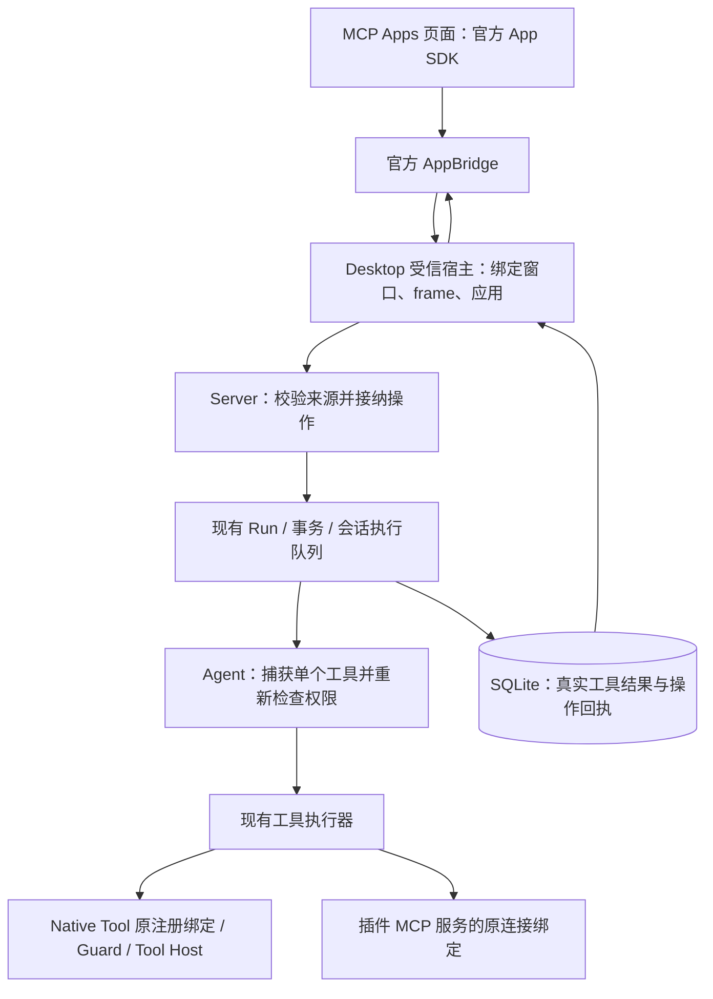

# 统一 MCP Apps 与会话常驻面板设计

> 状态：当前实施方案；按阶段交付，未完成阶段不代表现有客户端能力。
> 日期：2026-10-20。调研基线：OpenHarness-ts `af717317`；参考 ZCode `0ae51b1c`。
> 本次修订：MCP Apps 是最终唯一的插件页面协议；Native UI 仅在有明确结束条件的迁移期存在。补齐去重键、控制版本、页面结果更新、app-only 权限和 unknown 后续操作限制。

## 1. 目标与边界

插件可以作为“聊天旁边持续使用的小应用”：用户直接打开面板，编辑、保存、引用选区，再让助手围绕同一份文档继续工作。

页面统一使用官方 App SDK 和 AppBridge。Native Tool 保留原有业务实现和进程隔离，由宿主适配成页面可调用的 MCP 工具表面；插件已有的 MCP 服务也能接入同一个页面宿主。两类后台共用参数校验、权限、Hook、执行队列、事务和操作回执。

| 内容 | 最终处理 |
| --- | --- |
| Native Tool 的注册、进程、业务实现、dataDir | 保留，页面调用通过受控适配接入 |
| 插件安装摘要、批准、精确工具绑定、取消、Run/Part 回执 | 保留并抽取为统一应用执行流程 |
| VykorPluginUi、私有 UI MessagePort 方法、UI manifest v2 | 迁移后移除活动支持 |
| 现有页面、text-inspector 样例、create-plugin 模板 | 改用 MCP Apps 和新的应用定义 |
| 历史工具结果、uiAction、提交回执、原 ID 和指纹 | 保留，只读查询，不重新激活旧页面 |

方案修订已完成，当前已获用户授权实施全部阶段，优先编码、按阶段集中测试。不直接改写用户已安装的快照或实际数据库；迁移通过代码和临时数据库验证，不自动提交、合并或发布。实施基线为 `f761572f`，顺序与进度见配套计划。

首批覆盖本地 Desktop、本地执行环境、已安装并批准的插件。远程、WSL、Web/手机、独立非插件 MCP 服务、原生设备权限、外部网络资源、sampling、页面注册模型工具、Gen UI、自动保存授权和市场建设不在首批范围。

## 2. 当前机制如何改造

| 当前限制 | 需要的改造 |
| --- | --- |
| `packages/mcp/src/index.ts` 丢弃部分工具元数据并把结果合成文字 | 保存原始 MCP 结构，模型反馈与页面数据分别生成 |
| `session-plugin-ui-service.ts` 的实例必须来自成功工具 Part | 新增持久应用身份，允许从会话菜单直接打开 |
| `agent.ts:runTool()` 只认可已声明的 Native UI 动作 | 抽取精确工具执行部分，新建统一应用入口；最终删除对旧 UI manifest 的依赖 |
| `session-plugin-ui-action-executor.ts` 已有独立工具 Run 与可靠结算 | 复用执行与回执规则，不为适配工具另起一次 Run |
| 原 submit 把 UI 设为 resolved | 新应用多次发送普通输入，发送后仍保持打开 |
| Provider 和 Main 绑定当前会话，切会话会清理 | 页面归窗口管理，始终绑定原会话的有效凭证 |
| Native UI 的定义、SDK、安装模板分布在多个包 | 先迁移实际使用方，再整体删除旧活动入口和生成产物 |

迁移期间旧入口只维持已有行为，不添加常驻、订阅等新能力。最终架构不存在两套页面协议、两套可执行来源处理器或两条长期维护的 UI 调用链。

## 3. 目标运行流程与状态归属



宿主后台适配有两种实现：`native-tools` 与 `mcp-server`。这是内部工具与资源接口，不是第二个浏览器 SDK。Native 适配不监听端口、不额外启动 MCP 服务、不把 Native Tool 再包成一个会被二次授权的代理工具。

| 状态 | 唯一写入方 | 生命周期 |
| --- | --- | --- |
| 安装、批准、插件代码摘要 | 现有插件安装服务 | 持久 |
| 应用 ID、来源、状态、controlRevision、活动操作指针 | Server 应用仓库 | 持久，不保存业务文档正文 |
| 工具接纳、调用前事实、真实结果和回执 | 现有 Run/Part/transaction | 持久 |
| 精确 Native Tool / MCP 连接绑定和运行凭证 | Agent 应用绑定表 | 当前运行时 |
| 实际窗口、frame、MessagePort、挂载身份 | Electron Main | 当前窗口 |
| 活页面、可见性、标签、少量 widgetState | 窗口页面管理器 | 内存 |
| 草稿、光标、撤销历史 | 插件页面 | 活页面内存 |
| 文档正文、业务 revision、operationId 去重 | Native Tool 或 MCP 服务自己的 dataDir | 插件负责持久化 |
| 旧 Native UI 历史 | 原 Part/Input/Run，历史读取器只读 | 保留原 ID，不转换成新应用 |

## 4. 唯一应用定义与两类后台

新增 `components.apps`。最终所有可运行页面都由它声明，旧 `components.ui` 不再生成页面或调用权限。

Native Tool 插件的根清单示例：

```json
{
  "schemaVersion": 1,
  "id": "example.text-inspector",
  "name": "text-inspector",
  "version": "2.0.0",
  "components": {
    "tools": [{ "entry": "./tools/index.mjs", "runtime": "node" }],
    "apps": ["./ui/apps.json"]
  }
}
```

`ui/apps.json`：

```json
{
  "schemaVersion": 1,
  "backends": [{
    "id": "inspector",
    "kind": "native-tools",
    "resources": [{
      "uri": "ui://text-inspector/panel.html",
      "entry": "./ui/panel.html"
    }],
    "tools": [{
      "tool": "TextInspectorCheck",
      "visibility": ["model", "app"],
      "ui": { "resourceUri": "ui://text-inspector/panel.html" }
    }, {
      "tool": "TextInspectorPreview",
      "visibility": ["model", "app"]
    }]
  }],
  "surfaces": [{
    "id": "inspector",
    "title": "文本格式检查",
    "backend": "inspector",
    "resourceUri": "ui://text-inspector/panel.html",
    "availability": "session"
  }]
}
```

实际 MCP 服务的后台定义示例（放进同一个 backends 数组，surface 按 ID 引用）：

```json
{ "id": "notes", "kind": "mcp-server", "server": "notes" }
```

- Native 后台的 `tool` 精确匹配同插件实际注册名；页面用相同名称调用，没有别名或参数转换。description/inputSchema 来自实际定义，不在应用文件复制。
- Native 的静态资源按 URI 精确映射到插件快照内文件。沿用路径、symlink/junction、文件大小和字节摘要检查，不能读任意文件或列出插件未声明的目录。
- MCP 后台的 `server` 必须是同插件 mcpServers 的声明键；不能调用其他插件或宿主全局服务。
- 每个 surface 固定一个后台。首批不支持一个页面同时获得多个后台的权限。
- Native Tool 未列入应用映射时，保留原模型调用能力，页面不可调用。映射为 app-only 时，模型目录、搜索、代理入口均须隐藏；同一 Native Tool 被多个后台声明为不同可见性时，拒绝冲突定义，不做权限并集。
- 安装批准沿用 `ui:render`、`ui:invoke-own-tools`，并保留实际工具的文件、网络、进程等权限要求；新增应用入口不自动获得旧安装未批准的权限。

`components.apps`、backends/surfaces 是 Vykor 的插件包装定义；页面通信、工具 UI 元数据、资源 MIME 使用 MCP Apps。官方页面不需要导入 Vykor 私有 SDK。

普通工具结果默认按工具调用隔离。只有同插件、同后台、同资源且唯一对应声明的 surface 时才复用面板；不能只因为 URI 字符串相同就合并不同来源。页面必须支持 fullscreen 才能作为侧栏面板；inline-only 保持内联，pip 首批不支持。用户显式打开另一个成功 Part 时，按宿主 sourcePartId 去重并顺序投递该 Part 的输入和结果；重复点击同一 Part 不重复通知，仍保持原 frame 和握手，也不执行工具。

## 5. Native Tool 如何适配

### 5.1 调用链

```text
app.callServerTool({ name: "TextInspectorPreview", arguments })
→ AppBridge → 原应用后台与精确映射
→ 宿主确认 + Server 接纳并保存一个 Run
→ Agent.runPluginAppTool()
→ 原 TextInspectorPreview 注册绑定的 checked execution
→ 原 NativeToolCallGuard → 原 NativeToolHost.call()
→ 保存原 ToolResult 与执行状态
→ 将终态结果转换为 MCP CallToolResult，返回原页面
```

适配层不能直接 import 工具模块执行 `invoke()`，不能绕过 Guard 直接调用 Tool Host，也不能伪造另一个 MCP 工具后重复执行原工具。保留原 cwd、plugin.root/dataDir、sessionId/runId、deadline、AbortSignal、参数校验、网络限制、并发/超时/输出限制和审计归属。

打开应用不把插件注入当前模型 Run。Agent 从应用的已批准绑定和受限目录中生成单工具能力快照；页面没有全 registry、内置工具、其他插件工具或 `readToolResult` 的额外读取权。依赖本轮结果的 Native Tool 仍遵守现有范围，不因页面常驻获得跨 Run 历史读取权。

私有 app-only 目录只改变工具向谁显示，不能放宽工具执行范围。生成能力快照及实际调用前，复用 `RuntimeToolRegistry.isVisible()` 的宿主工具上限、当前角色 allowedTools、deny、supportedEnvironments 和 networkMode 判定；将该策略判断与模型目录的 visibility 过滤分开复用。不能因为模型目录已隐藏 app-only 就判定页面不可调用，也不能直接从内部 registry 取 binding 而跳过上述策略。该规则同时适用于 Native 和 MCP 后台，原 PermissionChecker、Guard 与 Hook 继续执行。

最终 `runPluginAppTool()` 按后台种类选择一个受信实际 binding，共用原工具执行器。旧 `runTool()` 的 Native UI 入口在迁移完成后删除；其内部校验与执行能力先迁入新流程，不能随入口一起丢弃。

### 5.2 结果与资源

Native Tool 继续返回现有 ToolResult。新增约定 `metadata.appData` 为页面使用的有限 JSON 对象；不把任意 metadata 全量交给页面，也不从 text 中猜测或解析 JSON 充当结构化数据。

| Native 结果 | MCP 页面结果 | 可信程度 |
| --- | --- | --- |
| `content` 中 text | `content` 中 text | 普通工具数据 |
| 有效 `metadata.appData` | `structuredContent` | 普通页面数据，不授予权限 |
| `isError` | `isError` | 真实业务结果 |
| executionState、failureKind、审计、宿主回执 | 留在原执行记录与宿主流程 | 不由插件 metadata 覆盖 |

首批 Native 适配的页面结果支持文本和结构化 JSON；其他内容块返回明确的页面能力错误，保留已执行工具的原始结果和回执，不将其解释为“工具未执行”。图片转换需要现有受权媒体机制，不根据页面给定路径直接读取。

`metadata.appData` 无效或超限不改写工具本身的成功结果：宿主显示页面数据错误，文字结果仍可读。`metadata.ui` 在切换后仅作为无效旧建议忽略，不能创建实例。

页面主动调用时，从 `const result = await app.callServerTool(...)` 的返回值读取 structuredContent/isError 并更新页面；`ontoolresult` 只消费宿主主动发送的初始结果或模型工具结果通知，不能假定主动调用会自动触发该通知。两条路径共用同一结果校验与显示函数。宿主不把同一次页面调用的返回结果再作为通知推送，不为补刷新重复执行工具；通知处理不得再次调用工具或触发保存。

Native 后台提供声明资源的 read/list，模板列表为空；读取静态 HTML 不执行工具。资源订阅只在后台确有更新源时宣告，不用虚假成功模拟 MCP 服务通知。实际 MCP 后台透传并校验原资源、工具结果和通知。

## 6. 数据、身份与权限

### 6.1 完整结果和隐私

真实 MCP 结果通过 `ToolResult.mcpResult` 完整经过 MCP client、checked execution、tool.completed、Part.output、SQLite 和宿主授权读取；模型文字优先使用原 text，无 text 时才用 structuredContent 的 JSON 兜底。

Native 操作保留原 ToolResult，页面结果由宿主在结算后派生；不要存第二份 Native 结果档案。两类后台的 `_meta`/appData 不能直接进入普通摘要、日志、模型历史、压缩或跨插件工具结果导入。原始数据不构成来源或权限证明；新增宿主身份/操作字段加入保留字段清单。

最终统一限额：HTML 16 MiB、资源总解码量 8 MiB、MCP 原始结果 1 MiB、页面结构化 appData 256 KiB、操作 args 64 KiB；已有 Native Tool 更严格的限额继续生效。错误必须明确，不静默截断后声称完整。

阶段 1 核对发现 ext-apps 2.0.0 要求 MCP 2 和 Zod 4，因此按备选版本规则精确锁定官方 ext-apps 1.1.2，保留现有 MCP SDK 1.29.0 和 Zod 3.25.76。已通过 Electron 39.8.10 的离线隔离 iframe 握手、完整初始结果、取消与沙箱验证。类型边界使用官方 MCP CallToolResultSchema 校验有限 JSON，不使用 any 掩盖差异；具体证据与后续阶段进度见配套计划。

### 6.2 统一应用身份

新增 `session_plugin_app`，接入 SessionStore 的事务、增量持久化、回滚、会话删除与临时数据清理。字段包括 appId/sessionId/pluginId/version/pluginDigest/definitionDigest/backendId/backendKind/resourceUri/origin/logicalKey/status/controlRevision/活动和最近操作指针/时间戳。

最终所有活应用都引用 `PluginAppSource { sessionId, appId }`；Native Tool 和 MCP 服务不产生两类 UI 实例。来源 origin 可以是直接会话入口，或已验证的成功 Native/MCP 工具结果。历史旧实例不导入此表。

同逻辑入口重复打开复用 appId；插件版本变化先撤旧凭证，新打开重新检查。Agent 凭证绑定运行时、插件摘要、后台身份、backendGeneration 和随机 token；Native Tool Host 重启与 MCP 连接替换都使旧后台代次失效。Main 再绑定真实窗口/frame。HTML 摘要只证明当前读取内容；MCP 动态 HTML 不能当安装摘要。

### 6.3 权限与回执

执行权限取有效安装与批准、合法应用、固定后台、明确工具映射、app 可见性、环境/deny 规则与原工具策略的交集。readOnlyHint、app-only 均不是用户授权。

原工具策略明确包括宿主工具上限和当前角色 allowedTools；安装批准与宿主确认不能覆盖 deny、环境限制或工具范围。私有 app-only 目录仍经过第 5.1 节的同一策略判断，不能只复用 PermissionChecker 而遗漏 registry 层的限制。

两类后台都继续通过 `SessionOperationRunner` 接纳、SQLite 事务创建 pending Run、`enqueueHostWork` 调度，工具执行前再次校验。首批与同会话其他执行互斥；busy 时保留草稿，不新建并行执行队列。保留现有 UI 调用确认，自动保存授权另行设计。

JSON-RPC ID 关联页面请求；requestId 由受信宿主生成。工具操作的唯一键为 `(sessionId, appId, requestId)`，确定性 Run ID 只由此三元组生成，指纹绝不参与 Run ID。指纹保存在操作记录中，用于比较固定的应用来源及插件/定义摘要、后台身份、工具名、有限 JSON 参数和 expectedRevision；不含会变化的 lease token。

统一工具请求接口如下；PluginAppSource 和 PluginAppRuntimeLease 分别是第 6.2 节的持久来源与运行凭证，详细字段见配套计划。页面只提交标准工具名和参数，其余字段均由受信宿主补齐，不新增页面私有参数。

```ts
interface PluginAppInvokeInput {
  requestId: string;
  expectedRevision: number; // 应用 controlRevision，非业务文档版本
  toolName: string;
  args: Record<string, unknown>;
}
interface PluginAppToolRequest extends PluginAppInvokeInput {
  source: PluginAppSource;
  lease: PluginAppRuntimeLease;
}
```

宿主在展示确认前拥有参数的独立副本，固定 requestId、expectedRevision、来源及后台身份。确认后的 HTTP/Client 接纳必须携带同一个 PluginAppToolRequest，不能重新读取最新 controlRevision 替换 expectedRevision。传输重试保留原 requestId、参数、expectedRevision 和指纹；页面重载后的新 RPC ID 不能声称自动去重。

已认证宿主先按原会话读取权定位唯一键：已有操作同指纹返回原回执，异指纹报 409，不能更新原记录或新建 Run。只有不存在的操作才检查当前 lease、安装批准、工具策略、open 状态、unknown 限制、busy 和 expectedRevision，再在同一事务中创建 pending Run、保存固定请求和设置活动指针。数据库唯一约束与 SessionOperationRunner 共同保证并行重试只有一条操作。回执查询先于新操作校验，不意味着向失效 frame 交付结果；Main 仍校验结果接收方。

若新请求在接纳前被明确拒绝，Server 只有在原会话的串行范围内查证工具 Run 不存在，或消息 Input 及关联 Run 均不存在后，才返回 HTTP 409 的 PluginAppAdmissionRejection：code 为 plugin_app_not_accepted，附 kind、source、requestId 和 expectedRevision。Main 仅接受原受信 Client 返回且全部字段匹配的证明，释放该本地 pending，让用户重新显式操作；不更换或重放原请求。普通 404、网络失败和未确认结果不能作为未接纳证明，已有 unknown 限制也不会因此解除。

controlRevision 使用以下规则，宿主通过现有 snapshot/SSE 接收最新值；页面不管理此版本：

| 事件 | 版本和持久状态变化 |
| --- | --- |
| 首次创建应用 | controlRevision 为 0，无活动操作 |
| 接纳新工具操作 | 要求 expectedRevision 等于当前值 r；同事务保存 Run 和固定请求，设置 activeActionRunId，版本变为 r + 1，并记录此次接纳版本 |
| 实际调用前 | 再校验原精确 binding、权限、lease、open 状态、活动 Run 所有权和接纳版本；失配不能开始外部调用 |
| 首次结算该操作 | 同事务保存真实结果/执行状态、清除属于该 Run 的活动指针、设置 lastActionRunId，当前版本加 1；保留已经 closed/revoked 的状态 |
| 首次关闭、撤销，或 closed 应用显式重开 | 每次真实状态变化将当前版本加 1；保留 lastActionRunId，重开不清除 unknown；revoked 的旧定义不能重开 |
| 同请求重试、重复结算、读取/prepare、重复打开已 open 应用、可见性/主题/业务文档变化 | 不递增，不重复设置指针或执行工具；仅运行凭证变化由独立的 lease/backendGeneration 管理 |

关闭/撤销可能发生在接纳和结算之间，所以结算必须对最新记录递增，不能强写 expectedRevision + 2 或重新设为 open。并行确认使用旧 expectedRevision 时返回版本冲突，由宿主重新读取并重新确认；不能默默换版本继续执行。

普通后台重载、功能开关和暂时不可用只撤销运行凭证、处理在途工作，保留 appId、持久状态与 lastActionRunId；单独的运行代次变化不增加 controlRevision。只有已确认的插件版本、整体摘要或对应后台定义变化才永久撤销旧定义，不能把普通重载变成无法恢复的 revoked 记录。

调用前失败为 not_started；已开始但结果未确认保留 unknown；取消不等于回滚，禁止自动重放。Native Tool Host 成功收到 invoke 返回时，由宿主将执行事实归一为 completed，业务 isError 不变；插件顶层 executionState 不能声称调用未发生。调用前的宿主拒绝仍为 not_started，传输拒绝、断连、取消或超时仍沿原执行链保留 unknown。AppBridge 等终态再返回真实 MCP 结果，pending receipt 仅供宿主使用。关闭、插件撤销后仍可按用户对原会话的读取权查询已接受回执。

回执查询除 Run status 外，必须返回持久的 executionState 和已保存的原工具结果（如存在），供受权宿主判断；页面仅接收派生的标准 MCP 结果，不能用插件 metadata 覆盖宿主执行事实。failed/interrupted 不代表 not_started。lastActionRunId 指向 unknown 或其执行事实缺失/无法验证时，沿用现有保护，拒绝该应用的新工具操作及 ui/message，显示“上次操作结果尚未确认，请先检查实际状态”；原回执和资源的受权只读查询仍可使用。

更换 requestId、关闭重开、重载、重连或进程重启都不能清除该限制；恢复时先恢复持久执行事实，再开放新操作。只有原操作获得可验证并已持久化的确定执行结果后才解除。首批不新增用户手动标成功、插件自报成功或清空 lastActionRunId 的入口；无法确认时保留 unknown 并提示核实，不能用重试代替核实。

## 7. 聊天协作与常驻行为

- `ui/message` 复用普通输入接纳和宿主确认；每次提交在普通 Input/Run 中原子保存来源与指纹，多次发送不会关闭应用。
- `ui/update-model-context` 显示为可删的原会话插件上下文条目，不覆盖用户草稿、不立即发消息、不创建 Run。发送时 Server 再验证来源；隐藏会话不能投递到当前会话。
- 原“加入输入框”迁为可见上下文条目，原“交给助手”迁为 ui/message。迁移不增加私有 draft/submit 别名；旧一次性交互结束语义不强行保留。
- 消息说明最多 4096 个 Unicode 字符、结构数据 32 KiB。能力只在实际装配后声明。

窗口级 PluginAppPageManager 放在 Desktop root，持有固定容器中的 frame；侧栏/内联位置只是展示锚点。切会话、切标签、收面板保留同一 frame、AppBridge、输入与已接纳操作。Main 使用原会话 lease，不能把目标替换成 activeSessionId。

| 事件 | 行为 |
| --- | --- |
| 隐藏/切会话 | 保活；拒绝新用户操作和对话，已接纳工作继续结算 |
| 明确关闭应用 | 暂停新准入、取消待确认，固定版本的持久关闭成功后才撤挂载、请求取消在途工作并释放页面；版本冲突保留 frame 和草稿，刷新后由用户明确重试 |
| 插件撤销/更新、会话归档/删除 | 先关闭准入、撤凭证、取消/结算，再释放页面 |
| 后台失联/Host 重启/连接替换 | 可保留可见草稿，断桥禁用操作；查询旧回执，明确重连后签新凭证 |
| 窗口/应用重启 | 不恢复活页面或重放动作；显示入口，由用户重新打开插件持久文档 |

最终配额为每窗口 8 个活页面、每会话 4 个；触顶拒绝新建，不淘汰编辑器。迁移期旧页面的原两帧限制只随旧宿主存在，阶段 5 一并移除，不是最终双配额设计。

widgetState 是 32 KiB 的自愿视图快照，窗口内存保存、关闭清理，不替代文档保存。它不是 MCP Apps 标准方法：若装配，以 `experimental["vykor/widgetState"]` 明确协商，通过官方 App.request 发送 `ui/set-widget-state`，初值置于 hostContext 的同名扩展键；不提供私有 SDK 别名、不另建连接。未装配时不宣告该扩展。 当前固定的官方 ext-apps 1.1.2 会在能力解析时丢弃 experimental 内的扩展名，无法可靠完成上述协商，因此本阶段不装配 widgetState；不注册方法、不宣告支持，也不修改 SDK 私有实现。常驻 frame 继续保存窗口内的页面草稿。

页面无 Node/preload/父 DOM/任意文件/外部网络/子 frame/设备权限；复用现有文档协议、frame 校验、CSP 隔离并迁到统一宿主。字体可随包内联；首批不开放稳定浏览器存储身份。

## 8. 资源更新与共同编辑

阶段 4 增加真实 MCP 资源订阅，绑定 appId/lease/backendGeneration/URI，合并重复订阅、撤销迟到成功和旧代次通知。Native 静态资源后台不具备订阅源时不声明该能力。

当前官方 SDK 1.1.2 不提供页面资源订阅方法；宿主对已鉴权读取的 URI 管理真实后台订阅，通过标准 ResourceListChanged 通知页面重新读取。后台明确拒绝单 URI 订阅时只隔离该项，不能取消其他页面的正常订阅；读取、lease、鉴权和传输错误仍按原规则拒绝或恢复。

窗口共享一条经过鉴权的应用通知流；通知只表示资源可能更新，不携带文档正文，不进入聊天持久重放。断线恢复发送 resync，页面重新读取；Run 和应用状态仍走现有持久 snapshot/SSE。通知流不管理操作终态或另建执行队列。

笔记参考应用用插件 dataDir 保存正文，写入携带业务 expectedRevision/operationId；与宿主 controlRevision 分开。冲突保留草稿并提供重载或另存选择。先手动保存，服务端确认后才显示“已保存”。样例在 dataDir 内按宿主原会话哈希分目录，同一会话的页面和模型共用文档；不同会话默认独立。较旧保存回执不能降低已观察的最高业务版本，也不能清除较新资源版本的冲突提示。

## 9. Native UI 迁移步骤

### 9.1 迁移范围

当前已核对的直接使用方包括 `examples/plugins/text-inspector/`、`skills/create-plugin/assets/text-inspector/`、Skill 指南、包的 ui-sdk/ui-styles 导出和相关 Electron/单测夹具。实施切换前再次按旧导出和方法名扫描整个受控源码，补齐其他实际引用，不能只迁示例源码而漏掉生成 HTML 或分发包。

### 9.2 页面、声明和结果映射

| 旧接口/文件 | 迁移后 |
| --- | --- |
| `components.ui`、`ui/manifest.json` v2 | `components.apps`、`ui/apps.json`，显式后台、资源和工具映射 |
| `VykorPluginUi/createPluginUiClient` | 官方 App，先注册事件再 connect |
| getSnapshot/onSnapshot 的业务 data | 初始/模型结果经 ontoolresult，页面主动调用经 await callServerTool 返回值；共用显示函数，主动打开显示空表单并调用已映射读取工具 |
| appearance/applyPluginUiAppearance | hostContext、host-context-changed 与官方样式变量 |
| requestAction | callServerTool，返回真实结果；宿主保留操作记录 |
| requestConversation draft/submit | updateModelContext / sendMessage，保持用户可见和确认规则 |
| resize | 官方尺寸通知；宿主按实际模式处理 |
| dismiss/completion:resolve | 宿主关闭标签或插件业务自己的完成状态；不把发消息当关闭应用 |
| metadata.ui 的组件建议 | 工具声明的 ui.resourceUri + 明确 metadata.appData；旧建议不自动转换 |
| 自有 sdk.js、IIFE 导出脚本 | 官方 SDK 模块构建入单文件 HTML；模板携带 package.json/锁定依赖与已验证构建产物，安装后离线运行 |

text-inspector 的检查/修复算法、注册名、参数和 Native Tool SDK 不改写成 MCP 服务。两个工具把页面数据从 metadata.ui.data 改为 metadata.appData；页面调用原工具名。保留原文字反馈和大输入下文字可用的边界，结构数据超限明确提示。

迁移两个样例副本、构建脚本、生成 HTML、create-plugin 的 README/SKILL/references 和样例打包测试。保留 Native Tool 作者指南，UI 章节只教官方 SDK 与 Native/MCP 两类后台。版本递增后按现有安装链路重装；不能修改已安装不可变快照。权限未增加时复用已有批准，新增权限仍需确认。

### 9.3 历史和已安装旧包

历史 Part 上的 pluginUi、uiAction、pluginUiSubmission 及 Input/Run 保持可读。单独的 `plugin-ui-history` 模块只解析历史形状、读取结果和回执，不载入 HTML、不签发凭证、不授权调用；历史解析不得被新执行入口当作有效来源。

旧的动作/提交只读 GET 路径保留为历史查询，Client 只暴露明确的历史读取资源；删除原挂载、文档、POST action/dismiss/conversation 和执行型 Client 方法。旧卡片显示文字与“旧交互已停用，请更新插件后重新运行”，不自动绑定新版插件执行。

已安装旧包仍需通过原摘要、身份和 requestedPermissions 校验。保留根清单 `components.ui` 的有限退役识别与历史权限推导，使未篡改的旧包能停用 UI 后继续合法的 Skill/Native Tool；不解析、加载或交付旧 UI 定义/HTML、不生成 UI binding，整体安装摘要仍校验原包所有字节。新安装/重装包含退役入口的包时给出明确迁移错误，不新建旧 UI 安装。该识别只服务诊断和已有安装验证，不是第二种活动 UI schema。

### 9.4 切换与移除顺序

1. 先完成新页面宿主、两类后台、权限与持久回执，在开发范围验证迁移后的 text-inspector。
2. 迁移维护中的所有页面、模板、打包产物和作者指引；新插件不再产生旧协议。
3. 切换前停止旧 UI 新准入，取消待确认请求，等待/中止已接纳操作并结算。not_started 可标中断；已开始而未确认的操作保留 unknown。重启恢复也不重放旧 UI 操作，不把旧 requestId 改投新应用。
4. 撤销旧 mount/port/凭证，将旧卡片改为文字和历史读取；启用 MCP Apps 为唯一入口。
5. 把回执、权限、隔离等仍需能力和安全回归测试迁到统一流程，包括 registry 层的宿主/角色/deny/环境限制和 lastActionUnknown 保护；验证通过后删除旧 SDK/桥、UI v2 加载器、旧执行服务、活动 HTTP/IPC/Client API 和生成配置。
6. 删除只验证旧页面方法的测试，增加旧协议拒绝与历史只读测试；确认权限、参数、取消、并发、未知结果和持久化测试仍覆盖新流程。

## 10. 移除清单与完成标准

| 当前模块 | 最终处理 |
| --- | --- |
| `packages/plugins/src/ui-sdk.ts`、`ui-sdk.test.ts`、`ui-styles.css`、`tsconfig.ui-sdk.json`、对应 package exports | 删除私有 SDK；必要 CSS token 迁到应用样例，不保留旧导出 |
| `packages/plugins/src/components/ui.ts`、`ui-schema.ts` 与 UI 元数据加载绑定 | 安全文件读取能力迁入 apps 资源模块后，删除旧 schema/加载器 |
| protocol 的 plugin-ui-bridge、活动 request/conversation 和 SDK 快照 | 删除；必要历史记录类型/解析迁入 plugin-ui-history，仅只读使用 |
| agent 的 RunPluginUiBinding、pluginUi 能力视图、旧 runTool UI 验证 | 安全约束迁入统一后台精确绑定后删除旧入口 |
| Server 旧 UI 来源/动作/交接/当前状态服务 | 可靠执行与普通输入接纳迁入 plugin-app 流程后删除活动部分；留独立历史读取器 |
| Desktop 旧 plugin-ui Main/Renderer/IPC/preload | frame/CSP/确认能力先迁到统一宿主，再删除旧协议控制器、Provider 和活动 API |
| examples 与 Skill 的 sdk.js、旧 manifest、生成脚本、HTML | 替换成官方 SDK 产物，禁止残留旧 IIFE |
| 旧历史记录、用户插件数据、安装批准 | 保留；不靠删除数据完成清理 |

最终验收必须同时满足：新构建只装配官方 AppBridge；维护中的插件和模板不引用 VykorPluginUi；私有页面方法被拒绝；Native Tool 与 MCP 后台各有真实执行/回执测试；旧回执只读可查；不存在借历史类型重新打开旧页面的路径。旧名只允许出现在历史文档、纯历史解析、退役诊断和拒绝测试中，不能构成活动依赖。不能仅用关闭开关宣称旧机制已移除。

## 11. 分阶段交付

| 阶段 | 交付内容 | 验收门槛 |
| --- | --- | --- |
| 1：协议数据与 SDK | MCP 结构/隐私、工具可见性、官方 SDK 隔离握手 | 结果持久化完整，模型不泄露页面私有数据，SDK 构建通过 |
| 2：两类后台与统一回执 | Native 宿主内适配、MCP 原连接、应用身份、共同授权与操作流程 | 原绑定真实执行、稳定唯一键与控制版本、app-only 策略拒绝、unknown 阻止新操作 |
| 3：常驻宿主与实际页面迁移 | 窗口级页面、官方协议、消息/上下文、迁移 text-inspector 及作者模板 | 两类后台均可经真实 Electron 工作；Native 无额外服务；主动调用和通知各更新一次 |
| 4：协同编辑 | 资源订阅、工具结果复用、笔记样例、业务冲突 | 用户与模型操作同文档，旧通知不串页 |
| 5：切换与物理移除 | 停旧准入、结算、迁移分发产物、删旧活动模块、历史只读 | 最终只有一个页面协议，历史和后台工具能力仍可用 |

依赖为 1 → 2 → 3 → 4 → 5。阶段 3 是可体验版本；阶段 5 完成统一与移除，属于本轮必做范围。sampling、页面工具和更多平台是后续独立扩展，不作为保留旧 UI 的理由。

## 12. 验证、回退与文档边界

行为验收覆盖：直接打开、Native Tool 原绑定执行、MCP 服务原连接执行、参数/权限拒绝、审批后撤销、同 requestId 去重、unknown 不重放、多次发送不关应用、跨会话保留草稿、历史只读、旧包降级和退役权限推导。

本次审查补充的验收必须有下列独立证据，Native/MCP 共用的执行规则均覆盖两个后台：

- 同 `(sessionId, appId, requestId)` 同指纹并行/终态重试只有一条 Run、一次实际调用；不同参数或 expectedRevision 返回 409，查询仍定位原回执。
- 确认前固定 expectedRevision；陈旧确认被拒绝；接纳、结算、关闭/重开按表递增，重复请求不递增，关闭后结算不复活应用；重试不借新版本绕过冲突。
- 页面主动调用不收到结果通知时，仍从 Promise 返回值更新一次；初始/模型通知单独更新一次；两个结果路径均不额外执行工具或保存。
- app-only 已映射且安装已批准，仍分别被宿主工具上限、角色 allowedTools、deny、环境不支持/禁网拒绝；确认期间策略收紧也阻止调用。NativeToolHost.call / MCP client.callTool 次数均为 0；允许场景仍实际执行原绑定一次。
- 工具已产生副作用但回包/保存失败时保留 unknown；新 requestId、新确认、重开、重连及重启仍不能开始该应用的新工具或 ui/message；旧回执可读，实际调用次数保持 1。读取及取消不能把 unknown 改成 not_started 或成功。

阶段 3/4/5 使用真实 Electron 和 Native Tool Host/stdio 服务，不能只依赖 mock。按影响范围运行类型、定向测试和架构检查；不主动搭样式预览或截图，样式由用户查看；新增组件按 DESIGN.md 和 beUI 选型。

迁移期可以关闭新应用入口，但已经迁移的插件不会自动转换回旧协议。阶段 5 之后关闭 MCP Apps 时只保留普通工具、文字与历史回执；不会重启已移除的 Native UI。需要完整产品版本回退时必须明确协调客户端与插件版本，不能自动改写快照、批准或重放动作。

本文取代旧设计中“长期保留两套页面协议”的目标；原 10-02、10-11 文档作为实现历史，不作为最终页面协议依据。先前“仅修订两份方案”的范围已被用户的全阶段实施授权取代；其他文档与代码随相应阶段更新，用户安装仍走原安装/更新链路。

## 13. 参考

- [官方 MCP Apps 概览](https://modelcontextprotocol.io/extensions/apps/overview)。
- [官方 AppBridge](https://apps.extensions.modelcontextprotocol.io/api/modules/app-bridge.html)。
- [官方 Quickstart](https://apps.extensions.modelcontextprotocol.io/api/documents/quickstart.html)。
- [原 Native UI 设计](./2026-10-02-native-plugin-ui-design.md)。
- [原 Native UI 连续性与交接设计](./2026-10-11-native-plugin-ui-continuity-design.md)。
- [实施计划](../plans/2026-10-20-mcp-apps-resident-panels.md)。

ZCode 对照依据是本地宿主代码；独立插件仓库未核验。其 surfaces、widgetState 和订阅扩展不自动视为官方标准。

最终模式校验：SDK 1.1.2 的公开 `McpUiAppCapabilities.availableDisplayModes` 与 `AppBridge.getAppCapabilities()` 已验证可用。握手前无侧栏资格；未声明模式按 inline-only 处理。只有确认支持 fullscreen 后才显示侧栏标签，侧栏位置的 hostContext 为 fullscreen，工具卡位置为 inline；不支持的请求明确失败。直接菜单打开先隐藏握手；inline-only 或初始化失败时，Main 依据 Server 本次事务的 openedByRequest 事实、原控制版本和全窗口查看器状态，仅关闭本次新打开且没有操作的独占占位，然后释放查看器。同会话 open/mount/拒绝清理串行，已有、共享或出现操作竞态时保留应用目录中的明确关闭入口，不自动关闭，也不重建已有工具结果页面。已投递工具结果仅保留 sourcePartId 去重；Main 每个 mount 最多保留 64 条 settled 工具记录，prepared/sent 保留，持久回执与执行链不变。
