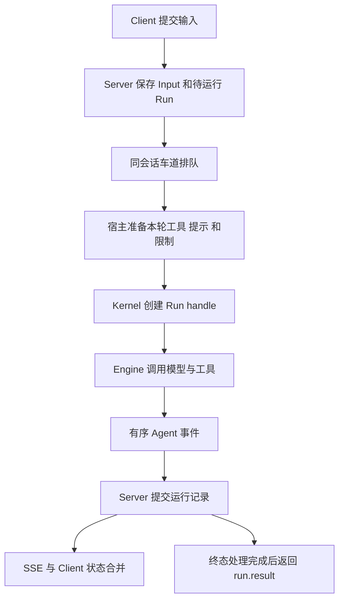
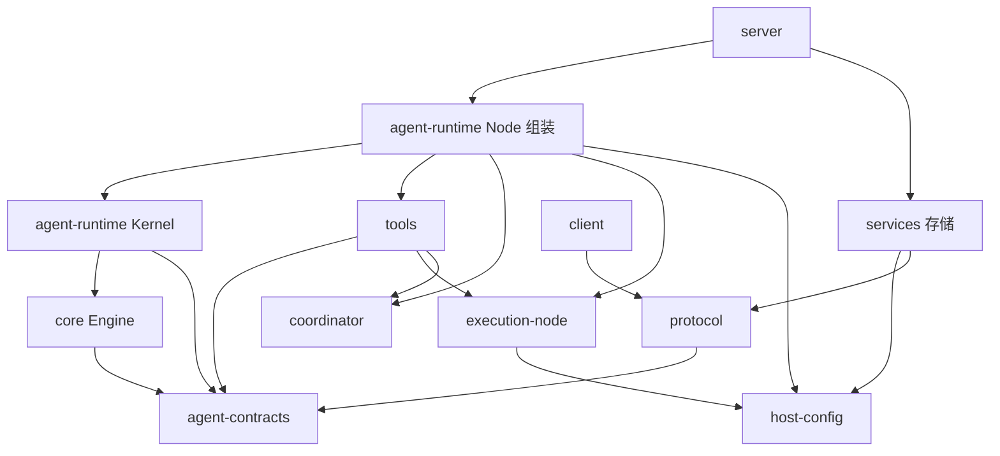

# Agent 核心包架构收敛方案

> 状态：当前架构调整方案；2026-10-21 基于 `bd63a584` 核对，2026-10-22 完成 P5。P0–P5 已实施，显式模型准入与 Goal 记账已接入，维护/事实/便签业务归 Server 应用用例；P6 待实施。职责、所有权与验证结果见 [P5 记录](../reviews/2026-10-22-agent-package-convergence-p5.md)。
> 范围：packages 的职责、依赖、运行状态所有权和公开入口。实施顺序见[分阶段实施计划](../plans/2026-10-21-agent-package-convergence.md)。

## 1. 目标和决策

本次调整让新增一种工具、插件或应用能力时，能够明确找到接入位置，不再同时修改执行引擎、Agent 生命周期和服务端投影器。

确定采用渐进收敛：保留会话排队、事务、可靠事件处理和子 Agent 生命周期；先移动职责和缩小接口，再整理大文件。每阶段形成可编译、可运行的完整切面，不提交只有新接口、实际调用仍走旧实现的空架构。

最终新增三个内部包，其他职责先在现有包内分目录、子入口管理：

1. `@vykor/agent-contracts`：执行双方共同使用的消息、工具、事件和控制接口，以及必要的纯数据校验、错误身份。
2. `@vykor/host-config`：本机配置、配置类型、目录规则、文件锁和原子保存。
3. `@vykor/execution-node`：本地进程、输出文件、执行记录目录和 LSP 的 Node 实现。

不新增通用 Manager、万能 Context、动态服务查找器或任意名称的生命周期插件系统。暂不把 engine、Kernel、默认 Node 组装、Workflow、Plugin Runtime 分别变成独立发布包。

### 1.1 方案比较

| 方案 | 收益 | 代价 | 决定 |
| --- | --- | --- | --- |
| 只拆大文件，包和接口保持原样 | 变动较少 | 新能力仍要改公共上下文，职责继续回流 | 不采用 |
| 新增三个底层包，现有包内收敛 | 切断主要依赖交叉；可分阶段验证 | 需要同步修改实际使用者和类型出口 | 采用 |
| 全面拆成多个独立 SDK/宿主/业务包 | 物理隔离更强 | 发布、类型和组装关系过早复杂化 | 暂缓，P6 后按真实消费需求另行决定 |

### 1.2 不改变的产品行为

- HTTP/SSE 请求、响应和持久记录的现有格式；本次不主动升级协议版本或修改 SQLite schema。
- 根 Run 的 queue/steer/replay/reject 规则，子 Agent 的输入幂等窗口和空闲释放规则。
- 当前授权优先级、计划模式限制、插件撤销与来源校验；应用已获授权的操作不增加重复弹窗。
- 默认 Node SDK 的创建入口与独立 Kernel 入口路径。具体 TypeScript 接口变动见第 9 节，调用者在同一迁移任务中更新。
- 文件版 Workflow 用于独立宿主，SQLite 版用于 daemon；两种存储不自动互相接管。
- 不重置用户数据库、凭据、插件、记忆或工作目录；不迁移实际用户文件。

## 2. 现状依据与问题

统计范围是 `packages/*/src` 下非测试 TS/TSX 文件，行数含空行；仅用来判断阅读范围，不作为架构优劣或验收阈值。

| 包 | 文件数 | 约行数 | 本次关注点 |
| --- | ---: | ---: | --- |
| core | 61 | 9,489 | 公共类型、执行引擎、本机配置混在一起；QueryEngine 约 1,706 行 |
| agent-runtime | 50 | 8,698 | Kernel 和 Node 共用带插件、Goal、应用接口的 Agent |
| tools | 81 | 9,649 | 工具定义同时拥有 Workflow 后台运行、Jobs 和宿主接线 |
| coordinator | 21 | 4,221 | 调度、定义加载、文件存储和进程级团队状态并存 |
| services | 97 | 16,236 | SQLite 领域存储和本地进程/LSP 混合依赖 |
| server | 217 | 38,016 | 投影、预算准入和新增路由的职责交叉 |

以下记录编写方案时 `bd63a584` 的问题；P3 已迁移的链接指向当前对应实现，当前职责以 [P3 验证记录](../reviews/2026-10-22-agent-package-convergence-p3.md)为准：

- [core 公共入口](../../../packages/core/src/index.ts)、[ToolContext](../../../packages/agent-contracts/src/tools.ts)、[QueryEngine](../../../packages/core/src/engine/query-engine.ts)。13 个其他 package 的业务源码导入 core，很多只需要类型或路径函数。
- [Kernel 组装](../../../packages/agent-runtime/src/kernel/index.ts)、[Agent 接口](../../../packages/agent-runtime/src/kernel/agent.ts)、[默认组装](../../../packages/agent-runtime/src/node/runtime/agent-composition.ts)。Kernel 不主动发现插件，但返回接口仍带插件目录、应用记录和 Goal 参数。
- [Workflow 工具](../../../packages/tools/src/agent/workflow/tool.ts)、[worker runner（现归 Node）](../../../packages/agent-runtime/src/node/workflow/agent-workflow-runner.ts)、[本地 Jobs（现归 Node）](../../../packages/agent-runtime/src/node/jobs/local-agent-job-host.ts)。迁移前工具内含后台 Promise、取消监听和持久记录查询；P3 已移入 Host。
- 原 Workflow store 同时定义 Repository、文件实现、持久运行控制和模块级活动目录，P3 已拆为 [Repository 接口](../../../packages/coordinator/src/workflow/repository.ts)和 [Node Host](../../../packages/agent-runtime/src/node/workflow/workflow-host.ts)；[TeamRegistry](../../../packages/coordinator/src/teams/index.ts) 原为进程单例，P3 已改为根树实例。
- [Agent 事件投影器](../../../packages/server/src/application/agent/daemon-agent-event-projector.ts) 在 `projectGoalUsage` 中检查预算并拒绝模型调用；可靠记录和执行准入通过同一事件通道相连。
- [maintenance 路由](../../../packages/server/src/http/routes/maintenance.ts)、[facts 路由](../../../packages/server/src/http/routes/facts.ts) 承担文件读写、互斥和 Runtime 关闭编排；[边界检查](../../../scripts/architecture-boundaries.mjs) 尚未覆盖所有新入口。

上述为职责问题，不表示每一处都已经产生运行故障。活体目录、持久记录和界面快照可以各有一份派生状态，关键是不能有两个独立控制同一执行对象的负责人。

## 3. 运行流程与状态所有权

### 3.1 普通输入



入口仍是 Client Resource 与 Server 应用服务。Server 决定输入何时运行；Node 宿主把具体功能准备成工具和执行限制；Kernel 管理本轮以及子 Agent 的生命期；Engine 执行模型和工具循环。事件可靠写入后才发布给客户端，终态事件处理完成后 Run 才返回结果。

### 3.2 所有权表

| 状态/资源 | 唯一控制者 | 其他模块怎样使用 |
| --- | --- | --- |
| 当前历史、模型回合、工具批次、有限的结果缓存 | core Engine | Kernel 调用执行接口；宿主不直接改进行中的消息数组 |
| Agent 的 idle/running/maintaining/closing/closed 与 root Run handle | agent-runtime Kernel | Server 保存路由 handle，不复制状态机 |
| 直接子 Agent、创建中的实例、空闲计时和环境 lease | 创建它的 ChildManager | 根树目录负责查找，不负责关闭其他 manager 的资源 |
| 根树团队成员 | 显式创建的 TeamRegistry 实例 | 工具通过注入的 TeamPort 操作；不读进程默认实例 |
| 插件安装/授权事实 | plugins 和 Server 插件应用服务 | Node Plugin Runtime 捕获并验证执行来源 |
| 本轮工具、来源绑定和委派上限 | Node RunPreparation；非 Node 宿主自行提供 | Kernel/Engine 只消费冻结结果；子 Agent 只能缩小权限 |
| 插件应用活体后端与 lease | Node Plugin Runtime | Server 持久化应用记录，Kernel 不接收 PluginAppRecord |
| Workflow 活动调度和取消/收尾 | WorkflowHost 实例 | Tool/Jobs/CLI 调用同一实例；Repository 保存快照 |
| 本地进程和输出流 | execution-node 的宿主实例 | Local Jobs/daemon BackgroundShell 观察和控制，不再自建第二个进程所有者 |
| Session/Input/Run/Attempt/Permission/Goal/应用操作 | Server 应用服务 + services Repository/Transaction | Runtime 通过窄回调请求操作 |
| Goal 尝试准入与实际用量结算 | Server GoalModelAttemptService | Engine 在每次网络调用前后显式等待它 |
| 同会话串行、owner lease、提交后发布 | SessionOperationRunner 及现有运行车道 | 新入口也接入这些规则，不各自实现并发策略 |
| 用户选择、草稿、面板与连接展示 | apps/Client | 从服务端读取业务事实，不推测执行终态 |

### 3.3 Workflow 生命周期

Tool/CLI 发起 → WorkflowHost 验证 owner 并登记活体 handle → Coordinator 调度 → 注入的 worker runner 创建框架子 Agent → Repository 写快照/事件 → Jobs 查询和控制 → WorkflowHost 等取消、worker 和写入收尾完成后注销。

父 Run 的取消、用户 JobCancel、宿主 close 都进入同一个 WorkflowHost。不能由工具返回后留下无人管理的 Promise。`repositoryKey` 只标识存储目标，不代替宿主或 root tree 的执行所有权。

## 4. 包职责与允许依赖

下表是 P6 的目标直接依赖上限，不要求每个包都导入上限中的所有包。测试、类型导入、动态导入和相对路径跨包引用也受约束。新增外部 npm 依赖不由本方案自动授权。

| 包 | 目标职责 | 允许的 workspace 直接依赖 |
| --- | --- | --- |
| **agent-contracts（新增）** | 执行消息、工具、事件、控制接口、通用模型错误和规范工具数据 | environment；仅类型引用环境接口 |
| **host-config（新增）** | Settings/Permission/MCP 配置类型，本机路径、读取、校验、锁与原子保存 | agent-contracts、environment、protocol |
| **execution-node（新增）** | 本地进程、输出捕获、执行观察记录、LSP | agent-contracts、host-config、environment、sandbox |
| core | Engine、工具注册/检查执行、历史、压缩、重试、轨迹控制、上下文统计 | agent-contracts、environment |
| environment | 工作目录绑定、执行环境、文件/进程与 Shell 的通用接口 | 无 |
| agent-runtime | Kernel 与 Node 组装；模块边界见 4.2 | agent-contracts、core、host-config、execution-node、api、auth、coordinator、environment、hooks、jobs、mcp、memory、permissions、plugins、prompts、protocol、sandbox、skills、terminal、terminal-node、tools |
| api | Provider 网络适配、流解析、模型目录与目录缓存 | agent-contracts、host-config |
| auth | Provider/Channel/MCP 凭据保存与解析 | agent-contracts、host-config、api |
| permissions | 工具、路径和命令策略计算 | agent-contracts、host-config、environment |
| hooks | Hook 定义加载和具体执行 | agent-contracts、host-config、environment、sandbox |
| mcp | MCP 连接、OAuth、运行连接协调与工具/资源适配 | agent-contracts、host-config、protocol、environment、sandbox |
| sandbox | OS 隔离、环境创建、路径/进程限制 | agent-contracts、host-config、environment、protocol（规范审批模式类型） |
| tools | 工具 schema、输入解析、领域能力调用与结果格式化；基本文件/Shell 实现 | agent-contracts、host-config、environment、execution-node、sandbox、coordinator、jobs、terminal、protocol |
| coordinator | Agent 定义与 Workflow 纯调度、存储接口、实例团队目录 | agent-contracts |
| jobs | 统一 Job 接口、查询过滤与多个来源的组合 | protocol |
| terminal | 终端能力接口和事件 | protocol |
| terminal-node | PTY 与终端 Job 的具体实现 | environment、host-config、jobs、terminal、protocol（规范终端与 Job 数据） |
| services | SQLite 领域存储；明确隔离的 Office/Memory 辅助子域 | agent-contracts、host-config、protocol、memory、environment、sandbox、execution-node、core；后四类引用只限明确的宿主辅助子域，存储规则见 4.3 |
| server | 多入口应用编排、持久化适配、恢复、事件投影、HTTP/SSE | 表中各能力包；禁止依赖 client 和 apps |
| protocol | 跨进程 DTO、版本、校验、序列化；不拥有执行策略 | agent-contracts；只引用通用数据子入口，禁止函数/handle 类型进入 DTO |
| client | 协议握手、Resource、传输、同步和 reducer | protocol |
| plugins | Native manifest、安装、校验、组件读取与 SDK | agent-contracts、host-config、protocol、skills、coordinator/definitions |
| plugin-converters | 外部格式到 Native manifest 的显式转换 | plugins |
| plugin-sources | Git/归档来源读取 | 无 |
| prompts | 默认提示、个人提示文件与提示片段装配 | agent-contracts、host-config、environment、sandbox、memory、personalization、core/context-budget |
| skills | Skill 格式、发现与目录 | 无 |
| memory | 记忆格式、文件内容管理、检索与脱敏 | 无 |
| personalization | 用户/项目事实处理 | memory |
| channels | Channel 接入、队列和传输 | protocol |
| commands | 命令元数据 | 无 |
| output-styles | 输出风格资源 | 无 |
| themes | 主题资源 | 无 |
| swarm | 文件团队/邮箱/权限同步的独立工具；不参与当前子 Agent 执行 | 无；仅在确认无人使用后退役 |

### 4.1 主要依赖图

箭头表示“导入/依赖”，不表示用户请求方向。图只画主要关系，细节以上表和模块限制为准。



### 4.2 agent-runtime 的包内硬边界

目标目录 `src/kernel/` 只能依赖 agent-contracts、core 的执行子入口、environment 类型和自身文件。不得导入 Node 组装、host-config、tools、plugins、coordinator、protocol、services、server，也不得读取磁盘配置、发现插件、创建 PTY/数据库/本地工作树。

目标目录 `src/node/` 负责默认能力、工具工厂、插件/MCP/Memory/Workflow 和 OS 资源的组装；可以调用 Kernel。Kernel 不回调一个任意名称的服务容器，只接收本方案列出的明确接口。

`src/index.ts` 继续提供 Node SDK 的正式公开入口，`src/kernel-entry.ts` 提供精简 Kernel 入口。公开入口汇总长期 API，不保留已经迁走的旧实现路径转发文件。

### 4.3 services 的包内硬边界

- database、sessions、conversations、runs、goals、permissions、workflows、attachments、plugin-apps、notes 等记录模块：允许 agent-contracts、host-config、protocol 和同包存储模块；禁止 core 引擎、execution-node、sandbox、server、client、tools、agent-runtime。
- `session-runtime/store.ts` 仍负责存储组装、owner lease 和持久恢复，不创建模型/Agent/PTY；逐步把调用方改为所属 Repository 的窄接口。
- Office、autodream、memory-extract 等具体宿主辅助服务保留当前职责；它们可以依赖执行能力，不能被存储 Repository 反向导入。
- tools 和默认 Node Agent 不导入 services 根入口或任何 services 子入口；本地进程/LSP 迁往 execution-node，其他业务能力由 Server 注入。

## 5. 契约和接口如何收口

本节接口是目标设计，不是当前可导入 API。沿用的 Message、ContentBlock、ToolUseBlock、ToolResult、ToolExecutionResult、StreamEvent、AgentEvent、AgentRunScope、AgentRunHandle、AgentEffects、AgentExecutionLimits、AgentExecutionProfile、AgentRunContribution、ToolRegistryView 等名称，都从现有 core 定义迁移并删去宿主专属字段；不复制第二份同名结构。

### 5.1 agent-contracts 的内容上限

| 目标文件 | 内容 | 明确不放入 |
| --- | --- | --- |
| `src/messages.ts`、`usage.ts` | 消息、内容块、用量与通用输入能力 | SessionRecord、数据库行、界面状态 |
| `src/model.ts`、`errors.ts` | StreamingMessageClient、请求、尝试身份/结果、失败描述与错误身份 | 网络客户端、默认重试算法、凭据 |
| `src/tools.ts`、`tool-data.ts` | 工具定义、注册来源、只读描述、结果、JSON/MCP 标准数据及其有界校验 | 插件安装、应用 lease、授权策略 |
| `src/execution.ts`、`events.ts`、`children.ts` | Run/Child scope、事件、effect、限制、控制 handle、通用贡献 | Settings、Schedule、Jobs/Terminal 实现、GoalRunBinding、PluginAppRecord |
| `src/permissions.ts`、`hooks.ts` | 执行侧策略接口、Hook 事件/结果与稳定字段 | 配置文件、Hook 注册管理和具体执行器 |
| `src/tool-names.ts` | 规范工具名称的纯函数 | 产品退役清单、配置迁移和注册表实现 |
| `src/collections.ts`、`context-usage.ts` | 冻结执行集合的只读视图与上下文账本数据 | 能力发现/筛选策略、账本装配算法 |

core 的重试策略和超时默认值不全部移进 contracts。API 单次连接/空闲超时缺省值迁到 api/provider 的默认配置，Node 组装明确给 Engine 传递重试策略；两者是否相同由配置测试证明，不靠 api 反向导入 Engine。

现有 `ModelRequestFailure`、执行限制等跨 bundle 错误继续使用已有全局 Symbol 身份，移动源码时不顺带改变 Symbol key，防止独立 bundle 的 `instanceof` 行为变化。

protocol 需要的 MCP JSON/UI 元数据从规范的 `agent-contracts/tool-data` 引用；现有有界 JSON 校验与私有字段过滤也在那里唯一实现。协议 DTO 中不得携带 execute、Promise、resolver、AbortSignal 或包含它们的 AgentEvent 类型。

context-usage 只抽取跨包共同使用的 ContextBucketId/ContextLedgerSegment 等纯输入数据。ContextUsageSnapshot 的产品展示、统计装配和提示算法继续归 core/context-budget，不为迁移两个类型把全部展示模型放进 contracts。

### 5.2 引擎的工具上下文

通用 ToolContext 保留工作目录、环境接口、执行 scope、两个生命周期的取消信号、deadline、调用/尝试 ID、授权工具描述、受限结果读取、通用输入/权限交互和 ChildController。具体工具所需的 Settings、MCP 管理器、Skill 目录、Terminal、Jobs、Schedule 通过具名工厂闭包注入。

例如 `createWorkflowTool(port)`、`createJobTools(host)`、`createTerminalTools(host)`、`createSkillTools(catalog)`、`createMcpTools(port)`。工厂的 port 由宿主创建并绑定当前 root/session 或 Run；不能从模型参数获取。禁止改成 `context.services.get(name)` 或 `Record<string, unknown>` 来隐藏原来的依赖。

计划模式切换、工具搜索和结果复用仍属于受信任的执行控制，保留有类型的窄接口。移走 Settings 不等于删除本地路径保护、网络限制或可信工具身份校验。

### 5.3 Kernel 输入与 Node 扩展

目标结构：

```ts
interface PreparedAgentRun {
  tools: ReadonlyMap<string, RunToolBinding>;
  contribution?: AgentRunContribution;
  limits?: AgentExecutionLimits;
  profile?: AgentExecutionProfile;
  modelAttempts?: ModelAttemptGate;
}

interface AgentRunPreparation {
  prepare(scope: AgentRunScope): Promise<{
    run: PreparedAgentRun;
    release(): void | Promise<void>;
  }>;
}
```

`RunToolBinding` 为现有捕获工具绑定的通用执行部分，保留原定义 identity、execute/invoke、来源和可见受众；插件候选、Skill/Agent/MCP 目录与安装摘要留在 NodeCapabilityView。来源信息用于核对同一个工具，Kernel 不据插件名称决定策略。

准备后的 Map/Set 使用现有禁止 set/add/delete/clear 的只读封装，不能仅用 Object.freeze(Map/Set) 冒充不可变集合。准备失败、事件/执行失败、正常终态都只释放一次本轮资源；外部注入的宿主能力为借用对象，由提供方关闭，root 和 child 不重复释放它们。

`VykorAgent` 成为精简 Kernel 接口。默认 Node 创建返回 `DefaultNodeAgent extends VykorAgent`，增加一个正式的 `host: NodeAgentHost` 属性：

| NodeAgentHost 成员 | 责任 |
| --- | --- |
| `plugins` | 候选、NodeCapabilityView、来源复核和 PluginAppRuntimeHost |
| `configuration` | 请求配置读取/更新；包括 provider/baseUrl/effort 等宿主选择 |
| `memory` | remember 与记忆资源，没有能力时明确返回跳过 |
| `inspect()` | MCP、Sandbox、已装载 Hook 与宿主能力诊断 |
| `workflows` | 当前宿主的 WorkflowHost |

Server AgentPool 持有的控制对象是 Kernel；需要上述能力的组装/应用服务通过明确的 `HostedAgent { agent: VykorAgent; host: NodeAgentHost }` 记录获得。自定义宿主必须显式提供相应 port；缺失返回既有 unavailable/不注册工具，不偷偷创建 Node 默认值。

Kernel 的运行配置只包含模型执行必需值和回调；不接收完整 Settings。ChildManager 的工厂接收已经解析的 child 执行参数和环境 lease，不再引用 `VykorAgentOptions` 或 Node 配置对象。Node 层负责子角色、插件来源、模型/权限继承；Kernel 继续检查深度、活跃数量、Run 身份和取消范围。

### 5.4 Goal 与插件应用接入

GoalRead、GoalUpdate、Goal 提示和 GoalRunBinding 移入 Server 的 `application/goals/`，由 Server 构建 AgentRunContribution。每次读取/更新仍核对 goalId、objectiveVersion、sessionId、runId；Goal 绑定不作为模型可修改的执行授权。

插件应用活体 catalogue/lease/后端适配移到 `agent-runtime/src/node/plugin-apps/`。Server 的应用操作服务持有应用记录，向 Node 插件能力请求捕获的工具，再调用 Kernel 的通用独立工具执行入口。Kernel 只看工具、scope、取消信号和可靠结果出口，不接收应用记录。

当前应用精确授权分支改成通用宿主确认接口：硬 deny 先执行；只有 ask 时，宿主才能用已经保存的操作事实确认同一个 scope、工具原定义 identity、固定参数和当前授权 revision。匹配失败走普通权限流程或拒绝；不能使用模型 metadata、MCP readOnlyHint 或可见性声明作为授权。

`pluginAppOrigin` 从内部 StreamEvent/AgentEvent 中移出。Server 在可靠事件入口，使用宿主登记的本轮绑定与 Node 插件能力生成同一个持久化/协议字段；工具结果的自由 metadata 仍不能伪造它。默认 SDK 的插件观察信息由 Node host 接口提供。

### 5.5 Workflow、Agent 定义和 Team 接口

coordinator 新增正式子入口：`/definitions`、`/workflow`、`/teams`。Workflow 纯调度不得依赖 definitions、文件系统、Settings 或默认团队。AgentDefinition 在 definitions 唯一定义；移走原 core.RunAgentBinding 中复制的定义，Node 目录直接引用 AgentDefinition。

`FileWorkflowRunRepository` 移到 `agent-runtime/src/node/workflow/`，文件格式和目录解析保持原样。`WorkflowRunRepository` 接口和快照解码留在 coordinator/workflow。现有 store 中的持久运行函数及活动运行 Map 迁到实例 WorkflowHost，不保留跨宿主活动运行单例。

```ts
interface WorkflowInvocation {
  input: Readonly<Record<string, unknown>>;
  scope: AgentRunScope;
  signal: AbortSignal;
}

interface WorkflowToolPort {
  invoke(call: WorkflowInvocation): Promise<ToolResult>;
}

interface WorkflowHost extends WorkflowToolPort {
  readonly jobs: AgentJobHost;
  close(reason?: string): Promise<void>;
}
```

WorkflowInvocation.scope.signal 代表拥有它的 Run，signal 代表本次工具请求；后台执行绑定前者和 Host 的关闭信号，不因工具已经返回或其短暂请求结束就误杀后台任务。等待型请求取消和显式 JobCancel 的语义分别测试，不能混用两个信号。

工具负责 action/schema 的表层验证；Host 使用 coordinator 的具名解析/校验结果执行 run/resume/history/timeline/template/reconcile/validate，不能再次实现 DAG 或预算算法。Host 创建时注入 Repository、worker runner 和 owner 检查。Jobs 的 read/wait/cancel 适配器通过同一 Host 查询和控制。

独立 Workflow CLI 通过 Node WorkflowHost + 文件 Repository 执行；daemon 通过 Node WorkflowHost + 现有 SessionWorkflowRunRepository 执行。同一应用生命周期内，同一 Repository 的 Host 由组合根创建并复用，session/root 拿到限制为自己 owner 的操作视图。Root/session 关闭只取消自己的运行，应用关闭等待全部运行，不通过模块级单例找其他应用的 Host。独立 SDK 根实例自行拥有其 Host。

现有文件 Repository 的 claim 只返回进程信息，不提供跨进程互斥；SQLite claim 有 generation 记录，也不能据此推断已具备完整的跨进程执行排他性。本轮保持既有数据与恢复语义，不宣称搬迁能解决多进程共享同一 Workflow 目录的互斥问题；这类增强需要单独设计。

TeamRegistry 是普通实例，生命周期为 root tree/WorkflowHost；TeamPort 由工具工厂注入。相同进程中的两棵树可以各自创建同名 team，关闭一棵树不影响另一棵。

### 5.6 显式模型尝试准入

```ts
interface ModelAttemptIdentity {
  scope: AgentRunScope;
  generationId: string;
  attempt: number;
}

interface ModelAttemptAdmission extends ModelAttemptIdentity {
  model: string;
  provider?: string;
  purpose: "generation" | "compaction" | "finalization" | "memory" | "plugin_selection";
}

interface ModelAttemptSettlement extends ModelAttemptIdentity {
  status: "completed" | "failed" | "interrupted";
  usageStatus: "complete" | "partial" | "unknown";
  usage?: UsageSnapshot;
  notDispatched?: true;
}

interface ModelAttemptGate {
  beforeDispatch(input: ModelAttemptAdmission): Promise<void>;
  settle(input: ModelAttemptSettlement): Promise<void>;
}
```

`usageStatus` 沿用现有 ModelAttemptUsageStatus。未发出的尝试由 `notDispatched: true` 表达，不能新增持久枚举值。记录结构仍用现有 GoalAttemptStart/Report 的明确转换，不把 scope.signal 序列化。

顺序固定：

1. Engine 分配一次尝试身份，执行通用 limits 检查。
2. 等待 beforeDispatch：GoalModelAttemptService 在现有事务中核对 Goal 版本/父 Run 并调用 beginGoalModelAttempt；不把登记尝试改造成未经设计的 token 预扣模型。
3. 发布并可靠处理 model.attempt.started；处理失败或取消时禁止网络调用。
4. 调用 Provider。每次重试都重新登记 attempt；不重复执行已经提交的工具。
5. 对成功、失败、取消和已登记但未发出的尝试调用 settle，再发出完成事实。
6. 投影器保存 transcript/attempt 展示等事实，不再调用 Goal 准入或 Goal 用量写入；重复事实不会重复记账。

唯一键保持当前 runId/generationId/attempt 身份。准入拒绝不制造一次已发出的调用；准入成功后未发出要明确结算，已发出但缺少可靠用量继续按现有未知用量规则保守处理。结算持久化失败使本次执行失败并交给现有恢复机制，不重新请求模型来“补一次成功”。

主生成、重试、压缩、收尾、记忆和插件选择都接入；没有 Goal 的宿主可以不安装 gate。自动审查等独立辅助调用不伪造父 Run，保留当前归属策略并纳入测试，不扩大 Goal 预算统计范围。

## 6. 代码迁移清单

“目标”均为待创建或待重组路径；表中既有路径按 `bd63a584` 记录。同一行的调用方和测试必须一起迁移。

| 编号 | 当前来源 | 目标位置 | 处理与阶段 |
| --- | --- | --- | --- |
| M01 | core `types/messages.ts`、`usage.ts`，model-retry 中身份/失败类型 | agent-contracts `messages.ts`、`usage.ts`、`model.ts`、`errors.ts` | P1 先移无宿主依赖部分；删除旧导出与文件内重复定义 |
| M02 | core `config/`、`types/settings.ts`、`types/mcp-oauth.ts` 中配置/凭据数据类型 | host-config `src/` | P1；MCP 活体协调接口另归 mcp，不一股脑移动 |
| M03 | core `config/permission-settings.ts`、`agent-environment-settings.ts`，Hook 配置结构 | host-config `permissions.ts`、`environment.ts`、`hooks.ts` | P1；Hook 执行事件/结果归 contracts |
| M04 | core `utils/tool-names.ts` | contracts `tool-names.ts` + host-config `tool-configuration.ts` | P1；纯规范函数与产品配置退役检查分离 |
| M05 | services `src/executions/`、`src/lsp/` | execution-node `src/executions/`、`src/lsp/` | P2；含输出文件、运行目录、测试与关闭行为 |
| M06 | tools 中 services 动态导入；Shell 输出导出；Server BackgroundShell 引用 | execution-node 的明确子入口 | P2；一次更新全部使用者；移除 services 旧出口 |
| M07 | coordinator `agent-loader.ts`、`agent-definitions.ts`、`types.ts` 的 AgentDefinition | coordinator `src/definitions/` | P3；用户目录读取由传入路径提供，默认目录由 Node 解析 |
| M08 | coordinator `team-registry.ts` 与 tools `agent/team.ts` | coordinator `src/teams/`、tools `src/agent/team-tools.ts` | P3；保留实例类，删除默认单例函数和隐式读取 |
| M09 | coordinator `workflow/store.ts` 的 Repository/解码声明 | coordinator `src/workflow/repository.ts`、现有解码文件 | P3；纯接口留在调度域 |
| M10 | 同文件的 FileWorkflowRunRepository | agent-runtime `src/node/workflow/file-workflow-run-repository.ts` | P3；沿用文件数据格式 |
| M11 | 同文件的 run/resume/cancelPersistentWorkflow 与 activeWorkflowRuns | agent-runtime `src/node/workflow/workflow-host.ts` | P3；活动状态归实例，关闭可等待 |
| M12 | tools `agent/workflow/runner.ts`、`presentation.ts`、输入执行编排 | agent-runtime `src/node/workflow/agent-workflow-runner.ts`、`workflow-actions.ts`、`workflow-presentation.ts` | P3；独立 spec 解析/验证归 coordinator，模型输出格式归宿主适配 |
| M13 | tools `job/local-job-host.ts`、`agent/child-task.ts` 的执行等待适配 | agent-runtime `src/node/jobs/`、`src/node/children/child-task-adapter.ts` | P3；tools 只保留注入 host 的模型工具 |
| M14 | tools `registry.ts` 的默认选择/宿主接线 | agent-runtime `src/node/tools/default-tool-registry.ts` | P3/P4；ToolRegistry 类留 core；具体能力由 Node 创建后注入工厂 |
| M15 | core `types/tools.ts`、`client.ts`、`events.ts`、`runtime-child.ts`、`runtime-events.ts`、runtime 通用执行部分 | agent-contracts 对应文件 | P4；通用上下文缩小后再移，避免 contracts 反向依赖 core/config |
| M16 | protocol `mcp-apps.ts` 的通用工具 JSON 数据与有界校验；core 对这些函数的引用 | agent-contracts `src/tool-data.ts` | P4；protocol 保留应用协议和读取 DTO，引用唯一规范数据定义 |
| M17 | core `RuntimeBundle`、`engine/runtime-builder.ts` | agent-runtime `src/node/runtime/node-runtime-resources.ts` | P4；Kernel 使用 Engine 执行接口及显式 release，不接收宿主 Bundle |
| M18 | agent-runtime `agent.ts`、`framework-agent-run.ts`、`event-source.ts`、child 相关文件 | agent-runtime `src/kernel/` | P4；保留状态机/回执/幂等，删除 Node 类型依赖 |
| M19 | agent-runtime `default-*`、`agent-composition.ts`、配置与 integrations | agent-runtime `src/node/` 按 tools/mcp/configuration/memory 分目录 | P4；runtime-integrations.ts 拆成固定的具名安装函数和资源清理 |
| M20 | agent-runtime `plugin-*`、`run-capability-view.ts`、native-tools、MCP/native app backend | agent-runtime `src/node/plugins/`、`src/node/plugin-apps/`、`src/node/capabilities/` | P4；来源/绑定/撤销校验不得删减 |
| M21 | agent-runtime `goal-extension.ts`、`goal-read-tool.ts`、`goal-update-tool.ts` | server `src/application/goals/` | P4；Server 创建通用 contribution |
| M22 | FrameworkAgentRun 的 pluginAppOrigin 生成；core 专用 app 授权上下文 | server `application/agent/tool-app-origin-projector.ts` + Node app 宿主确认适配 | P4；普通工具执行只保留通用授权/来源接口 |
| M23 | QueryEngine 的模型尝试、工具上下文、上下文准备 | core `engine/model-attempt-runner.ts`、`tool-execution-context.ts`、`turn-context.ts` | P4/P5；历史所有者仍是 QueryEngine，不复制消息数组状态 |
| M24 | projector `projectGoalUsage`；各模型入口 start/finish 回调 | server `application/goals/goal-model-attempt-service.ts`；core 显式 ModelAttemptGate | P5；唯一记账、覆盖辅助调用，沿用现有表 |
| M25 | server `http/routes/maintenance.ts` 文件/重启/用量编排 | server `application/maintenance/maintenance-application-service.ts`、`maintenance-policy-repository.ts` | P5；路由只解析和错误转换，关闭/lease 语义不变 |
| M26 | server `http/routes/facts.ts` 修改与 Runtime 关闭编排 | server `application/personalization/project-facts-service.ts` | P5；读写仍保留脱敏与 cwd/session 对应检查 |
| M27 | server `http/routes/notes.ts` Repository 直接调用 | server `application/notes/note-application-service.ts` | P5；集中业务错误；无新规则时避免逐方法纯转发，允许应用层声明窄用例接口 |
| M28 | scripts architecture-boundaries、baseline、测试 | 模块策略 JSON + AST 解析器 + 现有聚合入口 | P0 声明阶段规则，P6 取消全部本轮过渡例外 |
| M29 | core AppStateStore，coordinator Coordinator/注册插件全局函数，swarm 候选出口 | 核实使用者后删除或保留独立用途 | P6；不能仅凭名字或仓库内零引用认定公开包可删除 |
| M30 | SDK 构建/pack、CLI workflow、Server loader/pool、公开 API 使用者 | 各自现有入口与测试 | P1–P6 同步更新；正式 SDK 出口不留下旧签名适配层 |
| M31 | core `query-tool-limits.ts` 的环境变量读取与 tools 的 inline 输出策略引用 | host-config `src/tool-output-policy.ts` + Engine 的显式 output/timeout limits 参数 | P4；纯裁剪/超时算法留 core，默认/环境变量由宿主解析后注入 |
| M32 | core `context-budget/` 的公共类型和 prompts 对 core 根入口的引用 | core 正式 `/context-budget` 子入口；纯账本数据类型归 contracts `src/context-usage.ts` | P1/P4；不让 prompts 为账本类型拉入整个 Engine 公共面 |
| M33 | agent-runtime `run-capability-view.ts` 中 readonlyMap/readonlySet 等通用集合封装 | agent-contracts `src/collections.ts` | P4；能力筛选留 Node，Kernel 不为集合工具导入 Node 文件 |

### 6.1 必须同步的调用方

每次删除 core 导出或移动 Node 能力，都要对 `packages`、`apps`、`scripts`、`tests` 扫描静态/类型/动态导入以及相对路径引用；不能只按 package.json 的 dependencies 计算影响。

重点包括 api/auth/mcp/plugins/hooks/permissions/sandbox/prompts/services 的配置引用、CLI 的独立 Workflow 命令、Server 的 daemon-agent loader、AgentPool、SessionRunExecutor、应用操作 executor、审批 reviewer，以及 SDK 声明和 pack 测试。UI 本轮没有样式调整。

### 6.2 自动审查和记忆

配置审批 reviewer 迁到 `agent-runtime/src/node/review/`，纯解析和判断辅助函数放同目录；Server 决定用什么证据发起审查。记忆运行准备迁到 Node memory，持久维护仍由 Server 调度。core 压缩只接收通用章节和模型客户端，不读取 Memory/附件文件，也不判断“目标是否完成”。

## 7. Server 事件和应用层调整

AgentEventProjector 保留一个有序可靠入口，再委派给 transcript、run/attempt、child、tool-origin 和 settlement 处理模块。拆分后仍共享当前顺序号、事务协调和投影失败恢复，不能变成多个互相不等待的订阅者。

执行准入失败和记录失败要区分：前者来自显式 gate/limits，后者仍通过可靠 onEvent 使操作失败。subscribe 仍是旁观接口，不参与数据库、授权或预算控制。

maintenance/facts/notes 的应用服务由 DaemonApplication 注入路由。对写操作明确规定 ready/owner/cwd lease 的取得和释放点；移动后不改变安全重启“关闭准入、释放当前维护 lease、等待 drain”的顺序。路由不能拿完整 SessionStore、数据库路径，不能自行保存策略文件或关闭 Runtime。

DaemonApplication 可以较长，只负责构造、连接和启动/关闭模块；不得把迁走的逻辑塞回构造函数里的大闭包。子系统组装函数必须返回自己的资源关闭器和窄服务接口。

## 8. 分阶段完成条件

| 阶段 | 交付 | 依赖 | 可以继续保留的阶段性关系 | 必须消除的关系 |
| --- | --- | --- | --- | --- |
| P0 | 基线、目标依赖策略、行为回归清单 | 无 | 当前实现边由明确来源路径记录 | 未登记的新越界依赖 |
| P1 | 叶子契约 + host-config | P0 | core 中尚待 P4 缩小的执行上下文 | 其他包为配置/路径导入 core；复制叶子类型 |
| P2 | execution-node | P1 | services 宿主辅助子域使用 execution-node | tools/runtime 为本地进程或 LSP 导入 services |
| P3 | WorkflowHost、定义子入口、实例 Team/Jobs | P2 | 当前 Kernel API，待 P4 一次切换 | tools/coordinator 拥有后台活动执行/进程单例 |
| P4 | 精简 Kernel、Node host、工具注入、完整执行契约 | P3 | projector 旧 Goal 用量分支只允许到 P5 | Kernel/Engine 的具体 Goal/应用/Settings/MCP/Jobs 接线 |
| P5 | 显式模型准入与 Server 用例收口 | P4 | 没有本轮新增过渡例外 | 事件投影做预算准入；路由拥有持久流程 |
| P6 | 零过渡例外、SDK/文档/完整验证 | P5 | 目标表中明确允许的正式关系 | 本轮旧出口/单例/反向依赖和未处理的门禁基线 |

阶段状态由实际合并和验证证据更新；写完本方案不表示 P0 已执行。每阶段的具体文件、步骤、命令见实施计划。

2026-10-21 已完成 P0 的实际实施与验证，见 [P0 基线记录](../reviews/2026-10-21-agent-package-convergence-baseline.md)。当前 policy 固定在 P0，登记 1,128 条精确待迁移关系；P1–P6 未开始。

## 9. API、构建与数据策略

- 正式子入口随实现增加 exports：contracts 的 `/tool-data`、coordinator 的 `/definitions`、`/workflow`、`/teams`、core 的 `/engine` 和 `/context-budget`、execution-node 的 `/executions` 和 `/lsp`；pack/声明检查覆盖这些入口，不依赖绕过 exports 的源码路径。
- 保留 `@vykor/agent-runtime` 和 `/kernel` 两个正式入口。原 `VykorAgent` 上插件、记忆和宿主配置能力迁往 DefaultNodeAgent.host；同仓使用者一次改完，不保留 deprecated 方法或纯转发旧文件。
- core 只导出执行实现和引擎配置；不重新导出迁往 contracts/config 的所有符号。调用者显式选择所需包。
- 新包为 workspace 内部包；SDK 继续按现有策略打包所需实现。新增路径必须加入声明构建、workspace 依赖、锁文件及发布闭包验证。
- Kernel 构建 metafile 检查“实际进入 bundle 的依赖”和声明可达图。只改导出列表、依靠 tree-shaking 或 optional peer 声明不能算隔离成功。
- Kernel bundle/声明不得包含 Node 组装、services、数据库、node-pty、插件应用/Goal 类型。Kernel 仍是 Node 平台 SDK，不承诺浏览器可运行，也不承诺安装整个 SDK 时不安装默认入口所需的 native 依赖。
- 默认入口的 native-tools host-entry、PTY 等能力照常做 pack 验证。better-sqlite3/sharp 是否可从 SDK 依赖删除，以实际构建图和 pack 结果为准，不能仅凭源码移动删除。
- 本次不改 HTTP 版本、SQLite schema 和文件记录格式。若实施发现必须改格式，应形成独立变更说明及迁移测试，不能夹在“搬文件”提交中。
- 错误全局 Symbol、模型尝试身份、插件行为摘要、应用 lease、owner generation、SSE cursor 等稳定身份保持语义；不因迁目录重新生成。

### 9.1 对外接口迁移对照

| 当前入口/能力 | 目标入口 | 同步要求 |
| --- | --- | --- |
| createDefaultNodeAgent(options) | 名称/路径保留，返回 DefaultNodeAgent；配置类型更名为 DefaultNodeAgentOptions | SDK/Server/CLI 同时更新类型；直接 run/close 用法继续成立 |
| createAgentKernel({ settings, capabilities, createRuntime }) | AgentKernelOptions 只包含工作身份、执行工厂、prepareRun、effects、事件出口和通用 child 配置 | 删除 Settings 与宿主能力包；显式 Engine options 由工厂提供 |
| createAgentKernel 的 runtime: RuntimeBundle | `{ engine: AgentEngine, release(): void \| Promise<void> }` | AgentEngine 从现有执行接口收窄，支持 submitMessage/executeTool/history/compact/usage；不暴露宿主资源集合 |
| createBasicAgentKernelRuntime 的 settings | 显式 model/maxTurns/systemPrompt/client/tools 与执行配置 | fake client 示例不再需要构造完整产品 Settings |
| Agent.getPluginCandidates/createRunCapabilityView/validatePluginScope/pluginApps | DefaultNodeAgent.host.plugins 的同类具名操作 | Server 的插件选择、应用操作和 child 准备转用宿主接口 |
| Agent.runPluginAppTool(app, request, options) | Server 应用服务准备工具后调用 Agent.executeTool(toolUse, options) | options 只有 scope、冻结工具绑定、取消和可靠工具事件出口；应用记录只留宿主 |
| Agent.remember/updateConfiguration/宿主诊断 | host.memory.remember、host.configuration.update、host.inspect | 模型选择仍在下一个请求边界捕获 revision，不中途修改当前重试请求 |
| Agent.inspect/getCapabilities | Kernel 只返回运行状态、工具和 child 执行信息；完整能力放 host.inspect | MCP/Sandbox/Memory 等状态不进入 Kernel 类型 |
| tools.createDefaultToolRegistry/LocalAgentJobHost/createAgentWorkflowRunner | Node 组装与正式 Node Workflow 导出 | tools 不为旧调用者保留导出别名 |
| core 中已迁走的配置/公共类型 | host-config 或 agent-contracts 的规范出口 | 更新真实消费者，不在 core 根入口重新汇总所有旧符号 |

通用独立工具入口必须按 Agent 自身身份生成/核对 agentId、sessionId 和 cwd；外部 scope 只能提供本次执行/追踪身份，不能覆盖 Agent 的所属会话或环境。它保留原维护互斥、可靠结果交付和取消检查，不新增一条跳过受检查执行的快捷路径。

### 9.2 通用宿主工具确认

为保留应用精确授权，同时消除 core 中对具体应用记录的理解，执行侧提供以下受信任回调形状：

```ts
interface ToolConfirmationRequest {
  scope: AgentRunScope;
  toolUse: ToolUseBlock;
  binding: RunToolBinding;
  signal: AbortSignal;
}

type HostToolConfirmation = (
  request: ToolConfirmationRequest,
) => Promise<AgentPermissionDecision | undefined>;
```

只在普通策略返回 ask 后调用；undefined 进入原 requestPermission 流程，approved 仅确认当前原定义/固定参数，denied/expired 拒绝。实现由 Server/Node 宿主提供并复核已保存应用授权，不在 ToolContext 公开“设置已批准”方法，不因该回调绕过硬 deny、环境限制、Hook 或工具参数检查。

## 10. 验收标准

### 10.1 结构验收

- **A01**：三个新包有明确出口和测试；agent-contracts 不导入 Node 模块、protocol、host-config、core 或任何具体能力实现。
- **A02**：core 不导入 host-config/protocol/jobs/terminal/服务端/Node 组装；引擎配置与公共上下文不包含 Settings、PluginAppRecord、GoalRunBinding、MCP manager。
- **A03**：Kernel 的源码和声明可达图都满足 4.2；不能只检查单个入口文件。
- **A04**：tools 不依赖 services/agent-runtime，Workflow/Job/Team 工具不持有后台任务、存储或进程全局目录。
- **A05**：coordinator 的 workflow 目录没有文件 I/O、配置路径读取、默认 Agent/Team 查找；全部活动运行归 WorkflowHost 实例。
- **A06**：services 存储模块不反向依赖宿主辅助模块；HTTP route 无 SessionStore/Repository/配置文件业务操作。
- **A07**：AST 门禁覆盖 root/子入口/相对路径/类型/动态导入，包含故意越界的反例；workspace 无循环依赖；本轮阶段例外为零。

### 10.2 行为验收

- **B01**：queue/steer/interrupt、同 Agent 互斥、输入回执和终态回执顺序不变。
- **B02**：可靠 sink 失败使操作失败；旁观者失败不影响执行；终态处理结束前 result 不完成。
- **B03**：子 Agent 保留树范围查找、创建归属、ID 冲突检查、幂等输入、TTL 恢复和 close 等待全部资源释放。
- **B04**：父子工具权限只能缩小；插件升级/禁用/撤销后拒绝过期绑定；工具 description/metadata/模型参数不能提高权限。
- **B05**：应用工具与模型工具共用参数/权限/超时/执行结果管道；硬 deny 优先；固定授权不增加重复弹窗；伪造 origin 无效。
- **B06**：Workflow 后台执行可 read/wait/cancel；父 Run 取消和 Host.close 等待 worker、持久写入及监听清理；文件/SQLite 两种宿主都通过。
- **B07**：同进程两棵树可创建同名 team，不同 Repository 可使用相同 Workflow runId；一棵树关闭不影响另一棵。同一应用/Repository 的 Tool、Jobs 和关闭入口共享唯一 Host；SQLite generation 与现有恢复规则不退化，不虚构文件版跨进程互斥能力。
- **B08**：每次实际模型尝试先准入；拒绝时 Provider 调用数为零；generation/compaction/finalization/memory/plugin_selection 和重试均有覆盖；重复完成不重复计费。
- **B09**：取消、准入后未发出、已发出未知用量、结算写入失败、崩溃恢复维持当前保守预算和终态规则。
- **B10**：maintenance/facts/notes 的返回值、业务错误、ready/owner/cwd 保护、脱敏、备份与重启关闭顺序不变。
- **B11**：独立安装 SDK 后 fake Provider 的 root/child/关闭成功；默认入口原生工具与必要 PTY 验证成功；Client 浏览器构建仍不引入 Node 依赖。

### 10.3 完成证据

每阶段记录受影响文件、执行命令、退出码和失败处置。以测试断言与依赖图验证所有权，不以文件行数、类数、包数或普通导入次数减少代替完成证明。

P6 只在阶段验收全部通过、API 使用者完成迁移、旧入口删除、文档和 pack 一致后关闭。根测试套件在最终整体验收执行一次；之前按阶段运行直接相关测试，失败或接口影响扩大时再增加检查。

## 11. 风险控制与实施边界

| 风险 | 实施要求 |
| --- | --- |
| 配置读取默认值/路径变化 | 原文件路径、锁语义、环境变量、默认值做迁移前后同输入对比；不重新定义存储根目录 |
| 工具工厂闭包借用了过宽权限 | 以当前 Run 的已捕获 binding 和环境上限创建；不让子 Agent 读取父全局可变注册表 |
| 移动 Goal gate 导致双记账或漏记 | 同一提交删除 projector 写入，启用唯一 gate；覆盖启动、重复、取消和恢复 |
| Workflow 从全局目录改为实例后无法 cancel | 所有 Tool/Jobs/CLI/close 共用宿主登记的同一实例，禁用旧全局查找 |
| 分拆事件处理丢失顺序/事务 | 单入口 await、共享顺序与 transaction；不用并行旁观订阅替代可靠消费 |
| SDK bundling 后错误类型身份改变 | 保留现有 Symbol 身份，测试跨 bundle instanceof 与独立 pack |
| 改动过大无法回滚 | 每个任务连同实际调用方和测试形成可独立回退的提交；不同阶段不夹带产品功能 |

代码回退以阶段/任务的完整提交为单位，不通过重新增加旧 API 维持半迁移状态。本轮不发布、不部署、不删除用户数据；P0–P5 已按授权实施，P6 等待后续授权。
