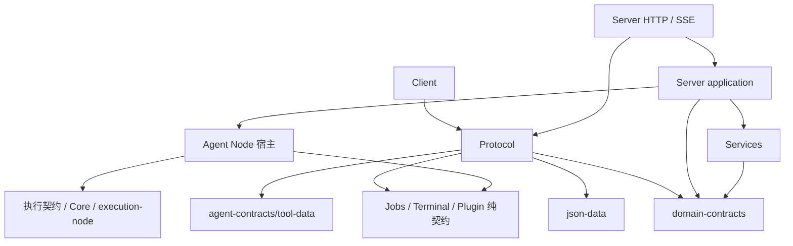

# Protocol 分层收敛方案

> 状态：2026-10-22，P7–P13 实现与集中验收完成。当前阶段 P13，`stageExceptions` 为零；详见[最终验收记录](../reviews/2026-10-22-protocol-layering-closeout.md)与[分阶段计划](../plans/2026-10-22-protocol-layering.md)。`01035993` 与 P7 的 4,173 条关系保留为历史基线。

## 1. 问题与目标

Protocol 负责 Vykor 客户端与服务端之间的通信格式，包括请求、响应、事件、版本、编解码和通信校验。P7 基线时，它还拥有能力数据、产品领域记录、配置归一化和执行策略，底层包因此反向依赖通信层；本轮将这些内容迁回各自所有者。

迁移前，除 Client、Server 外，agent-runtime、channels、host-config、jobs、mcp、plugins、sandbox、services、terminal 共 9 个包声明了 Protocol 运行依赖。Core、Kernel、execution-node、tools 已无直接依赖，但部分依赖链仍经上述包到达 Protocol。P0–P6 的规则明确允许了这些边，因此“阶段例外为零”不足以证明这个边界已经收敛。

本轮目标：能力包拥有自己的契约，产品领域记录有独立来源，Protocol 消费这些数据并适配通信格式。Server 的应用层和存储接口也不再由 HTTP 请求类型决定。既有状态机、权限、预算、持久格式和资源关闭责任保持原语义。

## 2. 所有权的判断规则

| 类别 | 判断依据 | 所有者 |
| --- | --- | --- |
| 执行契约 | 无客户端也存在的模型、工具、执行权限与运行交互 | agent-contracts；仅执行相关内容 |
| 能力契约 | 某项能力自己使用的参数、状态和结果 | jobs/terminal 的纯数据子入口；插件另设纯契约包 |
| 产品领域记录 | Session、Run、Goal、附件等需要长期保存的数据 | 新增 domain-contracts，按业务子入口组织 |
| 存储命令 | 写库、事务、投影结算所需的内部输入 | services 各领域的 commands.ts |
| 应用用例输入 | 发起 Goal 操作、提交输入、修改配置等业务意图 | Server application 各用例的 inputs.ts |
| 应用查询结果 | 用量汇总、运行观察、清理预览等计算结果 | Server 对应应用模块的 query-models.ts；HTTP 转换为公开 DTO |
| 通信 DTO | HTTP/SSE 请求、响应包装、公开事件、握手和分页格式 | protocol |
| 通用 JSON 算法 | 对象原型、有限数值、字节/深度检查、确定性序列化 | 新增 json-data，不携带业务默认值 |
| 策略 | 允许什么、使用何种默认值、何时执行/重试/关闭 | 对应权限、Node 或应用/能力模块；附件默认限额由 Services 单独持有，Server 引用 |

名字包含 Request、Snapshot 或 Record 不直接决定归属。相同的领域数据可以被 Protocol 明确再导出；不同语义的数据通过映射转换，不为了复用名字强行共用一个类型。

## 3. 包与依赖方向

新增三个有明确范围的 workspace 包：

| 包 | 职责和正式子入口 | 允许依赖 | 禁止放入 |
| --- | --- | --- | --- |
| json-data | `/json`：JsonValue、结构检查、确定性序列化、显式有界复制 | 无 workspace 依赖 | UUID 工具合集、业务限额、权限、HTTP 错误 |
| plugin-contracts | `/manifest`、`/presentation`、`/validation`、`/limits`：清单、展示和格式硬上限；`/runtime`、`/runtime-data`：后端绑定、来源、lease 与复制适配 | json-data、agent-contracts/tool-data | 插件安装器、进程、活动目录、SessionGoal、HTTP 请求 |
| domain-contracts | `/sessions`、`/inputs`、`/goals`、`/attachments`、`/schedules`、`/channels`、`/notes`、`/memory`、`/approvals`、`/plugin-apps`、`/workspace-changes`、`/usage`、`/maintenance` | json-data、plugin-contracts 的纯数据入口、必要的执行数据 | Repository、事务、宿主接口、调度、文件 I/O、配置加载、报表查询模型 |

domain-contracts 只组织 Vykor 产品实体及其数据不变量；Job、Terminal、插件清单、通用 JSON、应用查询结果不搬进去。新增类型必须能说明它保存或引用哪种产品实体、由谁维护状态；只因两个包都使用而无法回答的类型不能加入。各模块只暴露自己需要的接口，不设置汇总全部类型的根 barrel（汇总导出文件）；禁止消费者通过包根绕过子入口约束。



最终直接依赖 Protocol 的范围：Client、Server 的 HTTP/SSE 接入层、明确的客户端通信适配层，以及协议联合测试。Server application、services、Node、host-config 和能力包不直接依赖它。Server 包的清单可以因 HTTP 模块声明依赖，但包内模块规则必须继续限制来源。

Jobs、Terminal 采用现有包内的 `/contracts` 子入口，因为它们可以在移除 Protocol 后保持无 I/O；plugin-contracts 独立建包，因为 Protocol 引用插件数据时不应安装或触达插件安装器及本机依赖。纯子入口既检查源码/声明闭包，也检查 manifest 依赖环，不能仅用子入口名称解释隔离。

以下为本轮涉及的依赖调整，其他依赖沿用 P0–P6 的职责约束：

| 消费方 | 改用的数据/策略来源 | 本轮禁止新增或保留的关系 |
| --- | --- | --- |
| host-config / sandbox | agent-contracts/permissions；sandbox 继续使用本机配置 | 两者 → Protocol；host-config → permissions 实现 |
| jobs / terminal | 自己的 contracts.ts；实现引用本包纯数据 | 两者 → Protocol/domain-contracts；纯入口 → 实现 |
| plugins / mcp | plugin-contracts、json-data、agent-contracts/tool-data | 两者 → Protocol/domain-contracts；MCP → 插件安装器 |
| permissions | agent-contracts 的执行权限数据和已有本机配置 | 权限计算 → Protocol/产品记录 |
| services | domain-contracts、自己的 commands.ts 与既有存储模块 | Services → Protocol/Server/Node 宿主 |
| channels | 自己的消息/连接/平台传输契约 | channels → Protocol/domain-contracts/Services/Server |
| agent-runtime Node | plugin-contracts、Jobs/Terminal 纯数据、执行/配置/权限模块 | Node → Protocol/domain-contracts/Server/Services |
| Server application | domain-contracts、Services、Node，以及自己的输入/查询模型 | 应用层 → Protocol/HTTP；HTTP DTO 作为内部命令 |
| Protocol / Client | Protocol → 明确的数据子入口；Client → Protocol | Protocol → 实现、策略、Services、Node；Client 绕过 Protocol 直接依赖产品包 |

## 4. 类型、校验与策略的迁移位置

下表以迁移前的 `packages/protocol/src/` 为来源根，列出实现后的规范归属。细分领域入口包括 `/sessions/records`、`/sessions/model-metadata`、`/sessions/runtime-config`、`/approvals/auto-review` 和 `/plugin-apps/history`；它们不建立根汇总入口。

| 来源 | 目标位置 | Protocol 最终保留什么 |
| --- | --- | --- |
| approval-mode.ts 的 ApprovalMode、WorkMode | agent-contracts/src/permissions.ts，替换 children.ts 中对应字面量重复定义 | 只选择性公开通信使用的类型 |
| normalizeApprovalMode、isWorkMode | host-config/src/permission-modes.ts；保持已有旧值归一化语义 | 通过字段适配使用规范结果，不拥有配置迁移 |
| effectivePermissionMode | permissions/src/effective-permission-mode.ts；保持 plan 上限和现有 ask/auto_review/full_access 映射 | 不保留执行策略函数 |
| approval-review.ts | 执行审查 Input/Evidence/Result/Outcome 归 agent-contracts/src/permissions.ts；持久 ApprovalReviewRecord 归 domain-contracts/src/approvals/records.ts | 审查记录的通信形状和解码 |
| json.ts | JsonValue/isJsonObject/isJsonRecord/validateJsonRecord/stringifyCanonicalJson 归 json-data/src/json.ts；UUID、整数等字段校验留所属 schema | 通信字段辅助函数与 Protocol 错误转换 |
| job.ts | jobs/src/contracts.ts，新增 `/contracts` 出口 | 显式公开这些可序列化数据；编解码仍在 serialization.ts |
| terminal.ts | 能力参数、状态、事件归 terminal/src/contracts.ts；带 AbortSignal 的等待接口仍在 provider.ts | 请求解码及对外响应，不复制能力状态定义 |
| plugin-presentation.ts、plugin-apps.ts 的清单/后端/资源/展示定义 | plugin-contracts/src/manifest.ts、presentation.ts、validation.ts | 对外展示 DTO 引用规范定义 |
| PLUGIN_APP_HTML_MIME_TYPE | agent-contracts/src/tool-data.ts 中的规范 MCP_APP_HTML_MIME_TYPE | 不再成为 MCP/插件实现的常量来源 |
| PLUGIN_APP_LIMITS | 按下一张表拆分清单/数据硬上限、Node 有效限制和 Server 会话配额；不把 windowPages 的请求限制误当成纯桌面策略 | 通信大小检查引用结构上限，不决定运行授权 |
| PluginAppToolPolicy、getPluginAppToolPolicy | 策略描述形状归 plugin-contracts/src/runtime.ts；默认值和有效策略判断归 Node plugin-apps/policy.ts | 只输出已计算的描述；页面提交不能指定 granted |
| PluginAppRecord、ActionMetadata/Receipt、SubmissionReceipt | domain-contracts/src/plugin-apps/records.ts | 请求/响应封装、租约传输和 HTTP 错误 |
| PluginAppRuntimeLease、PluginAppToolOrigin | plugin-contracts/src/runtime.ts；它们仅为不透明凭据/来源数据，不赋予自行构造后即可执行的权限 | 通信端可显式公开数据形状 |
| parsePluginAppToolRequest 等请求 parser | 留 protocol/src/plugin-apps.ts；纯数据验证复用 plugin-contracts/json-data | 网络请求解析、拒绝未允许字段、保留现有错误码 |
| copyPluginAppJson | 结构复制归 plugin-contracts/src/runtime-data.ts，底层算法调用 json-data；字节/深度限制显式传入 | 适配调用，不复制算法 |
| session.ts、session-model.ts | domain-contracts/src/sessions/records.ts、model-metadata.ts | SessionStateSnapshot 等响应组合及序列化版本 |
| session-input-items.ts | domain-contracts/src/inputs/items.ts、validation.ts | 传输请求包装，使用相同输入数据规则 |
| session-requests.ts | 写库输入归 services 各领域 commands.ts；应用输入归 Server 各用例 inputs.ts | 仅保留网络确实使用的请求类型，移除 CreateRun/AppendEvent 等存储出口 |
| requests.ts 的 metadata 清理和保留字段校验 | domain-contracts/src/inputs/metadata.ts；Server 对非 HTTP 入口同样执行；Services 校验自己的命令 | ProtocolError/ProtocolValidationError、请求 parser、状态码/字段错误映射 |
| session-goals.ts | 记录/状态/输入结构与上限归 domain-contracts/src/goals/；默认自动回合数及运行决策归 server/application/goals/goal-policy.ts | Goal 请求 parser 和响应数据，不启动/排队/恢复 Goal |
| attachment.ts、office.ts | 附件记录、限制形状、媒体识别归 domain-contracts/attachments；DEFAULT_ATTACHMENT_LIMITS 单一归属 services/src/attachments/attachment-policy.ts，Server 引用；Office 转换使用 services/office/contracts.ts 的 OfficeDocumentPreview | 上传与网络输入解析；OfficePreview 保留通信形状，当前没有 Server producer，不创建空 mapper |
| scheduled.ts | domain-contracts/src/schedules/records.ts；存储命令归 services/schedules/commands.ts | 对外创建/更新请求，不负责调度和重叠执行决策 |
| channel.ts | 记录归 domain-contracts/src/channels/；稳定输入 ID 算法和应用桥接归 server/application/channel/ | HTTP 接入请求与状态响应 |
| notes.ts、memory.ts | domain-contracts/src/notes/、memory/ 的记录和纯数据校验；修订号冲突与 I/O 留 Services/Server | 请求 parser 与响应 DTO |
| runtime-config.ts | 配置数据、readRuntimeMetadata/readSessionRuntimeRevision 归 domain-contracts/src/sessions/runtime-config.ts；readSessionRuntimeConfig、patch/changed 等组合计算归 Server application/session/runtime-configuration.ts，旧值归一化调用 host-config，执行模式计算调用 permissions | 公开配置 DTO 和反序列化；纯读取不引入权限策略实现 |
| auto-review.ts、workspace-changes.ts | domain-contracts/src/approvals/auto-review.ts、workspace-changes/；自动审查触发/证据和工作区采集留应用层 | 展示数据与通信校验 |
| maintenance.ts | UsagePrice/UsageSettings 归 domain-contracts/src/usage/settings.ts；StorageRetentionPolicy/MaintenanceBackupManifest 归 domain-contracts/src/maintenance/records.ts；报表、筛选、预览的内部模型归 server/application/maintenance/query-models.ts | UsageReport/StorageReport/CleanupPreview 等公开响应，HTTP 显式映射应用查询结果 |
| capabilities.ts、serialization.ts、mcp-oauth.ts、channel-runtime.ts、execution-observability.ts | 通信版本、解码、OAuth/通道公开视图、执行观察查询和导出 DTO 留 Protocol；对应应用输入/查询模型归各自 MCP 应用服务、channel/query-models.ts、observability/query-models.ts 等所属模块 | 保持通信职责；HTTP 映射输入和结果，底层能力保持自己的状态，不反向引用这些视图 |
| 历史界面记录与解析 | 记录和纯数据校验归 domain-contracts 的 plugin-apps/history.ts | 历史 HTTP 请求/响应适配；不恢复已退役执行入口 |

TerminalScope 的 project/session 字段在本轮保持原形状，视为终端归属数据；Server/桌面负责验证归属和解析 cwd。TerminalProvider 不因此取得 Session/Project Repository。如果以后需要跨产品终端 SDK，再单独设计 ownerKey，不与本次拆分混做。

`PLUGIN_APP_LIMITS` 按以下实际使用语义拆分。表内数值固定为基线值；执行限额不能突破格式硬上限，格式合法也不能替代授权。

| 现有字段和值 | 目标所有者及使用方式 |
| --- | --- |
| manifestCount 8、manifestBytes 256 KiB、backendCount/surfaceCount 32 | plugin-contracts/limits 的清单硬上限，plugins 的文件读取和清单校验共同使用 |
| htmlBytes 16 MiB、resourceBytes 8 MiB | plugin-contracts/limits 的资源硬上限；Node plugin-apps/policy 组装有效限制，资源读取通过参数接收；不引入新的放宽设置 |
| maxArgsBytes 64 MiB、jsonDepth 32 | plugin-contracts/limits 的调用数据硬上限；Node 有效参数限制不得超过它，Protocol 只做结构检查 |
| argsBytes 64 KiB、appDataBytes 256 KiB | Node plugin-apps/policy 的默认参数限制和本机应用数据结果限制 |
| handoffBytes 32 KiB、messageCharacters 4096 | domain-contracts/plugin-apps/limits 的产品输入上限；应用入口和通信 parser 均执行 |
| sessionPages 4 | server/application/session/plugin-app-policy.ts 的会话打开配额；继续由 Server 强制执行，桌面不能代替 |
| windowPages 8 | 当前实际用于 composer contexts 请求数量，迁为 domain-contracts/plugin-apps/limits 的 maxComposerContexts 8；若桌面有独立窗口配额，由桌面自行维护，不共用此策略名 |
| resultBytes 1 MiB、widgetStateBytes 32 KiB | 基线未发现生产消费者；P12 删除无用出口，不新建策略；已有 MCP 结果 1 MiB 限制及其来源保持不变 |

现有 parser 对请求包装额外允许的 16/32 KiB、文本复制的字符倍数等计算也纳入固定样本，不能仅保存这张表的常量。

## 5. 校验与策略的调用顺序

HTTP 请求 → Protocol 校验通信结构 → 应用服务校验 owner、版本、当前状态与授权 → 构造内部命令或宿主绑定 → Services/Node 校验自己的数据和资源边界 → 执行与可靠记录 → 映射为响应并序列化。

- 插件及插件产品输入校验使用 `ValidationResult<T> = { ok: true; value: T } | { ok: false; code: string; field?: string }`；各自定义局部结果类型，不为这个形状新建通用类型仓库。既有领域 parser 保留抛错控制流，改用纯数据错误 `DomainValidationError(message, field, reason)`；Protocol 和 HTTP 在边界转换成原通信错误，避免迁移时同时重写校验语义。既有 JSON 函数保留 valid/reason 结果接口。它们均不导入 ProtocolValidationError，不访问当前配置、文件、连接或数据库。
- Protocol 的公开 parser 保持原有返回值和 ProtocolValidationError 的 code/field；应用层将规范校验失败转成应用错误，HTTP 统一映射。不能依靠 Error.message 文案判断业务类别。
- Protocol 可以判断协议版本是否相同、JSON 是否可传输、DTO 是否缺字段；硬 deny、工具确认、Goal 准入、租约有效性和默认执行模式由现有执行/应用负责人决定。
- 同一个有界 JSON 规则只保留一个算法来源。json-data 的规范序列化必须保持现有排序、数字、原型键、深度和字节语义，包括 canonical 中对象/数组 `depth >= 20` 的拒绝边界；插件复制保留 `depth >= 32`，MCP 结果保留自己的 `depth > 32` 和复杂度限制。不能为统一命名改成一个默认阈值。

## 6. Node 与应用记录分开

迁移前的 `AgentHost.plugins.runPluginAppTool(app: PluginAppRecord, request: PluginAppToolRequest, options)` 让 Node 接触产品记录和通信 parser。当前使用：

```ts
interface PluginAppHostInvocation {
  binding: PluginAppHostBinding;
  lease: PluginAppRuntimeLease;
  toolName: string;
  args: Record<string, JsonValue>;
}
```

PluginAppHostBinding 定义于 plugin-contracts/runtime，包含 owner 的 agentId/sessionId、不透明 instanceId、插件 ID/version/digest、definitionDigest、backendId/kind 和 resourceUri。Server 从已保存记录设置 `instanceId = app.id`，只供 Node 做实例隔离和 lease 撤销；它不包含可变应用记录、open/closed 状态、控制 revision、Run 账本或页面信息。字段不能取自页面或模型提供的自称来源。

Server 解析请求、验证应用状态和 revision 后生成上述调用。Node 的 `AgentHost.plugins.runPluginAppTool(invocation, options)` 验证 owner、当前插件绑定、后端 generation 和 lease，捕获原工具绑定，再调用既有 Kernel.runTool，输出规范的 PluginAppToolOrigin。Node 保持原 lease 权威，Server 只适配它，不增加第二份 token 表。Server 保留本次 requestId/revision/应用动作与可靠事件的对应关系。

迁移不删除 Node 的二次来源校验，不向页面开放构造可信绑定的能力，不把合法 JSON 当成已授权。普通模型工具和应用工具继续使用相同参数/权限/Hook/超时管道；硬 deny 优先，固定授权仍仅作用于原工具与固定参数。

channels/src/core/durable-bridge.ts 同样是应用桥接，迁入 server/application/channel/durable-channel-bridge.ts；channels 保留消息总线、连接和平台传输，不再依赖产品记录或 Protocol。

## 7. 实施边界与验收

本方案实施后替代 P0–P6 方案中“能力包可依赖 Protocol”的相应目标矩阵；不否定已完成的执行与资源所有权调整。新增包使用显式子入口，Client 仍只直接依赖 Protocol，声明来源按规范数据路径单独检查。

| 编号 | 最终验收标准 |
| --- | --- |
| A01 | 上述 9 个包的生产源码、测试和 manifest 不再依赖 Protocol；Server application 也无直接/隐藏依赖 |
| A02 | 三个新包及 jobs/terminal 的纯数据入口无 Node I/O、handle、AbortSignal、Repository、配置或上层依赖；workspace 无环 |
| A03 | agent-contracts 仅增加本表列明的执行权限数据和 MCP 数据常量；Session/Goal/Note/插件安装与通用 JSON 工具不进入其中 |
| A04 | AST 门禁覆盖 manifest、静态/动态/类型导入、再导出、别名、相对路径与声明来源；新增绕行反例会失败 |
| B01 | HTTP/SSE 字段、版本 5、错误 code/field、SQLite schema、文件格式、事件 ID/cursor 及 payload 字节含义保持不变 |
| B02 | JSON 非有限数、循环、原型键、深度/字节边界及 canonical fingerprint 与基线一致 |
| B03 | 权限模式、审查失败回退、硬 deny、固定授权、伪造来源、过期 lease 和插件撤销行为不变 |
| B04 | Goal 的取消/排队恢复、幂等输入、用量记账、附件引用、便签修订、Schedule 和通道补发保持原行为 |
| B05 | Job/Terminal 的 read/wait/cancel、owner 隔离和四种 Workflow 取消继续等待清理；没有新增执行负责人或全局目录 |
| B06 | Client 浏览器构建无 Node 依赖；独立 SDK 的默认 Node、Kernel、Workflow 声明与运行验证通过，Kernel 不可达产品领域记录 |

每阶段连同调用方、exports、锁文件和契约测试一起迁移；正式旧内部导出不留长期转发。Protocol 对线格式中真实使用的规范数据可以明确再导出，这属于长期通信 API，不能顺带导出能力接口和策略。

用户已连续授权 P8-P13，无需逐阶段再确认。仅实施内部收敛，不发布、不推送、不升级协议或数据格式、不改真实用户数据；P7–P13 按用户要求合为本次整体提交。Client 的既有配置与插件策略辅助函数由本地请求构造/显示投影保留，只依赖 Protocol，不构成服务端策略或宿主授权。发生必须改变线格式的情况时，单独形成版本及迁移决策。回退以本次整体提交为单位，不通过新增兼容猜测接回半迁移接口。
