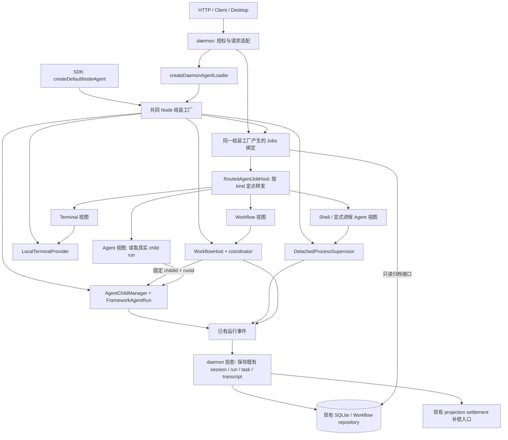
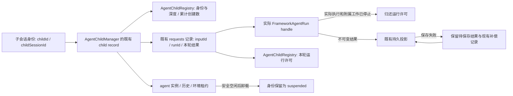

# SDK 与 daemon 共用执行核心的架构方案

> 状态：已实施并通过真实验收。A/B/C 均已审查并分别提交；三文件真实生命周期 66/66（A7+B31+C28），四大门禁与文档/退役检查通过，尾部审查修正另有定向复验。核对日期：2026-10-28。实施入口：[文件级实施计划](../plans/2026-10-27-shared-execution-core.md)。事实依据：[固定版本调研](../../research/2026-10-27-agent-task-lifecycle-comparison.md)。

推荐沿用现有四类执行器，把它们共同放到 Node 组装路径中。SDK 与 daemon 使用相同的执行器、Jobs 路由、子 Agent 名额和收尾规则。daemon 只增加授权、环境接入、持久记录和 HTTP 返回格式。删除重复的 child 执行登记器、daemon Jobs 生命周期分支和按全量列表发现归属的逻辑。

这里的“共同核心”不是再加一个掌管所有任务的管理器。Agent、Shell、Terminal、Workflow 分别保留一个真正运行任务的实现；共同的是两种入口都调用这些实现，以及它们遵守同一套停止确认和结果保存约定。

## 1. 基线核对与本次范围

调研基线为 `45e30ad25d66a53b4aff2e8fb2b4960910e31bfc`，方案编写时工作区 HEAD 为 `dc654b8a752ddacf659cada5394e473bcc14dad5`。两者之间已合入 Q1 存储优化及 Q2 回滚证据。核对命令：

```powershell
git diff --name-only 45e30ad25d66a53b4aff2e8fb2b4960910e31bfc..dc654b8a752ddacf659cada5394e473bcc14dad5 -- packages apps tests scripts
git status --short
```

生产代码差异限于 `application/maintenance/cleanup-settings.ts`、`application/session/execution/tool-operation-service.ts` 及其测试、基准和说明。本文涉及的 child、Jobs、执行器、Workflow 与协议代码没有变化，原报告的四项复现仍适合作为设计输入。保留 Q1 优化，不重新打开 Q2，也不再次调研五个外部仓库。

用户已授权方案、计划与 A/B/C 三阶段生产实施。修改涉及超过 8 个文件，主要原因是删除 SDK/daemon 两套接线和修改 Jobs 契约必须同时更新调用方。按三个可交付阶段组织，每阶段内的契约、接线、删除和验收须完整合入，不能发布半个阶段。

不做：通用 Job 状态数据库、分布式调度、跨进程自动重放、新的结果缓存服务、额外执行 ID、常驻实例 LRU、父任务借用名额。daemon 重启继续采用现有中断核对与持久记录恢复，不恢复已经失去执行归属的 JavaScript 任务。

## 2. 最终调用流程



图中的 Jobs 视图只把各领域已有事实转成 `JobSnapshot`，没有自己的运行 Map、完成回调、计时器或输出副本。`RoutedAgentJobHost` 保存固定的类型到来源绑定，不保存任务到来源的缓存。SDK 默认使用内存结果；daemon 注入既有持久读写端口。同一任务的实时状态只由图中一个执行器给出。

启动有两个入口：SDK 直接调用 `createDefaultNodeAgent`；daemon 先验证会话、当前授权和环境，再通过 `createDaemonAgentLoader` 调同一个工厂。后台 Shell 的 HTTP 创建入口也调用工厂所绑定的同一个 `DetachedProcessSupervisor`，不能经 daemon 服务另起一套启动规则。

读取、等待、取消的路径：请求携带任务类型和已有 ID；路由只调用该类型来源；来源先查该执行器的定点索引；明确“不在本进程”后才读取对应持久记录。数据库失败、权限失败和执行器失败必须原样报告，不能当成“不存在”后换执行器。等待只订阅指定执行器的事件或完成 Promise；等待请求超时仅结束观察，不停止任务。

## 3. 身份、状态与额度分别属于谁



| 概念 | 唯一事实来源 | 复用内容 | 不再承担的职责 |
| --- | --- | --- | --- |
| 子会话身份与亲子关系 | `AgentChildManager` 的 child record；`AgentChildRegistry.byId/bySessionId/depthBySessionId` | 已有 `childId`、`sessionId`、父关系；daemon 的 session/task 记录 | 不能以 idle/suspended 身份占运行名额 |
| 一次输入和 run | child record 内已有 `requests`；实际 `AgentRunHandle` | 已有 `inputId`、`runId`、`AgentInputReceipt` | 不用 Promise 对象身份识别 run，不新增 generation/task/attempt ID |
| 实际执行结果 | 上述 run 记录引用的单次结算结果 | 现有 `AgentChildResult` / `AgentRunResult` / `failureKind` | Jobs、daemon registry 不再复制并独立改写结果 |
| 结果保留 | SDK 现有有界 requests；daemon 现有 run/transcript/task 与 Workflow repository | 现有 requests 上限 256；既有持久结构 | 结果占用存储不等于占用运行名额 |
| child 运行名额 | 现有 `AgentChildRegistry` 内按 runId 获取与归还的许可 | `maxActiveChildren` 默认 8、根树共享范围 | 不按 child.close 才释放；不新增 QuotaManager |
| 子树创建限制 | 同一个 `AgentChildRegistry` | `maxDepth=4`、`maxTotalChildren=64`；system child 仍不计 total | 深度和累计创建数不随一轮结束清零 |
| 常驻实例和环境 | 现有 ChildManager、ExecutionRuntimeOwner、环境 lease | 现有 creating/suspending/close Promise 和 5 分钟空闲 TTL | 不增加第二个实例池，不借结果缓存管理资源 |
| Shell / 显式 OS Agent | `DetachedProcessSupervisor` 的 execution/state 与进程退出、输出 drain | 已有 execution ID、请求指纹和 generation 防迟到机制 | daemon 不决定何时算 stopped |
| Terminal | `LocalTerminalProvider` 内 PTY session | 已有 terminal ID、退出事件和输出缓冲 | daemon 不另做终端状态机 |
| Workflow | `WorkflowHost` 的 live run；coordinator 的步骤、deadline、重试策略 | 已有 Workflow runId 和步骤 attempt | runner 不另做停止宽限、失败重试与后端探测 |

`LiveChildAgentDirectory` 保留为 `childSessionId -> rootAgent + childId` 的接线索引，不能加状态和输出。daemon 历史任务记录用已有 `metadata.executionBackend` 区分 `child_agent` 与 `detached_process`。新框架 Agent 一律走 child；现有显式 `startAgentProcess` 仍是原生进程 API，并复用进程执行器，不再冒充框架 child。

### 一轮执行的最小契约

在 `agent-contracts/src/execution/execution.ts` 扩展真实 run handle 的结算屏障。屏障是一个 Promise，用于确认本轮实际工作已经停止，不是新状态库。

```ts
export interface AgentRunSettlement {
  // 复用现有结果类型；只存一份终态结果，不另设状态枚举。
  readonly result: AgentRunResult | AgentChildResult;
  readonly stoppedAt: number;
}

// 加到现有 AgentRunHandle；result 保留为同一结算事实的便利返回值。
readonly settled: Promise<AgentRunSettlement>;
```

`FrameworkAgentRun` 把已有 `completedResult` 与 `onSettled` 的分散数据改成这一个结算事实。先捕获模型和工具的实际结果，完成实际清理并兑现 `settled`，再等待终态事件保存。现有 `result` 是同一结果的便利返回，仍可因可靠事件投递失败而拒绝；ChildManager 从 `settled` 读取实际结果并释放许可，独立观察 `result` 的保存错误，记入原 run 记录的 `projectionError`。保存结果不写回不可变的执行事实。不能从 `result.catch` 猜执行是否停止。

`settled` 只在当前 run 的模型迭代、已接纳工具、取消传播及必须等待的附属清理完成后兑现；已明确 detached 的 Shell/PTY 有自己的执行归属。清理抛错而停止无法确认时，`settled` 保持未兑现，由实际退出/清理完成事件最终推进，不能以异常代替确认。这里直接复用 `core/src/engine/tools/query-tool-limits.ts` 已有的真实 invocation 完成 Promise：`checked-tool-execution.ts` 将它同时交给当前 run 的 `AgentExecutionContext.observeInvocation` 和原 S1 operation observer。当前 run 仅等待自己接纳的调用，不新增全局工具执行登记器。工具超时或 abort 的 race 完成，不等于真实 invocation 完成。

ChildManager 的 `requests` 每条记录保存同一个 runId、真实 handle、许可与结算引用，替换散落的 `lastResult/resultPromise` 观察状态。原有同 inputId 幂等规则保留。正在运行或尚待保存的结果不能因 256 条上限被丢弃；尚待保存结果占满保留额度时拒绝接纳新的留存项并报告存储故障，不能靠无界缓存撑住。归档已完成、无执行归属且无需补偿的旧记录才可淘汰。SDK 无归档时明确返回 `RUN_RESULT_NOT_RETAINED`。

在现有 `AgentChildHandle` 增加定点接口，并让 `AgentChildInvocation.runId/inputId` 对成功接纳变成必填：

```ts
export interface AgentChildRunSnapshot {
  readonly receipt: AgentInputReceipt;
  readonly startedAt: number;
  readonly updatedAt: number;
  readonly stopping: boolean;
  readonly result?: AgentChildResult;
  readonly stoppedAt?: number;
  readonly projectionError?: { readonly message: string };
}

readRun(runId: string): AgentChildRunSnapshot;
waitRun(runId: string): Promise<AgentChildRunSnapshot>;
```

snapshot 是上述 canonical record 的只读副本，不再保存独立状态。`result` 只在执行停止确认后出现。现有 `interruptRun(expectedRunId)` 继续负责匹配，返回的 boolean 明确定义为“该轮停止请求已接纳”，不再等同“已经停止”；它在原 run record 中保留唯一停止 Promise，由核心继续等待。Jobs cancel 接纳后即可返回 stopping；需要确认的调用方显式等 `waitRun`，不为 cancel 再设宽限 timer。关闭整个会话仍用 `interrupt/close`，且必须等待实际停止。同步更新现有等待型调用方，不保留旧语义的别名。`handle.result` 是最新一轮结果的便利入口，可以每次返回新 Promise，任何实现和测试均不得以 Promise 相等判断轮次。

许可方法放在现有 `child-registry.ts`：`reserveIdentity(parentSessionId, childSessionId, options)` 只处理深度、total 和身份回滚；`acquireRun(childSessionId, runId)` 返回幂等 `release()`。后者先于创建/恢复实例和提交执行，受同一根树的同步原子检查保护。到达 8 立即拒绝，不引入排队，以免占满名额的父任务等待子任务造成死锁。一次 run 的许可在确认停止时归还，身份深度在 close 时移除，累计 total 的原有策略不变。

## 4. Jobs 定点路由契约

在 `packages/jobs/src/contracts.ts` 定义下列值对象，在 `index.ts` 更新请求类型。它只组合已有身份，不生成 ID。

```ts
export type JobTarget =
  | { kind: "agent"; jobId: string; runId: string }
  | { kind: "shell" | "terminal" | "workflow" | "dream"; jobId: string };

export interface JobListResult {
  jobs: JobSnapshot[];
  errors: Array<{ kind: JobKind; message: string }>;
}

// JobReadRequest、JobWaitRequest、JobSendRequest、JobCancelRequest
// 都使用 sessionId + target；不再接收孤立 jobId。
// JobSnapshot 增加 target；agent 的 target 来自已接纳的那一轮。
```

路由接受 `Partial<Record<JobKind, AgentJobHost>>` 的静态绑定，每种 kind 只能注册一次。`agent` 来源以 direct child 索引或 direct session-task 存储读取既有 backend；对显式进程 Agent，`runId` 等于其既有单次 execution ID，由接纳回执提供，不能生成额外 ID。SDK 无存储时直接检查 child 和 supervisor 的已有 ID 索引；两者同时声称同一 Agent ID 要报归属错误，不以先查到的获胜。`dream` 若启用，绑定到现有显式进程来源；未启用返回不支持，不能偷偷探测其他后端。

`list` 用 `allSettled` 聚合已绑定来源，返回成功项和来源错误，统一过滤、排序、截断。某来源列举失败不污染定点操作。重复 ID 在不同 kind 内不冲突；同 kind 的多重接线在组装时立即拒绝。没有 `ownerByJobKey`，没有 `resolve -> list`。

框架 Agent `send` 的 target.runId 是继续输入的预期轮次，处理时原子核对；已结束时创建下一轮并返回已有 `AgentInputReceipt`，运行中则遵循现有 steer 接纳规则返回同轮回执。过时 runId 返回冲突，不能把迟到输入送到新一轮。显式进程 Agent 和 Shell/Terminal 输入只送给仍在运行的原生执行，不返回框架 run 回执；进程结束后不再以 writeInput 自动重开同一个 execution ID，删除该旧 restart 分支。确需新进程时显式 start 并使用已有的新 execution ID。将 `send` 返回类型定为 `Promise<AgentInputReceipt | void>`，Jobs 包通过结构类型 `JobInputReceipt {sessionId,inputId,runId}` 表达，避免 jobs 反向依赖 agent-contracts；两者结构一致。

Agent 取消必须固定 runId；若该轮已结束直接返回该轮终态，不能停止下一轮。Workflow 的 target.jobId 统一使用现有原始 Workflow runId，删除 `workflow:` 前缀与 raw ID 的双重解释。`JobSnapshot.target`、Agent/Workflow 工具回执和列表均携带完整 target，客户端可原样传回。

这要求一次明确的 API 切换：协议版本从 5 到 6，Jobs feature 从 2 到 3；同阶段更新 server、client、tools、CLI 和 desktop，沿用现有版本不匹配拒绝入口，不增加开关或 v5 别名。`/jobs show|cancel` 改为显式类型参数，Agent 还需 runId；无须先 list。SDK 的 `ObservableJobProducer` 全 host 覆盖改为低层 provider/environment/storage 端口，宿主不能再注入另一套生命周期。

## 5. 统一收尾：先确认停止，再分别处理许可和保存

所有领域遵守顺序：固定已有执行身份，记录停止原因，要求真实执行器停止，等待它的停止屏障，冻结实际结果，归还执行许可，保存结果并按已有约定补偿。领域执行器决定自己何时停止，共同契约决定哪些事实可以对外发布。

| 情况 | 可对外发布的执行事实 | child 运行许可 | 保存与后续行为 |
| --- | --- | --- | --- |
| 启动前明确未派发，且环境/准备已撤销 | failed / not_started | 回滚 | 保存失败回执，不重放输入 |
| `started` 回执失败，已有真实 handle 或可能启动 | stopping | 保留 | 对该真实 handle 发停止并等待 settled，不能直接 deleteRecord |
| 正常完成 / 执行失败 | 冻结实际 completed / failed 结果 | 确认停止后释放 | 保存同一结果，不因落库失败改写执行结果 |
| 运行超时 / 用户取消 / 父取消 | stopping，直到实际停止；之后按既有 failureKind 返回 | 未确认时保留 | 相同收尾函数，原因分开记录；不得靠超时假定已停止 |
| 停止动作报错或清理仍未结束 | stopping + cleanupUnconfirmed 诊断 | 保留 | 后续退出或清理确认继续完成原收尾，不重新执行 |
| 已确认停止，但终态事件或结果保存失败 | 实际终态 + projectionError；持久记录尚待补齐 | 释放 | 复用现有 projection settlement 补偿；不得第二次调用模型/工具 |
| 等待请求超时 | 仍返回真实 running/stopping 或已完成状态 | 不改变 | `timedOut=true` 仅表示观察期限结束 |
| 旧轮结果迟到 / 旧实例清理迟到 | 只更新旧 run，或忽略重复结算 | 只能释放旧 run 的许可一次 | 通过既有 runId 与实际 record/handle 引用核对，不重置新轮 |

`FrameworkAgentRun` 的启动/输入/工具持久写入仍是执行前置条件；本次仅把“已经停止但终态保存失败”从“还在执行”中分开。现有 S1 工具 unknown 写入保护、model attempt 账目、权限上限和投影补偿均保留。未知写入不能自动重放。

`DetachedProcessSupervisor.stopExecution` 不得先写 stopped 再 kill；保持非终态/停止请求事实，直到进程树终止与输出 drain 确认。启动幂等、启动中取消、环境 lease 释放统一放回这个已有执行器，daemon 的 BackgroundShellService 只提供授权、已有 SQLite 接纳记录及环境获取/保存回调。SDK 的无存储实现也经过相同代码。

不新增后台重试服务：保存补偿继续交给现有 `application/agent/projection-settlement-recovery.ts` 路径，按原 runId/事件 ID 幂等写入。它目前只对 `child.closed` 重试终态投影，其他 child 事件会走失败补偿；必须把 `run.completed/run.failed/run.interrupted` 纳入同一终态保存分支，保留原 outcome。旧轮补偿只更新其 run/transcript；只有 `SessionTask.runId` 仍等于该轮时才能更新 child 的当前 task 摘要。Shell 的保存也通过现有 SessionExecutionProjector 和同一补偿入口完成，不复制执行。若停止永远无法确认，系统诚实保留 stopping 和占用量；本次不承诺跨进程追杀与恢复。

## 6. Workflow 收拢与空闲回收

`WorkflowHost` 仍保存工作流 live run；coordinator 仍处理依赖、步骤 attempt、并发、deadline 和是否重试。`AgentWorkflowRunner` 只负责创建 child、保存已有 `childId/runId`、等待该轮 `waitRun`、把 coordinator 的取消传给 `interruptRun`。角色自带的 timeout 上限由 child 核心执行，Workflow 总期限由 coordinator 发停止请求；两者都调用同一停止入口。删除 adapter 的第二套 wait timeout 和 5 秒停止宽限。沿用 Workflow active run 已有 `stopReason/cancellation` 表达停止中，Jobs 映射为 stopping；repository 的 running/completed/failed 枚举不再增加一套状态。

coordinator 已有 `cleanupUnconfirmed` 阻止重试的规则继续保留。读取失败不能被当作 worker 消失，更不能 `catch` 后重新 spawn。恢复步骤只在持久记录明确允许继续且原执行确认不存在时进行；daemon 重启后的未知外部副作用沿用现有保护，不增加自动回放。

成功的一次性 worker 可立即请求安全 suspend，复用 ChildManager 的卸载流程；有活动 run、steer 队列、未决审批、附属工作、活动后代或未完清理时不能卸载，继续现有空闲 TTL。普通可继续对话的 child 仍用 5 分钟 TTL。运行名额与是否卸载无关，不引入新池或 LRU 容量。

`child-agent-options.ts` 在环境获取前，把角色 `model: "inherit"` 解析为本轮父 Agent 实际模型与 provider 配置。Agent 工具、Workflow worker、system child 使用同一解析函数；不让 provider 承担解释别名的职责。

## 7. 模块保留、合并、替换、删除

以下路径均相对仓库根目录 `D:/code/personal-project/OpenHarness-ts`。

| 处理 | 模块 / 文件 | 最终职责或退场方式 |
| --- | --- | --- |
| 保留并修正 | `packages/agent-runtime/src/kernel/framework-agent-run.ts` | 唯一框架 run；结算事实、实际停止屏障、持久错误分离 |
| 保留并修正 | `packages/agent-runtime/src/kernel/children/{child-agent,child-registry}.ts` | child 身份、定点 run 记录、根树许可；不增加并行管理器 |
| 保留并修正 | `packages/execution-node/src/executions/detached-process-supervisor.ts` | 唯一非 PTY 进程执行；吸收启动幂等、启动中取消和 lease 释放规则 |
| 保留并修正 | `packages/terminal-node/src/providers/local-terminal-provider.ts` | 唯一 PTY 执行；补 direct get |
| 保留 | `packages/agent-runtime/src/node/workflow/workflow-host.ts`、`packages/coordinator/src/workflow/task-runner.ts` | 工作流 live run 与已有调度；共用 Jobs view；唯一 Workflow 宽限和重试策略 |
| 替换 | `packages/jobs/src/composite-agent-job-host.ts` → `routed-agent-job-host.ts` | 从 list 发现归属改为 kind 固定绑定；删除旧文件、导出和专项测试 |
| 替换 | `packages/agent-runtime/src/node/jobs/local-agent-job-host.ts` → `child-job-source.ts`、`process-job-source.ts`、`node-job-bindings.ts` | 只有来源视图和一次组装；没有 childObservations、shellRequests、独立完成状态 |
| 删除 | `packages/execution-node/src/executions/child-agent-execution-registry.ts` | 所有 register/begin/complete/stop/writeInput 的 child 镜像控制转回真实 handle；删除 owner 工厂、exports、测试 |
| 合并 | `packages/server/src/application/session/transcript/session-execution-projector.ts` 的 child bridge → `application/agent/daemon-agent-event-projector.ts` | child 持久投影归事件投影器；前者只保留进程投影，删除 `SessionChildExecutionBridge` |
| 缩减 | `packages/server/src/jobs/daemon-job-service.ts` | 授权后调用共同 host；删除 reopen、回滚状态、runtimeFor、stopWorkflowWorker、独立 read/wait/cancel 状态规则 |
| 缩减 | `packages/server/src/jobs/job-snapshots.ts` | 保留持久记录到 DTO 的纯转换；删除 live child/PTY/Workflow 的重复投影 |
| 缩减 | `packages/server/src/application/session/execution/background-shell-service.ts` | 授权、SQLite 接纳端口与环境端口；删除 starting 和 environmentLeases 两个运行目录 |
| 保留接线 | `packages/server/src/application/agent/live-child-agent-directory.ts` | 定点找真实 handle；不登记结果或运行状态 |
| 共用 | `packages/terminal-node/src/host/agent-terminal-host.ts`、`packages/agent-runtime/src/node/workflow/workflow-host.ts` | SDK 和 daemon 使用同一 Terminal / Workflow Jobs 来源 |
| 删除 | `packages/agent-runtime/src/node/children/child-task-adapter.ts` | 不再把 child 伪装成 process AwaitExecutionResult；移除相关 process fallback 和双重 timer |
| 修正接线 | `node/capabilities/default-agent-capabilities.ts`、`node/agent/{default-agent,agent-options}.ts`、server `application/daemon-application.ts`、`daemon/daemon-agent.ts` | 相同工厂与低层端口，不允许宿主注入第二套生命周期 |

## 8. 分阶段交付与旧路径退出

### A：接通共同核心与 Jobs 定点访问

一起修改 Jobs v6 契约、真实 child run 定点观察、共同 Node 组装、Shell 启动所有权、Terminal direct get、daemon 接线和全部调用方。删除 Composite、LocalAgentJobHost、ChildAgentExecutionRegistry 和 child bridge；WorkflowHost 对旧 registry 的停止接线在这里一并改为固定 child run。Agent cancel 从本阶段起只取消指定 run。额度仍按现有规则计数，阶段 B 才切换语义；已知额度限制不妨碍本阶段正常使用。

本阶段可发布的条件：SDK 与 daemon 都通过真实工厂执行一次 child/Shell/Terminal/Workflow；定点操作在其他来源 list 抛错时成功；真实 child 结果可以稳定读取；v5 连接被明确拒绝；没有旧控制器引用。Shell 停止不能提前写终态，从本阶段起执行。

### B：按 run 计额度并落实停止与保存分离

在共同核心内改 FrameworkAgentRun 结算、ChildManager 启动失败撤销和 Registry 许可；同步 daemon 终态保存补偿。删除原先 close 才释放 activeChildren 的分支、基于 Promise 相等的残余判断和终态保存失败覆盖真实结果的分支。不加开关，直接替换 A 的内部规则。

本阶段可发布的条件：连续至少 24 个顺序 child run 不耗尽 8 个运行名额；8 个并发占满时第 9 个拒绝；未确认取消和启动回执失败仍占名额；实际停止而保存失败释放名额，并可补齐同一结果。可复用 child 身份、权限上限与 S1 检查不回退。

### C：Workflow 只连接同一 child run，完成文档收口

删除 Workflow 的隐式 process fallback、查询失败重建 worker、第二套等待/停止宽限，修正 inherit 和安全空闲卸载。保留 coordinator 唯一的重试策略及未确认停止保护；清理旧 adapter、导出、测试和现行手册中的旧语义。

本阶段可发布的条件：同一真实 Workflow 连续三轮、每轮至少 12 个顺序 worker 成功；实际并发不超额度；超时和取消后无重复 worker；迟到结果只落原 attempt；SDK 和 daemon 结果、停止原因与任务归属一致。

阶段内任务可以分开发审查，但整阶段验收前不能发布。阶段 A 改动最大，原因是移除一整套 child 镜像涉及事件、存储、接线和公开 Jobs 请求；用开关分批上线会把本次要消除的双轨实现固化，因此不采用。

## 9. 兼容取舍与退出条件

采用源码/API 一次切换，不保留 v5 Jobs 请求、`workflow:` 别名或旧 host 覆盖接口。CLI、Desktop、Client 同一版本更新；独立 Client 必须升级到支持协议 6 的版本。这是减少长期复杂度的明确成本，执行前应确认发布流程能同步交付，不能为此暗加兼容层。

唯一保留的是**既有持久数据读取**：旧 task 的 backend 字段、已有 workflow workerTaskId 和已保存原始 runId 仍须可读，不代表保留旧执行器。读取适配在现有 repository/持久 DTO 转换中，根据已有元数据还原 `JobTarget`；无法确定 runId 时显示归档且禁止输入/取消，不能猜测当前轮。影响仅限旧归档读取。退出条件是达到现有数据保留期、确认没有这类记录且完成备份核对后删除转换；本次不新增数据库迁移表或另一套 ID。

## 10. 复杂度变化与验收边界

| 项目 | 新增 | 删除 / 合并 | 净影响 |
| --- | --- | --- | --- |
| 执行管理器 | 0 | 删除 ChildAgentExecutionRegistry；删 daemon Jobs 与 Shell 的独立生命周期分支 | 执行事实少一个登记器和两处重复控制 |
| Jobs | 一个静态路由，三个 Node 来源/组装文件 | Composite 的所有权缓存与全量发现；LocalAgentJobHost 的结果观察和 Shell 请求表 | 来源文件数可能增加，持有状态和控制路径减少 |
| Run 识别 | 0 个新 ID；复用 runId | Promise 相等识别、child/process 状态转译 | 迟到与多轮有统一匹配依据 |
| 额度 | 原 Registry 增加按 run 获取/释放方法 | 身份保留绑定 activeChildren 的规则 | 同一 Registry 承担一份额度，不新增经理层 |
| 收尾 | 一个真实 handle 结算屏障；只读 run DTO | 各处 catch 后强行终态、提前释放、重复停止宽限 | 少推测状态，直接等待执行器确认 |
| 存储 | 0 张表，0 个通用 Job store | child 镜像输出/状态；复用已有投影补偿 | 只保存产品本来需要的结果 |
| Workflow | 0 个调度器 | process fallback、查询失败 spawn、child-task-adapter、重复 timer | 调度仍在 coordinator，执行仍在 ChildManager |
| 上线维护 | 一次 v6 切换 | v5 别名、raw/prefix 双解析、切换开关均不引入 | 同步升级成本换长期单路径 |

不能以源码行数一定下降代替架构验收。应检查：每类任务只有一个执行 owner；SDK/daemon 没有各自实现状态机；每轮只存一份权威结果；点查不调用 list；删除清单为空；无新增运行状态库或控制器。若后续实现需要更多缓存、兜底或重试才能让这些条件成立，应退回检查来源绑定、run 匹配、停止屏障和投影职责，不能直接增加管理层。

验收使用真实 `createDefaultNodeAgent`、真实 `createDaemonAgentLoader/DaemonApplication`、真实 ChildManager 返回的 handle，以及临时 SQLite。仅模型网络、环境获取和故障写入使用受控测试端口。测试不得手写 child handle、用固定 Promise 代替 result getter、mock 整个组装工厂或只测独立 Jobs host。执行计划逐项给出位置、故障注入与断言。

## 11. 要求落点

| 用户要求 | 方案落点 | 实施任务 |
| --- | --- | --- |
| SDK/daemon 同核心 | §2、§7，删除 host 覆盖和 daemon 生命周期 | A1 到 A4 |
| 唯一归属与定点访问 | §3、§4，kind 绑定、真实 handle、direct get | A1、A2、A4 |
| 分离身份/run/结果/额度 | §3，复用 requests/IDs/Registry | A2、B1 |
| 停止确认与保存失败 | §5，真实结算屏障和既有补偿 | A3、B1、B2 |
| 新接通即退旧路径 | §7、§8，各阶段删除门槛 | A5、B2、C2 |
| 不扩大范围 | §1、§10 | 全局约束与最终审查 |

关键取舍是：为清晰归属接受一次 Jobs API 升级；为如实停止保留 stopping 和已占额度；为长远单实现接受阶段 A 较大的联动修改。没有采用新 Job 平台，也没有用更大的缓存掩盖生命周期错位。
