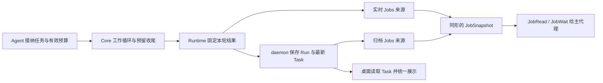

# 子代理预算提示与未完成结果处理方案

> 状态：设计已实施（2026-10-28），所选自动化验收通过；真实模型行为与实际样式未验证。执行证据见实施计划。保留现有预算和生命周期，统一子运行结果的保存、读取与展示。

实施顺序、文件清单与验收命令见[实施计划](../plans/2026-10-28-child-budget-feedback.md)。

本方案解决一个问题：子代理用完本次执行额度后，系统应准确交付停止原因和已有报告，让主代理与用户知道还有哪些工作未经确认。

改动围绕现有的一次执行（Run）展开：Core（执行核心）计算轮次并执行收尾，Agent Runtime（子代理运行层）产生结果，daemon（共用后台进程）将结果写成持久记录，Jobs（后台任务读取与控制接口）的来源统一读取格式，工具和桌面分别提供处理说明与展示。不新增业务完成状态、结果存储或自动续跑机制。

## 一 问题与证据边界

原始案例中，主代理修复 Three.js 池塘页面后，把“运行生产构建并检查修改是否正确”交给只读验证子代理，显式设置 `maxTurns: 5`。浏览器中的实际外观由主代理检查。

| 顺序 | 观察到的行为 |
| --- | --- |
| 1 | 子代理检查目录与配置；`git diff` 因工作目录缺少可用 Git 比较环境而出错 |
| 2 | 读取 JavaScript、CSS、HTML，正文过长，出现截断与补读 |
| 3 | 生产构建退出码为 0；产物体积提示没有使构建失败 |
| 4 | 继续读取源码；`node --check src/main.js` 退出码为 0 |
| 5 | 最后一轮进入已有的无工具收尾，报告构建和语法检查通过，进一步运行检查尚未完成，结尾为 `VERDICT: PARTIAL` |
| 6 | 运行以 `failed` 结束，`failureKind: max_turns`，收尾报告保存在 `partialResult` |
| 7 | `JobWait` 正常返回；主代理强调通过项后结束回复，没有说明委派验证仍有未完成事项；界面只显示红色“失败” |

该案例来自原稿的会话记录，本轮未重新执行原任务。它能说明预算预期和结果表达的问题，不能证明代码存在正确性缺陷，也不能证明结果交付丢失。

构建和语法检查通过、子运行达到轮次上限、委派要求是否全部满足，是三个不同判断。通用执行层确认执行如何结束并保留证据；任务要求是否满足，仍由主代理或已有的专用业务校验判断。不能根据报告里的 PASS、PARTIAL 或任务名称生成权威业务结论。

## 二 当前代码暴露的机制问题

### 1. 已有预算执行机制，缺少工作阶段的预期

`QueryEngine` 已使用宿主固定的 `hardMaxTurns` 限制本次子运行，并预留最后一轮无工具收尾。`MaxTurnsExceeded` 携带收尾文本，Runtime 将可信失败分类和有界报告放入 `AgentChildResult`。这些能力应直接复用。

原稿把轮次称为“模型请求次数”，并以“总请求次数不超过 5”验收，口径不准确。当前一轮内部允许模型网络重试，上下文压缩也可能请求模型；它们有各自的执行和用量约束。`maxTurns` 限制的是工作循环轮次，不能承诺限制所有底层模型请求。

### 2. 失败报告在保存时被写进错误字段

`DaemonAgentEventProjector.completeChildTask` 当前在失败时使用 `error: result.output`；正常终态调用它时也没有单独传入原始错误。报告和技术错误因此在 Task（父会话中的任务记录）中混合。恢复代码中还存在 `result.error ?? result.output` 的回退。

应在结果写入边界修正字段职责，并让正常结算、关闭补偿和恢复使用相同规则。只在界面折叠长文本，会留下存储语义错误，其他读取方仍会收到一份被当作错误的报告。

### 3. 实时与归档读取使用不同结果形状

实时 `createChildJobSource` 把 `failureKind`、`partialResult` 放在 `snapshot.metadata` 顶层；归档 `createTaskArchive` 使用 `snapshot.metadata.childFailure`，读取时还返回 `details.childFailure`。同一次运行在不同来源下需要不同解析方法。

统一应发生在 Jobs 来源构造快照（一次读取所见的状态）的边界。`JobRead`、`JobWait` 和界面不应各自维护“先试实时字段、再试归档字段”的兼容分支。

### 4. 旧轮结果和当前子代理身份容易被混用

一个子代理可以接纳多次输入，每次都有独立 `runId`。Task 是最新一轮的投影，即把运行事件写成供查询的记录，不能代替历史 Run。读取旧轮必须使用完整 `target`；继续输入还要核对当前能力。`kind: agent` 也可能来自独立进程，不能把所有此类 Job 都当作框架子运行。

### 5. 父代理处理建议不能代替业务验收

原稿新增的 `outcome.status=incomplete` 看似是业务结论，实际仍从运行状态与失败原因推导，重复表达已有事实。新增动态 `nextAction` 又需要复制输入能力、归档和续做规则，容易变成另一套策略层。

此次保留运行状态、停止原因、报告和既有 `capabilities`（当前可用的读取、等待或输入操作）；加强工具说明与有界摘要。主代理据任务要求判断缺项，通用工具不宣称已经验证全部业务目标。

## 三 方案决定与职责

采用“修正结果源头并统一读取”，然后补预算提示与展示。单改界面无法消除报告和错误混用；新增状态、调度器或自动扩额超出了本次需求。



| 所有者 | 负责什么 | 不在此处判断什么 |
| --- | --- | --- |
| Core | 当前有效轮次、普通工作与收尾切换、当轮预算提示 | 任务是否通过验收 |
| Agent Runtime | 绑定 `childSessionId/runId` 的本轮结果、停止原因与部分报告 | 桌面文案与重新分派策略 |
| daemon 投影与恢复 | 忠实保存结果、技术错误和运行身份，更新最新 Task | 根据模型正文改写完成状态 |
| Jobs 来源 | 将实时结果和持久结果转换成相同读取格式，提供当前能力 | 自动继续工作 |
| Jobs 工具 | 返回事实，生成简短摘要，说明怎样处理未完成工作 | 持久化第二份状态或业务结论 |
| 桌面展示模型 | 统一活动行、列表和详情的文案、样式与报告提示 | 重新分类底层异常或调度模型 |
| 主代理／已有业务校验 | 对照委派要求解释通过项、缺项和后续安排 | 把运行正常结束直接当成业务通过 |

此次不改变默认预算、任务状态枚举、数据库结构、共享用量限制、权限或审批规则。不新增 `outcome`、动态动作协议、报告解析器、恢复按钮、自动重试、父代理自动唤醒或统一业务验收框架。原稿的上游机制对照不作为本次接口设计依据；本方案以已核对的本地调用链为准。

## 四 从接纳到收尾的预算流程

入口仍是 `Agent`。`resolveChildMaxTurns` 沿用角色、请求配置和设置的现有优先级，调用方只能收紧预算。宿主在本轮接纳时固定硬上限。

每轮应用请求配置后，Core 复用现有 `maxTurnsLimit()` 与 `turnCount`，计算本轮剩余工作循环额度，不另建计数器。当前有效上限是配置上限与硬上限的较小值；提示必须与实际比较分支一致。

普通工作轮次的当次系统提示可写为：

> 本次运行含当前轮还剩 5 轮，其中最后 1 轮只用于无工具收尾。请据此安排必要检查；最终区分已有证据、尚未验证的事项和阻碍。

规则如下：

- 5 轮有效上限最多提供 4 轮普通工作和 1 轮收尾；一轮可以包含一组工具调用。网络重试和压缩请求不按工作轮次提示计数，仍受既有约束控制。
- 工具失败或输出截断不会返还已用轮次；补读若进入下一工作轮次，就占用下一轮。
- 提示随当轮请求组装，不写入长期消息历史；同一轮网络重试不递减提示中的轮次。
- 没有子运行硬上限时，不新增预算提示或收尾分支。有效上限为 1 时，直接沿用收尾提示，不发送普通工作提示。
- 收尾复用 `CHILD_FINALIZATION_PROMPT` 和已有禁用工具规则，不再叠加一套同义收尾要求。模型仍发出工具调用时，沿用已有拒绝行为。
- 早于收尾自然完成仍为 `completed`；进入预算收尾后，即使生成了报告，仍以 `max_turns` 结束。取消、超时、网络错误以及配置收紧导致无法再请求时，沿用现有终止规则，不承诺一定能生成收尾报告。

轮次控制只存在于本次 Core 查询循环。报告应围绕原委派要求说明已取得的证据和剩余事项，不引入必须解析的固定报告模板，也不根据轮次自行获得新权限。

## 五 结果保存与读取契约

### 先把报告与错误分开保存

继续使用 `AgentChildResult` 及已有终态事件：

- `status` 表示本轮执行如何结束。
- `output` 保存本轮已有输出，可能是部分报告。
- `error` 保存真实停止错误或执行错误，不能用报告替代。缺少错误正文时保留缺省，由读取方显示通用原因，不从 `output` 猜测。
- `failureKind` 保存可信停止分类；`partialResult` 保存带版本、子会话与运行身份的有界报告。存在报告不表示报告结论已经被系统验证。

正常结算应把终态事件中的错误单独传入 Task 结算；`child.closed` 补偿与恢复重放遵守同一字段规则。已有能够共用的转换集中在本职责目录的内部函数中，不增加可配置的投影框架。重复重放不能只比较状态与输出而忽略需要修正的错误或失败元数据。

Task 接纳新一轮时，除现有 `finishedAt/output/error` 重置外，必须清除上一轮的 `childFailure`。终态写入只更新匹配当前 `runId` 的 Task；历史事实仍保留在原 Run，迟到的旧轮事件不能覆盖新轮。

本次不批量改写历史记录。旧记录已有报告混入错误时，界面可以用可信失败分类显示简短说明，原字段仅作为原始记录查看，不宣称已恢复出独立的技术错误。

### Jobs 来源输出一种结构

对框架子运行，统一采用已经用于持久记录的 `snapshot.metadata.childFailure`：

```json
{
  "snapshot": {
    "status": "failed",
    "target": { "kind": "agent", "jobId": "child_1", "runId": "run_1" },
    "metadata": {
      "childSessionId": "session_1",
      "childFailure": {
        "failureKind": "max_turns",
        "partialResult": {
          "version": 1,
          "childSessionId": "session_1",
          "runId": "run_1",
          "source": "limit_finalization",
          "text": "构建与语法检查通过；进一步运行检查尚未完成。",
          "truncated": false
        }
      }
    }
  }
}
```

以上仅展示相关字段，其余现有快照、正文、游标和能力字段照常返回。实时来源调整为同形结构；归档来源按请求的 Run 取事实，不能借用最新 Task 的失败信息。`JobList`、`JobRead` 与 `JobWait` 的快照遵守相同字段约定，不能只修工具序列化结果。

读取规则：

1. 用 `target.runId` 定位运行，核对子会话归属；先识别真实来源，再处理子运行字段。独立进程不因 `kind: agent` 而被解释成预算耗尽的子代理。
2. 报告的版本、来源、字段形状和 `childSessionId/runId` 必须有效且匹配；有非空报告正文才可提示“已保留部分结果”。报告无效不影响可信停止原因的展示。
3. 未设置或未知的分类保持原失败语义，不匹配异常字符串、模型报告或任务名称。界面也不从正文提取“构建通过”。
4. `details.childFailure` 若继续保留，只能引用同一份规范化数据，不能独立推导；不新增实时平铺字段的长期回退链。部署与版本边界遵守现有协议规则，不另设本功能版本体系。
5. 正文按现有输出窗口读取，是否裁剪与报告自身的 `truncated` 分开处理。当前窗口为空不等于没有报告；报告被截断时不承诺正文完整。
6. `capabilities.send` 是当前快照可否发送输入的依据。归档仍只读；读取同一 Run 的执行事实应一致，实时与归档的当前输入能力可以不同。实际发送时继续由执行入口复核，不能把快照当作永久许可。

不新增 `hasPartialResult` 或第二份完成状态；这些展示信息从上述字段即时计算，不持久化。所有来源及读取方使用相同样本测试契约，避免各自增加形状探测。已有 `projectionError`、`cleanupUnconfirmed` 等保存或清理诊断继续保留，不能被预算说明遮盖或当成可直接续做的许可。

## 六 交给主代理与用户的处理流程

`JobRead`、`JobWait` 返回正常读取结果，子任务失败不等于观察工具调用失败。保留 `executionState: completed`；不能把一次成功读取改成可重试的工具错误。

工具说明明确：预算耗尽表示本轮没有正常完成，不代表被检查的程序失败；先阅读已有报告，对照委派要求说明证据和缺项，再决定由自己接手或在已有授权与限制内继续分派。继续旧子代理须使用当前可发送的完整 `target`；新输入返回新 `runId` 后，后续观察改用新回执。不能发送到只读归档，也不通过新建代理规避限制。

已有 `compactSummary` 增加简短停止原因与是否有部分报告，使压缩后的上下文保留关键事实；继续遵守现有长度界限，不复制报告全文或自动生成动态 `nextAction`。工具说明与预算提示各维护一处，不在结果正文里重复堆叠长指令。

主代理应说明本次任务实际覆盖到哪里。例如：

> 生产构建和 JavaScript 语法检查通过。验证子代理已达本次轮次上限，进一步运行检查尚未完成，已有部分报告可查看。

程序能保证的是事实正确、报告可读、运行身份不混用。主代理能否完整解释这些事实仍受模型行为影响；提示与说明不能作为“必定处理所有缺项”的证明。若要程序强制全部验收，必须另有明确的业务验收契约，不在此次引入。

一次 `JobWait` 到期但子运行仍在工作时，只表示等待结束，继续显示运行中。预算耗尽后的续做则是新一轮执行，受自己的有效上限和已有共享限制约束，不能扩展原轮、继承上一轮成功结论或自动重跑已完成的检查。

## 七 桌面只统一呈现运行事实

桌面继续读取 Task，不为此增加 Jobs 查询或另一份客户端状态。`agent-task-model.ts` 集中接收完整 Task，核对本轮失败信息，返回展示文案、语气和报告提示。活动行、列表、详情复用此模型，不能继续只传 `status` 就决定全部失败样式。

| 本轮事实 | 展示 | 说明 |
| --- | --- | --- |
| `failed` 且可信原因为 `max_turns` | 未完成 · 已达轮次上限 | 本轮额度已用完；是否保留部分报告另行判断 |
| `failed` 且可信原因为子运行 `timeout` | 未完成 · 已达时间上限 | 执行时限结束，不是一次等待到期 |
| 其他执行失败或原因缺失 | 执行出错 | 保留错误展示与原始记录入口 |
| 用户停止／中断 | 沿用已停止／已中断 | 不改成预算耗尽 |
| 运行中／正常完成 | 沿用运行中／已完成 | 旧轮失败信息不能覆盖当前状态 |

预算耗尽使用已有的中性或提醒样式，错误保留错误样式。标题通用为“子任务未完成”；tooltip 和原因说明保持简短。有效报告在子会话或现有结果正文中查看，技术错误按需展开，不把报告复制进错误框。普通执行错误也可以有部分报告，不能因报告存在而改成预算耗尽。

本期复用现有组件；不增加“继续验证”按钮或具体业务结论。样式由用户在实际界面反馈，不主动搭建预览或截图。

## 八 实施边界与验收

实施顺序按数据流推进，先让结果事实一致，再接入提示与展示。下列为实施边界；具体完成内容、测试命令与本轮执行调整见[实施记录](../plans/2026-10-28-child-budget-feedback.md#实施记录2026-10-28)。

1. **固定结果保存规则。** 修改 `packages/server/src/application/agent/daemon-agent-event-projector.ts` 与 `projection-settlement-recovery.ts` 的对应结算路径，分离输出与错误，核对新轮清理和旧轮保护。复用 Runtime 已有分类与报告，不重写其生命周期。
2. **统一 Jobs 来源。** 调整 `packages/agent-runtime/src/node/jobs/child-job-source.ts` 与 `packages/server/src/jobs/job-snapshots.ts`；验证列表、读取和等待都返回相同字段结构。维持 `packages/jobs/src/contracts.ts` 的现有状态与能力语义，不因展示新增通用结果类型。
3. **补预算与父代理说明。** 在 `packages/core/src/engine/query-engine.ts` 的当轮提示组装处复用真实计数；更新 `packages/tools/src/agent/agent-tools.ts` 的 `maxTurns` 说明，以及 `packages/tools/src/job/job-tools.ts` 的处理说明和有界摘要。
4. **接入统一展示。** 修改桌面 `tools/agents/agent-task-model.ts`、`agents-tool.tsx` 及 `conversation-page/message/activity/agent-activity-message.tsx`。完整目录均位于 `apps/desktop/src/renderer/src/components/desktop/`，不迁移组件目录。

测试放在被测模块所属的 `__test__/`，跨模块回归放在共同所属目录。实施时同步相应目录 README、[子代理流程](../../agent-child-session-flow.md)与[Jobs 协议](../../jobs-protocol.md)；本次不把提案行为提前写成已实现手册。

### 必须成立的自动化验收

- **循环有界：**5 轮有效上限的普通轮次提示依次为 5、4、3、2，最后一轮只收尾，无额外工作轮次或工具执行。覆盖 1 轮、无硬上限、配置收紧、提前完成和终止时无报告；模型网络重试不导致同轮提示递减，不把压缩或重试请求错误纳入轮次断言。
- **保存真实：**给定不同的报告文本与错误文本，正常终态、关闭补偿和恢复重放均分别保存；缺少错误正文时不回填报告。元数据单独缺失或错误时也能正确重放；旧轮事件不能覆盖新轮 Task。
- **来源同形：**新产生的同一 Run 经实时与归档 Read／Wait 读到一致的停止原因、有效报告和原始错误，List 对最新轮次遵守同样结构；允许当前能力不同。覆盖普通错误、执行超时、用户中断、独立进程、未知分类、无报告、畸形或身份不匹配报告和正文裁剪。
- **后续可定位：**预算失败后显式接纳新输入，观察使用新回执；当前 Task 不残留旧轮错误与报告，旧 Run 仍能按旧 `target` 读取。归档不可发送，过期能力快照不能绕过发送入口的核对。
- **观察无副作用：**等待到期不修改运行状态；读取失败子任务不触发工具自动重试。摘要有界且保留停止原因、报告可用性，不自动发送输入或扩大预算。
- **展示同义：**同一 Task 在活动行、列表和详情得到相同说明；只在本轮可信分类与有效报告分别支持时提示预算耗尽和部分结果。错误字段再长也不成为顶层 tooltip；普通失败和中断保持各自语义。

至少有一条现有集成测试从子运行收尾出发，经过 daemon 保存、Jobs 观察与新轮接纳，验证上述链路；其他分支用所属模块测试覆盖。不要为每种排列重复搭建整套环境，也不为此新增测试框架。

### 模型行为与验收限度

在已有授权的真实模型验证中，用原始案例检查子代理是否能安排额度、主代理是否交代未完成检查，并保留实际返回证据。构建通过或字符串快照测试不能代替这种行为验证；未执行时明确记录“模型行为未验证”，不因此扩展自动续跑或强制验收范围。

实现完成后运行受影响模块测试与类型检查，再运行 `pnpm check:retired-ui` 和 `pnpm check-docs`。文档检查只能证明路径与规则符合要求，不能证明本方案已实施。

## 九 本次审查的收敛结果

- 撤回新增 `outcome.status` 与动态 `nextAction`，复用已有状态、原因、报告、能力和回执。
- 将实时／归档差异收口到 Jobs 来源，并补上列表及压缩摘要，避免只修某个读取入口。
- 把报告与错误混用定位到结算及恢复流程，补充新轮清理和旧轮保护，避免只在界面遮盖。
- 将预算口径修正为工作循环轮次，提示与限制共用计数，避免另建请求预算系统。
- 分开可自动验证的数据保证与需要真实模型证据的行为目标，不把友好展示冒充业务验收。
